# AI task manager architecture

Status: Design for the implementation handoff; no product implementation is claimed.
Authority: BUILD.md and config/execution-policy.json include the current status-policy and clean-cutover decisions.

## Scope, terms, and drivers

Provide one reusable coordinator for task execution through Claude Code and Codex CLI. The lead coordinates, each independent task owns one assigned worker, worktree and application database, and one transactional metadata store records control state. The current target does not share application databases between role workers.

A task is tracked intent; an attempt is one execution; a worker is its supervised model process. A logical session selects the terminal's authorized work. A principal is the validated tracker identity. Delivery evidence is separate from execution progress. BUILD.md defines the complete transition rules and exceptions.

## Context and components

Use a modular core with Work, Execution, Scheduling and Resources domains. Application operations coordinate domain interfaces. Adapters translate host, Linear, Git and database operations without owning independent workflow rules. Presentation reads scoped views. One local supervisor coordinates claims and external actions; network microservices are not required for the first release.

The architecture image shows the Claude host path. The Codex adapter connects to the same core and scoped-session interfaces; both implementations are required. The product layout in BUILD.md defines their shared packaging.

### Architecture view



The plugin is one host adapter around the reusable core. Relationship arrows show responsibilities, not execution order.

| Component | Explanation |
| --- | --- |
| 1. Session terminal | The terminal belongs to one logical session and authenticated principal; its list contains only their authorized work. |
| 2. Claude plugin | The host integration exposes typed commands, guards and views. It calls the reusable engine rather than defining another policy. |
| 3. Workflow core | Application operations coordinate the separate Work, Execution, Scheduling and Resources modules through public interfaces. |
| 4. Control store | The transactional store retains tasks, attempts, reservations, evidence and sync records, separately from application databases. |
| 5. Linear adapter | The provider adapter exchanges authorized human intent and observed execution facts while preserving human decisions. |
| 6. Project adapters | Project bindings prepare resources and preserve existing procedures. The current merge script remains the merge authority. |
| 7. Worker runtime | A supervised worker executes one assigned attempt and reports its actual startup, progress and outcome. |

**Mermaid source**

```text
%% Diagram: Architecture diagram
%% Subtitle: The proposed core connects the session, worker runtime, control store and project integrations.
flowchart LR
    accTitle: Workflow coordination architecture
    accDescr: The proposed core connects the session, worker runtime, control store and project integrations.
    T@{ shape: rect, label: "1. Session terminal" }
    class T process
    P@{ shape: rect, label: "2. Claude plugin" }
    class P process
    C@{ shape: rect, label: "3. Workflow core" }
    class C process
    D@{ shape: cyl, label: "4. Control store" }
    class D datastore
    L@{ shape: rect, label: "5. Linear adapter" }
    class L process
    R@{ shape: rect, label: "6. Project adapters" }
    class R process
    W@{ shape: rect, label: "7. Worker runtime" }
    class W process
    T -->|"Scoped commands"| P
    P -->|"Typed operations"| C
    C -->|"Transactions"| D
    C -->|"Intent and execution facts"| L
    C -->|"Existing project procedures"| R
    C -->|"Supervised attempts"| W
%% Legend: flow_arrow | Relationship
```

## Runtime and data flow

Process startup, local transactions and Linear mutations are separate operations. Use reservations, acknowledgements, readback and reconciliation. A process that starts while its assignment is being confirmed remains Starting and cannot perform assigned work yet. Only a verified admitted task becomes Running. Live synchronization may be pending; expose that fact rather than implying atomic agreement across systems.

### Dispatch and blocking view



This view separates rejection, queued work, reserved capacity and confirmed execution. A failed launch cannot silently become running.

| Component | Explanation |
| --- | --- |
| 1. Task submitted | Submission names an authorized issue, accepted scope and a deduplication identifier. |
| 2. Authorized scope? | Validate project, authenticated principal, logical session and work authorization before enrollment or execution. |
| 3. Reject request | An unauthorized request creates no worker or foreign task-list entry. |
| 4. Dependencies and capacity ready? | Check dependency conditions, human holds and resource budgets. Admission is committed atomically with the reservation. |
| 5. Queue with reason | Keep the task queued with its blocker or resource reason; re-evaluate when that fact changes. |
| 6. Reserve task and resources | Claim one attempt and reserve capacity once; unique constraints reject competing active claims. |
| 7. Prepare and launch worker | Verify the dedicated worktree/database before launching through the supported runtime adapter. |
| 8. Startup confirmed? | Require a real worker identity and confirmed resources. A launch request alone is not readiness. |
| 9. Reconcile failed or unknown start | Retain the partial-start record and reconcile before retrying; do not start a competing replacement. |
| 10. Record running | Only confirmed, authorized startup permits the running state and protected execution. |

**Mermaid source**

```text
%% Diagram: Flowchart
%% Subtitle: Authorized tasks wait for dependencies and capacity before worker startup is confirmed.
flowchart TD
    accTitle: Task dispatch workflow
    accDescr: Authorized tasks wait for dependencies and capacity before worker startup is confirmed.
    A@{ shape: lean-r, label: "1. Task submitted" }
    class A data
    B@{ shape: diam, label: "2. Authorized scope?" }
    class B decision
    C@{ shape: stadium, label: "3. Reject request" }
    class C terminator
    D@{ shape: diam, label: "4. Dependencies and capacity ready?" }
    class D decision
    E@{ shape: rect, label: "5. Queue with reason" }
    class E process
    F@{ shape: fr-rect, label: "6. Reserve task and resources" }
    class F predefined
    G@{ shape: rect, label: "7. Prepare and launch worker" }
    class G process
    H@{ shape: diam, label: "8. Startup confirmed?" }
    class H decision
    I@{ shape: rect, label: "9. Reconcile failed or unknown start" }
    class I process
    J@{ shape: stadium, label: "10. Record running" }
    class J terminator
    A --> B
    B -->|"No"| C
    B -->|"Yes"| D
    D -->|"No"| E
    E -->|"Prerequisite changes"| D
    D -->|"Yes"| F
    F --> G
    G --> H
    H -->|"No"| I
    H -->|"Yes"| J
%% Legend: flow_arrow | Next action
```

### Worker-owned merge view



The worker keeps responsibility for the existing merge procedure. The controller records its result rather than introducing a replacement route.

| Component | Explanation |
| --- | --- |
| 1. Worker commits its changes | The worker commits its own task on its branch in its own worktree, preserving current issue attribution. |
| 2. Run merge prechecks | Run `bash scripts/merge-to-dev.sh --checks` in that worktree. This remains the existing precheck. |
| 3. CHECKS PASSED? | `CHECKS PASSED` permits the merge call; `WOULD NOT MERGE` returns the reported cause to the worker; `NOTHING TO MERGE` follows the current already-on-dev route. |
| 4. Worker fixes the reported cause | The worker follows the script’s answer, resolves the named cause or wait, and commits any repair before retrying. |
| 5. Run existing merge script | Run `bash scripts/merge-to-dev.sh` as the current foreground call. It retains rebase, serialization, checks, database lifecycle and dev-update ownership. |
| 6. Successful merge result? | `NOT MERGED` remains unfinished work. `MERGED` and `NOTHING TO MERGE` keep their current meanings, including existing warning semantics. |
| 7. Record the script’s answer | Record the actual command/result and attribution. Add no merge queue, extra checks or alternative cleanup route. |
| 8. Close execution under existing rules | Close execution under the existing task and merge rules. This does not imply deployment to production. |

**Mermaid source**

```text
%% Diagram: Flowchart
%% Subtitle: The worker keeps the existing merge procedure; the proposed controller records its result.
flowchart TD
    accTitle: Worker merge workflow
    accDescr: The worker keeps the existing merge procedure; the proposed controller records its result.
    A@{ shape: rect, label: "1. Worker commits its changes" }
    class A process
    B@{ shape: fr-rect, label: "2. Run merge prechecks" }
    class B predefined
    C@{ shape: diam, label: "3. CHECKS PASSED?" }
    class C decision
    D@{ shape: rect, label: "4. Worker fixes the reported cause" }
    class D process
    E@{ shape: fr-rect, label: "5. Run existing merge script" }
    class E predefined
    F@{ shape: diam, label: "6. Successful merge result?" }
    class F decision
    G@{ shape: rect, label: "7. Record the script’s answer" }
    class G process
    H@{ shape: stadium, label: "8. Close execution under existing rules" }
    class H terminator
    A --> B
    B --> C
    C -->|"WOULD NOT MERGE"| D
    C -->|"Yes"| E
    C -->|"NOTHING TO MERGE"| G
    D -->|"Commit the repair"| A
    E --> F
    F -->|"NOT MERGED"| D
    F -->|"MERGED or NOTHING TO MERGE"| G
    G --> H
%% Legend: flow_arrow | Existing merge flow
```

### Session display view



Both terminal views use the same authorized local snapshot; neither imports another session’s work.

| Component | Explanation |
| --- | --- |
| 1. Registered session context | The registered logical session and authenticated account select the context; a working-directory path does not. |
| 2. Verify identity and scope | Validate context on every interface. A model-supplied identifier does not authorize another session. |
| 3. Read matching task records | Read and write only records matching the project/repository instance, principal and session. |
| 4. Shared control store | The host store can count global capacity without returning foreign task titles, user details or queues. |
| 5. Scoped local snapshot | Return the current session’s task, dependency and sync facts. Foreign capacity is an aggregate only. |
| 6. Sidebar and status line | The companion sidebar supports grouping and expansion; the passive status line is its compact fallback. Both read the same snapshot. |
| 7. Task and blocker details | Explain the selected task and release conditions. Restrict details of dependencies outside the session according to authorization. |

**Mermaid source**

```text
%% Diagram: Architecture diagram
%% Subtitle: Proposed task views are restricted by project, authenticated account and logical session.
flowchart TD
    accTitle: Session task visibility
    accDescr: Proposed task views are restricted by project, authenticated account and logical session.
    A@{ shape: lean-r, label: "1. Registered session context" }
    class A data
    B@{ shape: rect, label: "2. Verify identity and scope" }
    class B process
    C@{ shape: rect, label: "3. Read matching task records" }
    class C process
    D@{ shape: cyl, label: "4. Shared control store" }
    class D datastore
    E@{ shape: lean-r, label: "5. Scoped local snapshot" }
    class E data
    F@{ shape: rect, label: "6. Sidebar and status line" }
    class F process
    G@{ shape: rect, label: "7. Task and blocker details" }
    class G process
    A --> B
    B -->|"Authorized query"| C
    D -->|"Matching records only"| C
    C --> E
    E -->|"Read-only rendering"| F
    E -->|"Authorized detail"| G
%% Legend: flow_arrow | Scoped data flow
```

Worker results and questions go into a durable inbox for the owning session. Replay unacknowledged events after resume. A status line alone does not wake the lead model. The host adapter must test its event/wait mechanism; when automatic push is unavailable, expose pending events and provide an explicit wait/read operation. Do not depend on an unverified notification feature for lifecycle correctness.

## Deployment and operations

Host packages contain the same versioned core artifact and pinned skill releases. Installation data and authoritative runtime state have separate lifecycles. The primary target is macOS, with real Linux-container portability and CLI smoke coverage. The right-hand UI is a companion terminal pane, not a presumed native host sidebar extension.

### GitHub lifecycle view



This view describes the managed installation/removal procedure. Direct native uninstall has the separate recovery behavior specified below.

| Component | Explanation |
| --- | --- |
| 1. Versioned GitHub release | The proposed GitHub repository publishes its marketplace, source, versioned releases and checksummed artifacts; the actual owner is still a publication setting. |
| 2. Install selected plugin scope | Use native plugin installation at the selected user, project or local scope. Downloading a plugin does not authorize work. |
| 3. Register project and principal | Validate project bindings, authenticated identity and runtime capabilities; record the integration settings this installation owns. |
| 4. Managed sessions use the plugin | Each logical session retains its separate list. Runtime history has an independent persistence lifecycle. |
| 5. Removal requested | Managed removal identifies the installation scope. Direct native uninstall is a separate path to test. |
| 6. Active owned work? | Inspect affected work only. Removing one project registration must not interrupt another project or user’s sessions. |
| 7. Drain or checkpoint work | Drain attempts or perform an explicitly requested safe checkpoint/cancellation. Preserve active resources and do not interrupt a merge unsafely. |
| 8. Restore owned integration settings | Restore only unchanged settings owned by this installation, including its display setup. Keep unrelated edits and registrations. |
| 9. Uninstall selected scope | Use native uninstall at the selected scope. Do not assume an uninstall callback runs plugin cleanup. |
| 10. Retain history and working data | Keep independent history, unfinished work and protected data. A purge is a separate explicit operation. |

**Mermaid source**

```text
%% Diagram: Flowchart
%% Subtitle: Proposed GitHub distribution with scoped installation, safe removal and retained task history.
flowchart TD
    accTitle: Plugin installation and removal
    accDescr: Proposed GitHub distribution with scoped installation, safe removal and retained task history.
    A@{ shape: doc, label: "1. Versioned GitHub release" }
    class A document
    B@{ shape: fr-rect, label: "2. Install selected plugin scope" }
    class B predefined
    C@{ shape: hex, label: "3. Register project and principal" }
    class C preparation
    D@{ shape: rect, label: "4. Managed sessions use the plugin" }
    class D process
    E@{ shape: lean-r, label: "5. Removal requested" }
    class E data
    F@{ shape: diam, label: "6. Active owned work?" }
    class F decision
    G@{ shape: rect, label: "7. Drain or checkpoint work" }
    class G process
    H@{ shape: rect, label: "8. Restore owned integration settings" }
    class H process
    I@{ shape: fr-rect, label: "9. Uninstall selected scope" }
    class I predefined
    J@{ shape: stadium, label: "10. Retain history and working data" }
    class J terminator
    A --> B
    B --> C
    C --> D
    D --> E
    E --> F
    F -->|"Yes"| G
    G -->|"Recheck ownership"| F
    F -->|"No"| H
    H --> I
    I --> J
%% Legend: flow_arrow | Managed lifecycle step
```

## Decisions and risks

Activation uses one complete project-wide cutover. Stop admission, finish active merges, quiesce workers, fence every legacy writer, import and reconcile all required state, replace instructions and compatibility entry points, then activate exactly one new authority. There is no dual live operation or partial ownership migration. Rollback must retain post-cutover facts and must not enable two writer sets.

Keep task-management.md as the concise readable contract. Executable policy definitions enforce transitions and generate the transition reference. Existing command surfaces remain callable through tested translation to the sole new engine. The merge script remains byte-identical.

Resource ownership includes stable owner identifiers so future parent/role grouping can be introduced through a separately reviewed change. Shared application databases remain disabled today. Missing real-host evidence, unsafe migration ambiguity or an unguarded required execution surface blocks acceptance; documentation cannot waive those gaps.
