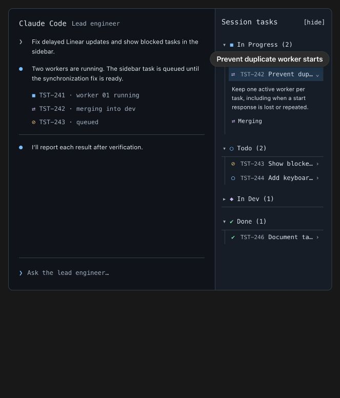

# Session task management specification

Status: Agreed interaction design, approved on 1 November 2026 with the subsequent activity-icon requirements. Native terminal implementation and host acceptance remain pending.
Source: The user's sidebar review; R04 and R17; WORKFLOW.md.

## Purpose and scope

The terminal shows the lead coordinator beside a compact right sidebar containing only this session's authorized tasks. Users can inspect task descriptions and dependencies without leaving the coordinator. The sidebar displays verified state; it does not own task policy or worker authority.

These requirements govern the sidebar. The host's own controls and bottom area, including its subagent list, remain outside this component.

## Definitions

| Term | Meaning |
| --- | --- |
| Status group | The task's configured workflow status, such as Todo or In Progress. |
| Activity | An observed operation or condition, such as merging or blocked, which may differ from the workflow status. |
| Description preview | The first five rendered lines of a task description. |
| Sidebar viewport | The visible right pane, matching the CLI pane's height. |

## Scenarios

A user expands Todo (2), then opens a queued task. Its description appears beneath its row. A blocked task has an activity icon, and its expanded details show Blocked and the dependency. The task remains in Todo; the display does not change its workflow status.

A task in In Progress is merging into dev. Its row shows the merging icon. Opening it shows the same icon and Merging beneath the description. Only the verified merge result can advance delivery state.

A user expands a long description. The whole sidebar scrolls while the CLI remains at its existing height and scroll position. Hiding the sidebar exposes more CLI space; [show] remains accessible on the right.

### Approved sidebar reference

The reference uses illustrative tasks. It demonstrates the approved layout, not a live task list or evidence of native host integration. The editable [mockup](mockups/session-task-management.html) is maintained with this specification.

## Requirements and business rules

* UI-01, scoped list: Show only tasks authorized for the current project, Linear principal and logical session. Exclude quarantined foreign work from normal rows and counts; retain its internal audit and unresolved ownership safely.
* UI-02, compact rows: Each collapsed row contains its activity icon, verified display ID and title. Do not add a blocked-by subtitle, worker summary or repeated synchronization details beneath the title.
* UI-03, status groups: Each task appears under its configured workflow status. Every group heading includes its task count, such as In Progress (2) or Todo (2), and can expand or collapse. Counts remain correct when a group is collapsed.
* UI-04, activity: Every task row has an icon for its current verified activity or condition. When that differs from its status group, show the same icon and activity label beneath the expanded description. Merging and Blocked are activities; displaying them does not rename a Linear state.
* UI-05, inline details: Clicking a task opens its description beneath that row. Dependencies appear in expanded details. Opening a dependency selects the authorized blocking task without importing foreign work.
* UI-06, long descriptions: Initially show at most five rendered lines. Show [show more] only when text exceeds the preview; it exposes the full description. [show less] restores the preview.
* UI-07, sidebar controls: Place [hide] in the sidebar header. When collapsed, retain a narrow right-hand strip containing [show]. Hiding or showing the sidebar must not change tasks, workers or synchronization.
* UI-08, scrolling: Match the sidebar viewport to the CLI pane's height. Use one vertical scroll region for the whole sidebar; all status groups and expanded descriptions move together. Individual tasks must not have independent scrollbars. Keep the hide control accessible.
* UI-09, host space: Add no top toolbar or global bottom toolbar. Preserve the native host's bottom area and subagent-list space.

## Quality and interface constraints

Use the same scoped projection as the CLI and MCP service. Canonical provider IDs govern operations; human-readable identifiers must come from verified provider metadata. Do not manufacture a TST identifier from a UUID or sequence.

Activity icons require script or provider evidence. A title, model narrative or branch name cannot establish Running, Merging, Blocked or Done. Pending, stale and unknown observations remain explicit. Symbols and accessible labels must retain meaning without color. Support mouse and keyboard inspection, and recheck wrapping when the terminal width changes.

Layout interactions are local view changes. State transitions, work leases, resource cleanup, merge operations and Linear writes continue through the existing guarded application interfaces.

## Acceptance criteria

| Requirement | Check and expected result |
| --- | --- |
| UI-01–UI-03 | Two-session/account fixtures show only owned rows; each group count matches the scoped data before and after collapse. Long titles remain readable through inspection. |
| UI-04 | A merging task remains under In Progress; a blocked task remains under Todo. Each row icon matches the activity label beneath its expanded description. Unsupported liveness claims cannot become activity facts. |
| UI-05–UI-06 | Short text needs no expansion control. Long, wrapped and multiline text initially occupies at most five lines; show more exposes all text and show less restores the preview. Dependency selection respects scope. |
| UI-07–UI-09 | Hide/show works from the sidebar. Expanding a long description does not resize or scroll the CLI. One sidebar scroll moves groups and descriptions together, with no task scrollbar or top/bottom toolbar. |
| R17, both hosts | Installed terminal tests verify rendering, mouse/keyboard interaction, resizing and the native host area. Browser prototype checks alone cannot pass this gate. |

## Open decisions

No layout decision remains open. Native rendering, host embedding and the full installed workflow still require implementation and execution evidence. These are acceptance prerequisites, not permission to change the approved interactions.

## Related design and work

[WORKFLOW.md](WORKFLOW.md) governs task and reporting behavior. [ARCHITECTURE.md](ARCHITECTURE.md) owns component boundaries. [BUILD.md](BUILD.md), work items T17/T18 and R17 govern implementation and verification. The docs directory remains the maintained source of truth.
