# Task coordination and Linear synchronization specification

Status: Agreed behavior from the user's implementation instructions; implementation is in progress. No end-to-end acceptance is claimed.
Source: R01–R38, the approved build decisions and the pinned legacy contract/regression inventory.

## Purpose and scope

A user can report work once and observe its complete path through a Linear issue, scoped CLI task, assigned worker, verified outcome and lead-AI report. Changes made in Linear and in the local task system synchronize through events. This specification replaces the old assumption that a ten-minute scan is the normal synchronization path.

The existing AI Index implementation is evidence for working contracts and past failures. Preserve those semantics through focused domain/application/provider modules, without importing or extending the monolithic synchronizer. The migration inventory distinguishes approved policy changes from behaviors that must remain compatible.

## Definitions

| Term | Meaning |
| --- | --- |
| Intake intent | Durable local record of an authorized request before a remote issue is confirmed. It cannot launch a worker. |
| Task | Scoped local work linked to a confirmed Linear issue and acceptance criteria. |
| Attempt | One assigned execution with its own identity and resource ownership. |
| Outbound intent | Persisted obligation to apply an authorized change to Linear, with an operation identity and observed outcome. |
| Inbound receipt | Persisted authenticated provider delivery, separate from successful domain application. |
| Lead receipt | A specific stage: queued, delivered to host context, AI acknowledged, or publicly reported to the user. |
| Real-time path | Processing triggered by a local operation or inbound webhook, without waiting for a periodic reconciliation tick. Internet/provider latency is measured, not assumed to be zero. |

## Scenarios

A user reports a defect. The lead frames its scope and acceptance, routes task prose through Technical Writer, and submits an intake intent. The Linear adapter confirms Backlog before the CLI task is linked. Explicit queue admission confirms Todo. The controller reserves resources, starts one worker and confirms In Progress before granting the work lease. The worker's result is checked against actual artifacts; the controller settles local execution and remote issue facts separately. The bound lead receives the result, acknowledges processing and publishes a truthful report.

A user changes a held issue in Linear while work is active. The webhook receiver authenticates and stores that event, and the shared policy applies the human decision. The controller safely checkpoints or resumes the worker as authorized. The CLI and lead receive scoped updates. An outbound write echoed by a webhook does not create a loop or a second task.

A receiver, worker or host disconnects. The product retains pending/uncertain work and resumes from durable identities and receipts. Reconciliation repairs missed facts; it does not manufacture acknowledgements or report an unavailable agent as running.

### Complete user request and result workflow



A request becomes a tracked issue, assigned work and a result acknowledged by the lead and reported to the user. Numbers identify the complete steps; each acknowledgement is an observed fact.

| Component | Explanation |
| --- | --- |
| 1. User reports work | The user reports a request or problem. Preserve its scope and authorization; incomplete intent is recorded for clarification, not silently expanded. |
| 2. Lead frames the request | The lead defines acceptance, relationships and ownership. It checks duplicates and creates a new linked issue when further work concerns a delivered issue. |
| 3. Review task prose | Technical Writer loads the correct issue-type reference and Writing Style. The exact provider-supported title/body receives version-bound review before publication. |
| 4. Confirm Linear Backlog | The controller persists intake intent before calling Linear. Confirm the remote issue identity and Backlog readback; uncertain creation remains pending and cannot dispatch. |
| 5. Link the scoped CLI task | Bind the confirmed issue to the trusted project, principal and logical session. Pending intake and an admitted CLI task remain different records. |
| 6. Enqueue and confirm Todo | An authorized queue decision creates a durable outbound intent. Only confirmed Todo makes initial work eligible; unrelated team backlog is never imported. |
| 7. Reserve and start worker | Reserve task/capacity atomically, prepare the task-owned worktree/database and confirm the actual assigned runtime. A process launch alone is not a work lease. |
| 8. Confirm In Progress and grant lease | Confirm matching Linear In Progress and trusted startup/resource evidence before granting execution and showing Running. |
| 9. Record progress and checkpoints | Store actual attempt progress, checkpoints and results. Heartbeat, prose and process exit do not establish completion or delivery. |
| 10. Verify result and delivery evidence | Check the relevant artifacts and tests, preserved merge procedure and any required delivery evidence. Part-of work cannot finish the whole issue. |
| 11. Settle CLI and Linear records | Local execution and remote issue stage settle separately. Retain failed/uncertain synchronization and show it explicitly rather than claim agreement. |
| 12. Deliver result to bound lead | Persist and deliver a scoped outcome notification. The target session has its own delivery cursor; another session cannot consume it. |
| 13. Acknowledge AI processing | The host adapter records observed AI acknowledgement of this exact event. Queued context or cursor movement is insufficient; disconnected leads remain pending. |
| 14. Report outcome to user | Capture the actual public report, including verification, delivery stage and pending synchronization. A report is not proof that a remote write succeeded. |

**Mermaid source**

```text
%% Diagram: Flowchart
%% Subtitle: A request becomes a tracked issue, assigned work and a result acknowledged by the lead and reported to the user.
flowchart TD
    accTitle: Task and Linear lifecycle
    accDescr: A request becomes a tracked issue, assigned work and a result acknowledged by the lead and reported to the user.
    N1@{ shape: stadium, label: "1. User reports work" }
    class N1 terminator
    N2@{ shape: rect, label: "2. Lead frames the request" }
    class N2 process
    N3@{ shape: fr-rect, label: "3. Review task prose" }
    class N3 predefined
    N4@{ shape: rect, label: "4. Confirm Linear Backlog" }
    class N4 process
    N5@{ shape: rect, label: "5. Link the scoped CLI task" }
    class N5 process
    N6@{ shape: rect, label: "6. Enqueue and confirm Todo" }
    class N6 process
    N7@{ shape: fr-rect, label: "7. Reserve and start worker" }
    class N7 predefined
    N8@{ shape: rect, label: "8. Confirm In Progress and grant lease" }
    class N8 process
    N9@{ shape: rect, label: "9. Record progress and checkpoints" }
    class N9 process
    N10@{ shape: fr-rect, label: "10. Verify result and delivery evidence" }
    class N10 predefined
    N11@{ shape: rect, label: "11. Settle CLI and Linear records" }
    class N11 process
    N12@{ shape: lean-r, label: "12. Deliver result to bound lead" }
    class N12 data
    N13@{ shape: rect, label: "13. Acknowledge AI processing" }
    class N13 process
    N14@{ shape: stadium, label: "14. Report outcome to user" }
    class N14 terminator
    N1 --> N2
    N2 --> N3
    N3 --> N4
    N4 --> N5
    N5 --> N6
    N6 --> N7
    N7 --> N8
    N8 --> N9
    N9 --> N10
    N10 --> N11
    N11 --> N12
    N12 --> N13
    N13 --> N14
%% Legend: flow_arrow | Event or command
```

## Requirements and business rules

- R36: Every lifecycle stage has a durable identity, owner, input/output and failure state. A later stage cannot infer an earlier acknowledgement.
- R02/R38: Initial task prose is approved through the current frozen Technical Writer, the appropriate issue-type reference and Writing Style before publication. Persist the intended operation before remote creation; confirm Backlog before queue admission.
- R03/R05/R06: Only actual matching startup, resource ownership and remote In Progress evidence grant a work lease. Capacity and attempt claims are atomic; unknown startup blocks competing attempts.
- R09/R13: Delivery stages use actual artifact evidence. Partial work cannot finish a whole issue. In Review can exit to every configured status with destination guards. Further work on delivered issues creates a new linked issue.
- R10/R37: The normal path is immediate outbound processing plus authenticated inbound webhooks. Retain operation/delivery IDs, payload hashes and causal/version facts. Recovery scans cannot be advertised as real-time synchronization.
- R04/R12: Human decisions and session/principal ownership are enforced in both directions, including direct API/tool paths. Inbound team backlog cannot silently become local admitted work.
- R36: Separate local state, provider acknowledgement, host-context delivery, AI acknowledgement and public user report. A cursor advance or notification log is not proof that an AI processed it.
- R35: Scoped incidents and user feedback can become bounded repair work after configured authority and budget checks. Capture a failing regression, preserve criteria, verify the fix and distribute a verified update. Keep private evidence local unless upload is authorized.
- R38: Skill versions and exact prose approvals are recorded. When an updated skill is supplied, audit affected artifacts and rerun impacted checks without erasing old version-bound evidence.

## Quality and interface constraints

Local commit, provider mutation, worker startup and model response are separate transactions. Use durable intents, acknowledgements, idempotency and reconciliation; do not claim distributed atomicity or exactly-once external execution. Typed errors distinguish denied, blocked, failed, pending and uncertain outcomes from an empty result.

The HTTPS receiver must persist an accepted event before returning a successful acknowledgement, and must avoid doing slow provider/model work in the request. Validate the raw-body signature and freshness, limit payload size, deduplicate delivery IDs and apply scope before any task effect. Linear's documented receiver and retry behavior governs the adapter. [Linear webhooks](https://linear.app/developers/webhooks).

Record timestamps for local intent, outbound send/readback, provider event time, receipt, domain application, CLI render, host delivery, AI acknowledgement and user report. Test the healthy path before any reconciliation tick and report observed end-to-end/provider latency separately. Do not invent an internet-wide timing guarantee; record the tested workload and configured timeout/lag budget.

While the lead is active with assigned work, the managed host integration must consume its scoped event channel and process outcomes. A background hook that only queues context does not prove an idle chat woke up. Unsupported/disconnected host modes leave receipts pending and report that capability limit. Strict full-loop acceptance needs actual tool-enabled host traces and the public report.

## Acceptance criteria

| Requirement | Check and expected result |
| --- | --- |
| R36 | WF-task-loop and B18: complete real TST/worker/CLI/host path with every distinct receipt; missing steps/order violations refuse. |
| R37 | WF-realtime-sync, RT01–RT03 and B19: immediate two-way events, authenticated persistence, echo/reorder/race handling and measured latency without relying on a scheduled scan. |
| R36/R16 | RT04: the actual bound lead acknowledges and reports a result; disconnected/unsupported paths remain pending and cannot pass by log inspection alone. |
| R35 | WF-maintenance, MA01–MA03 and B17: private incident capture, bounded authorized repair, failing regression, verified update and safe recovery. |
| R38 | WF-task-writing, WR01–WR03 and B20: actual skill/type/style routing, exact provider-supported content approval, bypass rejection and version-update audit. |
| R08/R28/R34 | Legacy inventory and isolated migration rehearsal preserve command flow and fence all old writer paths before one clean cutover. |

## Open decisions

Required deployment facts remain to be supplied or verified: a reachable HTTPS receiver route, permission to configure a run-owned TST webhook, and a second Linear identity for live two-user checks. These block the corresponding live acceptance cells, not independent core implementation. No paid hosting, workspace-wide webhook or production changes are authorized by this specification.

Automatic maintenance/updates are configured during installation with their own authority, channel and limits. The current build does not silently opt existing sessions into repair, upload private reports or activate production changes.

## Related design and work

See [the architecture](ARCHITECTURE.md) for dispatch and bidirectional integration views, [the build plan](BUILD.md) for delivery gates, [the contract lessons](migration/current-contracts.md) for the existing system and [acceptance cases](config/acceptance-cases.json) for exact scenario inventories. The docs directory is the maintained source of truth.
