# AI task manager architecture

Status: Maintained target design with focused component evidence. Full live-provider, installed-host and end-to-end acceptance remain incomplete; the Test Status Report (TSR) owns current observations.
Behavior: the Spec Driven Development document (SDD), [spec_driven_development.md](spec_driven_development.md), owns observable rules; the Policy (POL), [policy.md](policy.md), owns principles and authority. The Implementation Plan (IP), [implementation_plan.md](implementation_plan.md), owns delivery order.

## Scope, terms, and drivers

Provide one reusable coordinator for task execution through Claude Code and Codex CLI. The lead coordinates, each independent task owns one assigned worker, worktree and application database, and one transactional metadata store records control state. The current target does not share application databases between role workers.

A task is tracked intent; an attempt is one execution; a worker is its supervised model process. A logical session selects the terminal's authorized work. A principal is the validated tracker identity. Delivery evidence is separate from execution progress. The Spec Driven Development document (SDD) defines the complete transition rules and exceptions.

## Context and components

Use a modular core with Work, Execution, Scheduling and Resources domains. Implement the approved product contract through focused domain/application/provider modules. Do not import, copy, wrap or extend AI Index scripts or translate its old check catalog into product methodology. Application operations coordinate domain interfaces. Adapters translate host, Linear, Git and database operations without owning independent workflow rules. Presentation reads scoped views. One local supervisor coordinates claims and external actions; network microservices are not required for the first release.

The architecture image shows the Claude host path. The Codex adapter connects to the same core and scoped-session interfaces; both implementations are required. The component layout below defines their shared packaging.

### Architecture view



The plugin is one host adapter around the reusable core. Relationship arrows show responsibilities, not execution order.

| Component | Explanation |
| --- | --- |
| 1. Session terminal | The terminal belongs to one logical session and authenticated principal; its list contains only their authorized work. |
| 2. Claude plugin | The host integration exposes typed commands, guards and views. It calls the reusable engine rather than defining another policy. |
| 3. Workflow core | Application operations coordinate the separate Work, Execution, Scheduling and Resources modules through public interfaces. |
| 4. Control store | The transactional store retains tasks, attempts, reservations, evidence and sync records, separately from application databases. |
| 5. Linear adapter | The provider adapter exchanges authorized human intent and observed execution facts while preserving human decisions. |
| 6. Project adapters | Generic project ports prepare declared isolated resources. The product-owned foreground merge interface invokes one authority for checks and publication to a trusted configured target. R08 revision 6 retires the old shell entry point; the public command contract remains pending. |
| 7. Worker runtime | A supervised worker executes one assigned attempt and reports its actual startup, progress and outcome. |

**Mermaid source**

```text
%% View: overview
%% Diagram: Architecture diagram
%% Subtitle: Session, core, stores and project integration responsibilities.
flowchart LR
    accTitle: Workflow coordination architecture
    accDescr: The proposed core connects the session, worker runtime, control store and project integrations.
    T@{ shape: rect, label: "1. Session terminal" }
    class T process
    P@{ shape: rect, label: "2. Claude plugin" }
    class P process
    C@{ shape: rect, label: "3. Workflow core" }
    class C process
    D@{ shape: cyl, label: "4. Control store" }
    class D datastore
    L@{ shape: rect, label: "5. Linear adapter" }
    class L process
    R@{ shape: rect, label: "6. Project adapters" }
    class R process
    W@{ shape: rect, label: "7. Worker runtime" }
    class W process
    T -->|"Scoped commands"| P
    P -->|"Typed operations"| C
    C -->|"Transactions"| D
    C -->|"Intent and execution facts"| L
    C -->|"Existing project procedures"| R
    C -->|"Supervised attempts"| W
%% Legend: flow_arrow | Relationship
```

### Repository responsibility boundaries

The source responsibility contract is [`config/repository-layout.json`](../config/repository-layout.json). Its checker, `tools/repository_layout.py`, checks declared ownership, placement and actual runtime import edges. T34 relocates the legacy handoff material together with its consumers. Integration, installed-package checks and whole-product acceptance remain separate gates; a directory name alone does not establish semantic separation.

| Material | Owner and home |
| --- | --- |
| Product runtime | Focused modules under `src/ai_task_manager/` own application behavior. They do not import build tools, documentation or prototypes. Live state and credentials stay outside installed source and plugin caches. |
| Deterministic helpers | `tools/` owns build, integrity and operator mechanics. The relocated `check_handoff.py` and `setup_test_credentials.py` retain their command names and arguments. The checker accepts the repository root and the former documentation-root `--root` value. |
| Machine configuration | `config/` owns the requirements registry, build authorization, work graph, source provenance and layout contract. These are public source inputs, not credential or live operational stores. |
| Verification | `tests/` owns automated checks and fixtures. `tests/acceptance/cases.json` remains the single authored acceptance inventory, including behavior cases; future evaluation harnesses under `evals/` consume it rather than copy its oracles. |
| Published indexes and private evidence | `config/documentation-manifest.json` indexes source integrity; `config/build/evidence-index.json` retains published component records. Raw run records remain in ignored local storage or external evidence storage. The Test Status Report (TSR) links observed summaries. |
| Prototypes and documentation assets | `prototypes/terminal/` owns the executable browser reference. Markdown, editable/rendered diagrams and screenshots remain under `docs/`, including `docs/assets/` and `docs/mockups/`. The browser reference is not native terminal acceptance. |

The layout contract records the twelve old/new paths and before-image hashes. Deliver and recover them as one coherent relocation commit. Current consumers move together; frozen historical records keep their original path literals. Stop consumers bound to the old source before integration and adapt current private helpers at that boundary. Recovery must check destination collisions and preserve later work and run evidence. The product remains a modular application; this separation does not add network services.

### Product boundaries and repository layout

Build one modular Python application with one local supervisor and isolated worker processes. Use a supported Python version selected after dependency checks; record it in the lock and compatibility matrix. SQLite stores local control metadata on local disk. Do not introduce network microservices to coordinate claims, attempts and resource reservations that need one transaction boundary.

The proposed source layout below refines the earlier Claude-only packaging so both hosts consume one core:

```text
ai-task-manager/
├── pyproject.toml
├── uv.lock
├── src/ai_task_manager/
│   ├── domains/{work,execution,scheduling,resources}/
│   ├── application/
│   ├── ports/
│   ├── adapters/
│   ├── storage/
│   ├── supervisor/
│   ├── migration/
│   └── presentation/{cli.py,sidebar.py,statusline.py}
├── integrations/{claude,codex}/
├── config/{workflow-policy,project-schema}/
├── tests/{domains,contracts,process,live_tst,hosts,terminal,cutover,install,portability}/
├── evals/{cases,harness}/
├── tools/{preflight,build-runner,package,release_check}/
├── docs/
├── skill-releases.lock.json
├── .github/workflows/
├── AGENTS.md
├── CLAUDE.md
├── README.md
└── LICENSE
```

This is the target layout, not an inventory asserting that every file or command exists. Inspect current source and the Test Status Report (TSR) for implementation evidence. Build self-contained host packages containing the same versioned core wheel and required runtime skill files. Keep a single maintained core source tree; packaging may copy verified artifacts, but installed plugins must not import outside their package roots. Store operational state outside plugin caches and installation directories.

### Data and interface contracts

Define versioned records before adapters: Task holds identity, acceptance, project/principal/session, queue intent, dependencies and human decisions; Attempt holds task, process-start identity, host identifiers, lease, progress and outcome; Resource holds owner, provider, confined path/ID and release state; DeliveryEvidence holds commit, environment, verification and cause; SyncOperation holds operation identity, expected version, remote target, intent, acknowledgement and uncertainty. Events include actor, scope, timestamp, correlation and policy version. Preserve history across retries; one attempt's failure is not erased by another attempt's success.

The target application API exposes typed session registration/resume, intake, enqueue, dispatch, hold/resume, review/decision, cancel/duplicate, progress, verified delivery, transfer, reconciliation and scoped read/explain operations. The full request/result workflow also requires durable notifications with separate queued, session-delivered, AI-acknowledged and user-reported receipts. Cursor advancement alone is not AI acknowledgement. Define schemas and error categories for invalid input, denied authority, invalid transition, blocked prerequisites, stale version, pending synchronization and uncertain external outcome. A rendered label is never a mutation API. CLI and MCP call these same operations.

Bind each host session to a trusted local session capability, principal and project at registration. A shared MCP process cannot select a session by working directory or last-used state. Resume validates the original binding; transfer is one audited operation that prevents two active owners. Keep capabilities out of model-authored issue descriptions and public logs. Test forged, missing, stale and cross-session capabilities directly at the engine boundary.

Skill Builder is for authoring and evaluating focused reusable skills, such as lead coordination and setup/recovery/removal guidance. Its current contract requires one independently installable repository per skill. Produce those skill repositories in the build workspace outside the product checkout, then assemble pinned, hashed releases into the product package. Include reproducible source snapshots and license attribution. Do not modify Builder merely to make the product repository pass its skill layout checks. The product must run without Builder installed.

## Runtime and data flow

Process startup, local transactions and Linear mutations are separate operations. Use reservations, acknowledgements, readback and reconciliation. A process that starts while its assignment is being confirmed remains Starting and cannot perform assigned work yet. Only a verified admitted task becomes Running. Live synchronization may be pending; expose that fact rather than implying atomic agreement across systems.

### Dispatch and blocking view

This technical detail view serves adapter authors reviewing atomic claims, external setup and startup/readback ordering. The Spec Driven Development document (SDD) provides the user-facing overview; this view does not define another policy.



Admission, remote status and real worker startup are confirmed before task execution. Numbers identify the complete steps; each acknowledgement is an observed fact.

| Component | Explanation |
| --- | --- |
| 1. Queued CLI task and linked issue | The task already has reviewed prose, a confirmed Linear issue and trusted session linkage. This design view explains queue confirmation, resource reservation and startup in [the full behavioral flow](spec_driven_development.md#start-and-supervise-a-worker). |
| 2. Scope and admission authorized? | Check bound identity, current task/decision version, reviewed content and explicit queue or resume authority. An arbitrary model-supplied identifier grants nothing. |
| 3. Show blocked or refused reason | Show the exact refusal or prerequisite. Retry eligibility only on a relevant authorized change; do not spin on a failed guard. |
| 4. Queue or resume confirmed in Linear? | Initial work requires Todo acknowledgement. Authorized On Hold resume checks its prior queue history and current remote facts without inventing a new initial issue. |
| 5. Reconcile pending queue intent | Inspect uncertain or failed remote queue effects. Keep the task undispatched until the required remote state is confirmed. |
| 6. Dependencies and capacity ready? | Check dependency conditions and trusted finite host/project/resource budgets; failed predecessors do not imply success. |
| 7. Reserve attempt and owned resources | Use one local transaction for the task claim, attempt and capacity reservations. Resource preparation is external and must be confirmed or compensated. |
| 8. Prepare and launch assigned worker | Prepare the task-owned worktree and database, then launch one assigned worker with its bound profile and attempt capability. |
| 9. Worker startup confirmed? | Require actual runtime/process identity and owned resource evidence. Unknown startup cannot become Running or trigger a competing retry. |
| 10. Reconcile failed or unknown startup | Retain the failed/uncertain attempt, inspect the real process/resources and recover safely. Do not fabricate an active agent. |
| 11. Synchronize Linear In Progress | Persist the execution-status intent and send it immediately through the sole authorized Linear writer, respecting newer human decisions. |
| 12. Remote state confirmed? | Read back the matching issue state and verify it still permits the assigned attempt. A request being queued or accepted locally is insufficient. |
| 13. Hold startup and reconcile sync | Keep the worker without a work lease while synchronization or authority is unresolved. Reconcile the exact operation before retry. |
| 14. Grant work lease and show Running | Grant execution only after all admission/startup/remote guards pass; stream the truthful state to this session and queue the lead update. |

**Mermaid source**

```text
%% View: detail
%% Diagram: Flowchart
%% Subtitle: Reservations, runtime startup and provider confirmation boundaries.
flowchart TD
    accTitle: Worker admission design
    accDescr: Admission, remote status and real worker startup are confirmed before task execution.
    N1@{ shape: lean-r, label: "1. Queued CLI task and linked issue" }
    class N1 data
    N2@{ shape: diam, label: "2. Scope and admission authorized?" }
    class N2 decision
    N3@{ shape: curv-trap, label: "3. Show blocked or refused reason" }
    class N3 display
    N4@{ shape: diam, label: "4. Queue or resume confirmed in Linear?" }
    class N4 decision
    N5@{ shape: fr-rect, label: "5. Reconcile pending queue intent" }
    class N5 predefined
    N6@{ shape: diam, label: "6. Dependencies and capacity ready?" }
    class N6 decision
    N7@{ shape: rect, label: "7. Reserve attempt and owned resources" }
    class N7 process
    N8@{ shape: hex, label: "8. Prepare and launch assigned worker" }
    class N8 preparation
    N9@{ shape: diam, label: "9. Worker startup confirmed?" }
    class N9 decision
    N10@{ shape: fr-rect, label: "10. Reconcile failed or unknown startup" }
    class N10 predefined
    N11@{ shape: rect, label: "11. Synchronize Linear In Progress" }
    class N11 process
    N12@{ shape: diam, label: "12. Remote state confirmed?" }
    class N12 decision
    N13@{ shape: fr-rect, label: "13. Hold startup and reconcile sync" }
    class N13 predefined
    N14@{ shape: stadium, label: "14. Grant work lease and show Running" }
    class N14 terminator
    N1 --> N2
    N2 -->|No| N3
    N2 -->|Yes| N4
    N4 -->|No| N5
    N5 -->|Confirmed| N4
    N4 -->|Yes| N6
    N6 -->|No| N3
    N3 -. Relevant change .-> N2
    N6 -->|Yes| N7
    N7 --> N8
    N8 --> N9
    N9 -->|No| N10
    N9 -->|Yes| N11
    N11 --> N12
    N12 -->|No| N13
    N13 -->|Reconciled| N12
    N12 -->|Yes| N14
%% Legend: flow_arrow | Event or command
```

### Worker-owned merge view


This is the planned product workflow, independent of the retired shell interface. The worker owns its foreground request, and one authority validates checks and publication to the trusted configured target. Public command names remain pending. The controller records publication and cleanup separately; the diagram does not claim that integration or acceptance is complete.

| Component | Explanation |
| --- | --- |
| 1. Worker commits its changes | Commit the assigned work on its own branch/worktree with task attribution; never commit in the primary checkout. |
| 2. Validate merge request | Check current task authority, ownership, target and candidate inputs through the product-owned merge interface. The new command contract is pending. |
| 3. Checks valid? | Current valid checks allow publication. Blocked checks retain their cause. No changes still require content and target reconciliation. |
| 4. Resolve the attributed cause | Repair an actual task defect and commit it. Infrastructure, contention or unknown publication needs its own recovery; none proves a branch defect. The lead coordinates recovery when the worker is missing. |
| 5. Request foreground merge | One authority revalidates the current configured target, checks and resource lifetime before publication. Waiting remains part of the approved assignment, without an extra lead approval or a competing queue. |
| 6. Publication confirmed? | Verify Git ancestry and content independently. An unconfirmed outcome stays recoverable; never infer success from a model message. |
| 7. Record outcome and obligations | Keep confirmed publication, refusal, failure, unchanged content and uncertainty distinct. Later resource or reporting failures remain obligations without erasing a proven publication. |
| 8. Settle owned execution | Require complete ownership and stop evidence. Preserve unknown resources and unfinished cleanup; a merge does not imply production deployment. |

**Mermaid source**

```text
%% View: overview
%% Diagram: Flowchart
%% Subtitle: Planned merges through one authority, with current checks and verified outcomes.
flowchart TD
    accTitle: Worker merge workflow
    accDescr: A worker commits its own changes and requests a foreground merge through the product authority. Checks and publication are verified before execution is settled; unknown outcomes retain recovery obligations. Public command names remain pending.
    A@{ shape: rect, label: "1. Worker commits its changes" }
    class A process
    B@{ shape: fr-rect, label: "2. Validate merge request" }
    class B predefined
    C@{ shape: diam, label: "3. Checks valid?" }
    class C decision
    D@{ shape: rect, label: "4. Resolve the attributed cause" }
    class D process
    E@{ shape: fr-rect, label: "5. Request foreground merge" }
    class E predefined
    F@{ shape: diam, label: "6. Publication confirmed?" }
    class F decision
    G@{ shape: rect, label: "7. Record outcome and obligations" }
    class G process
    H@{ shape: stadium, label: "8. Settle owned execution" }
    class H terminator
    A --> B
    B --> C
    C -->|"Blocked"| D
    C -->|"Yes"| E
    C -->|"No changes"| G
    D -->|"Commit an attributed repair"| A
    E --> F
    F -->|"Unconfirmed"| G
    F -->|"Confirmed"| G
    G --> H
%% Legend: flow_arrow | Next action or outcome
```

### Session display view



Both terminal views use the same authorized local snapshot; neither imports another session’s work.

| Component | Explanation |
| --- | --- |
| 1. Registered session context | The registered logical session and authenticated account select the context; a working-directory path does not. |
| 2. Verify identity and scope | Validate context on every interface. A model-supplied identifier does not authorize another session. |
| 3. Read matching task records | Read and write only records matching the project/repository instance, principal and session. |
| 4. Shared control store | The host store can count global capacity without returning foreign task titles, user details or queues. |
| 5. Scoped local snapshot | Return the current session’s task, dependency and sync facts. Foreign capacity is an aggregate only. |
| 6. Sidebar and status line | The companion sidebar supports grouping and expansion; the passive status line is its compact fallback. Both read the same snapshot. |
| 7. Task and blocker details | Explain the selected task and release conditions. Restrict details of dependencies outside the session according to authorization. |

**Mermaid source**

```text
%% View: overview
%% Diagram: Architecture diagram
%% Subtitle: Task reads restricted by project, principal and logical session.
flowchart TD
    accTitle: Session task visibility
    accDescr: Proposed task views are restricted by project, authenticated account and logical session.
    A@{ shape: lean-r, label: "1. Registered session context" }
    class A data
    B@{ shape: rect, label: "2. Verify identity and scope" }
    class B process
    C@{ shape: rect, label: "3. Read matching task records" }
    class C process
    D@{ shape: cyl, label: "4. Shared control store" }
    class D datastore
    E@{ shape: lean-r, label: "5. Scoped local snapshot" }
    class E data
    F@{ shape: rect, label: "6. Sidebar and status line" }
    class F process
    G@{ shape: rect, label: "7. Task and blocker details" }
    class G process
    A --> B
    B -->|"Authorized query"| C
    D -->|"Matching records only"| C
    C --> E
    E -->|"Read-only rendering"| F
    E -->|"Authorized detail"| G
%% Legend: flow_arrow | Scoped data flow
```

Worker results and questions go into a durable inbox for the owning session. Replay unacknowledged events after resume. A status line alone does not wake the lead model. The host adapter must test its event/wait mechanism; when automatic push is unavailable, expose pending events and provide an explicit wait/read operation. Do not depend on an unverified notification feature for lifecycle correctness.

### Real-time Linear event flow

This technical detail view serves provider/host adapter authors checking durability, authentication, event application and recovery boundaries. The behavioral overview and receipt meanings remain in the Spec Driven Development document (SDD).



Immediate outbound intents and signed inbound events update scoped task views through one policy. Numbers identify the complete steps; each acknowledgement is an observed fact.

| Component | Explanation |
| --- | --- |
| 1. Authorized local task event | A local operation comes from the authenticated session and has passed its task-writing and execution guards. |
| 2. Durable outbound intent | The local transaction records the mutation and its outbound obligation before any remote request. |
| 3. Linear API | The adapter sends the allowed mutation immediately and reads back the result. HTTP success without a valid GraphQL result is not confirmation. |
| 4. Independent Linear edit | A human or integration changes a bound issue in Linear. Backlog or assignment elsewhere does not automatically admit it to this session. |
| 5. Signed webhook receiver | A reachable HTTPS receiver authenticates raw-body signature, freshness and workspace/team scope, then durably accepts the delivery before replying. |
| 6. Durable inbound event | Persist delivery identity and payload hash. Deduplicate echoes/retries and retain an event if domain application is interrupted. |
| 7. Apply shared task policy | Apply causality, ownership, human-decision and transition checks through the same domain API used by the CLI. Do not maintain a second inbound policy. |
| 8. Scoped CLI event stream | Push applied state and synchronization health to the authorized CLI/sidebar. Report delayed or disconnected paths explicitly. |
| 9. Lead notification and receipts | Deliver relevant events to the bound lead, with distinct queued, host-delivered, AI-acknowledged and user-reported receipts. |
| 10. Gap reconciliation | Use repair scans only for missed events, outages or reconnects. They never replace the normal event-driven synchronization path. |

**Mermaid source**

```text
%% View: detail
%% Diagram: Flowchart
%% Subtitle: Durable outbound operations and authenticated inbound events.
flowchart TD
    accTitle: Linear synchronization design
    accDescr: Immediate outbound intents and signed inbound events update scoped task views through one policy.
    N1@{ shape: lean-r, label: "1. Authorized local task event" }
    class N1 data
    N2@{ shape: cyl, label: "2. Durable outbound intent" }
    class N2 datastore
    N3@{ shape: rect, label: "3. Linear API" }
    class N3 process
    N4@{ shape: lean-r, label: "4. Independent Linear edit" }
    class N4 data
    N5@{ shape: fr-rect, label: "5. Signed webhook receiver" }
    class N5 predefined
    N6@{ shape: cyl, label: "6. Durable inbound event" }
    class N6 datastore
    N7@{ shape: rect, label: "7. Apply shared task policy" }
    class N7 process
    N8@{ shape: curv-trap, label: "8. Scoped CLI event stream" }
    class N8 display
    N9@{ shape: lean-r, label: "9. Lead notification and receipts" }
    class N9 data
    N10@{ shape: fr-rect, label: "10. Gap reconciliation" }
    class N10 predefined
    N1 --> N2
    N2 -->|Immediate write| N3
    N3 -->|Confirmed result| N7
    N4 --> N5
    N3 -. Webhook echo .-> N5
    N5 -->|Persist before HTTP acknowledgement| N6
    N6 -->|Deduplicate and order| N7
    N7 --> N8
    N7 --> N9
    N3 -. Recovery read .-> N10
    N10 -. Repair verified gaps .-> N7
%% Legend: flow_arrow | Event or command
```

## Deployment and operations

Host packages contain the same versioned core artifact and pinned skill releases. Installation data and authoritative runtime state have separate lifecycles. The primary target is macOS, with real Linux-container portability and CLI smoke coverage. The right-hand UI is a companion terminal pane, not a presumed native host sidebar extension.

### GitHub lifecycle view


This overview separates installation from managed removal. Direct native uninstall has no assumed cleanup callback; active work and owned settings still require safe handling.

| Component | Explanation |
| --- | --- |
| 1. Publish a verified versioned package | The GitHub marketplace, source, versioned releases and checksummed artifacts support distribution. Repository publication settings and release authorization remain separate; this view is not evidence that a release was published. |
| 2. Host installs the selected plugin scope | Install only the selected user, project or local scope. Downloading the plugin grants no task or resource authority. |
| 3. Tool validates project and principal | Verify project bindings, authenticated identity and runtime capabilities; record the exact integration settings this installation owns. |
| 4. Sessions use their own managed task lists | Each logical session retains a separate authorized task list. Runtime history lives independently from plugin cache/installation data. |
| 5. User requests removal of one scope | Identify the selected installation. Removing it must not interrupt another project, account or installation scope. |
| 6. Is owned work still active? | Inspect actual affected attempts and resources. Unknown ownership requires safe resolution, not an assumption that work has stopped. |
| 7. Tool drains or checkpoints owned work | Let merges finish and drain attempts, or perform an explicitly requested safe checkpoint/cancellation. Recheck ownership before continuing. |
| 8. Host removes the scope and retains history | First restore only unchanged settings owned by this installation, preserving unrelated edits and display configuration. Use native uninstall for the selected scope without assuming a callback. Retain unfinished work/resources and history; purge is a separate explicit operation. |

**Mermaid source**

```text
%% Diagram: Flowchart
%% View: overview
%% Subtitle: Selected installation scope, safe removal and retained runtime history.
flowchart TD
    accTitle: Plugin installation and removal
    accDescr: This overview separates installation from managed removal. Direct native uninstall has no assumed cleanup callback; active work and owned settings still require safe handling.
    N1@{ shape: lean-r, label: "1. Publish a verified versioned package" }
    class N1 data
    N2@{ shape: fr-rect, label: "2. Host installs the selected plugin scope" }
    class N2 predefined
    N3@{ shape: fr-rect, label: "3. Tool validates project and principal" }
    class N3 predefined
    N4@{ shape: rect, label: "4. Sessions use their own managed task lists" }
    class N4 process
    N5@{ shape: lean-r, label: "5. User requests removal of one scope" }
    class N5 data
    N6@{ shape: diam, label: "6. Is owned work still active?" }
    class N6 decision
    N7@{ shape: fr-rect, label: "7. Tool drains or checkpoints owned work" }
    class N7 predefined
    N8@{ shape: fr-rect, label: "8. Host removes the scope and retains history" }
    class N8 predefined
    N1 --> N2
    N2 --> N3
    N3 -->|"Validated capabilities"| N4
    N4 --> N5
    N5 --> N6
    N6 -->|"Yes or unresolved"| N7
    N7 -->|"Recheck owned work"| N6
    N6 -->|"No active owned work"| N8
%% Legend: flow_arrow | Next action or outcome
```

## Decisions and risks

The design uses one local supervisor and transactional metadata store so task claims, attempt ownership and capacity can be atomic locally. External provider/process/resource effects remain separate and use durable operations, evidence and reconciliation. Adapters cannot write another policy or infer a human decision from model prose.

The Spec Driven Development document (SDD) owns single-cutover, delivery, cleanup and installation guarantees; this design implements them through authority epochs, scoped capabilities, owned settings and durable records. The Implementation Plan (IP) schedules the migration and the future `migrate.md` How-to Guide (HTG) will expose tested script-backed commands.

R08 revision 6 requires a standalone merge engine and retires the old shell entry point, wrappers and aliases. Keep immutable historical source evidence outside the product, with no runtime/import/symlink bridge; preserve its results as history and assess scenarios critically. Verify corrected selection, sequencing and resource handling in independently authored projects. Use focused local domains for orchestration, Git publication, checks, resources and reporting; a network service requires a real lifecycle or deployment reason. Workers commit in their own branches/worktrees and one authority publishes to the trusted configured target. The new public API/CLI contract, scenario reconciliation and full standalone verification remain pending; this design does not claim the refactor has shipped. Resource ownership represents future parent/role grouping, while shared application databases remain disabled today.

Existing-issue lookup, inspection and admission are implemented through `task_find`, `task_inspect` and `task_admit`, with scoped writing/selection approvals and operation-bound provider readbacks. Actual host lead-selection integration and the delivered-follow-up issuer remain pending; the default selection verifier refuses without trusted observations. These component interfaces do not establish live host acceptance. Missing real-host proof, unsafe migration ambiguity or an unguarded required execution surface blocks acceptance. The Test Plan (TP), [test_plan.md](test_plan.md), owns checks; the Test Status Report (TSR), [test_status_report.md](test_status_report.md), owns current results.
