# AI task manager architecture

Status: Maintained target design with focused component evidence. Full live-provider, installed-host and end-to-end acceptance remain incomplete; the Test Status Report (TSR) owns current observations.
Behavior: the Spec Driven Development document (SDD), [spec_driven_development.md](spec_driven_development.md), owns observable rules; the Policy (POL), [policy.md](policy.md), owns principles and authority. The Implementation Plan (IP), [implementation_plan.md](implementation_plan.md), owns delivery order.

## Scope, terms, and drivers

Provide one reusable coordinator for task execution through Claude Code and Codex CLI. The lead coordinates, each independent task owns one assigned worker, worktree and application database, and one transactional metadata store records control state. The current target does not share application databases between role workers.

A task is tracked intent; an attempt is one execution; a worker is its supervised model process. A logical session selects the terminal's authorized work. A principal is the validated tracker identity. Delivery evidence is separate from execution progress. The Spec Driven Development document (SDD) defines the complete transition rules and exceptions.

## Context and components

Use a modular core with Work, Execution, Scheduling and Resources domains. Implement the approved product contract through focused domain/application/provider modules. Do not import, copy, wrap or extend AI Index scripts or translate its old check catalog into product methodology. Application operations coordinate domain interfaces. Adapters translate host, Linear, Git and database operations without owning independent workflow rules. Presentation reads scoped views. One local supervisor coordinates claims and external actions; network microservices are not required for the first release.

The architecture image shows the Claude host path. The Codex adapter connects to the same core and scoped-session interfaces; both implementations are required. The component layout below defines their shared packaging.

### Architecture view


The plugin is one host adapter around the reusable core. Relationship arrows show responsibilities, not execution order.

| Component | Explanation |
| --- | --- |
| 1. Session terminal | The terminal belongs to one logical session and authenticated principal; its list contains only their authorized work. |
| 2. Claude plugin | The host integration exposes typed commands, guards and views. It calls the reusable engine rather than defining another policy. |
| 3. Workflow core | Application operations coordinate the separate Work, Execution, Scheduling and Resources modules through public interfaces. |
| 4. Control store | The transactional store retains tasks, attempts, reservations, evidence and sync records, separately from application databases. |
| 5. Linear adapter | The provider adapter exchanges authorized human intent and observed execution facts while preserving human decisions. |
| 6. Project adapters | Generic project ports prepare declared isolated resources. The product-owned foreground merge interface invokes one authority for checks and publication to a trusted configured target. R08 revision 6 retires the old shell entry point; the existing workflow run/resume operations select a trusted installed code/merge plan. |
| 7. Worker runtime | A supervised worker executes one assigned attempt and reports its actual startup, progress and outcome. |

**Mermaid source**

```text
%% View: overview
%% Diagram: Architecture diagram
%% Subtitle: Session, core, stores and project integration responsibilities.
flowchart LR
    accTitle: Workflow coordination architecture
    accDescr: The proposed core connects the session, worker runtime, control store and project integrations.
    T@{ shape: rect, label: "1. Session terminal" }
    class T process
    P@{ shape: rect, label: "2. Claude plugin" }
    class P process
    C@{ shape: rect, label: "3. Workflow core" }
    class C process
    D@{ shape: cyl, label: "4. Control store" }
    class D datastore
    L@{ shape: rect, label: "5. Linear adapter" }
    class L process
    R@{ shape: rect, label: "6. Project adapters" }
    class R process
    W@{ shape: rect, label: "7. Worker runtime" }
    class W process
    T -->|"Scoped commands"| P
    P -->|"Typed operations"| C
    C -->|"Transactions"| D
    C -->|"Intent and execution facts"| L
    C -->|"Existing project procedures"| R
    C -->|"Supervised attempts"| W
%% Legend: flow_arrow | Relationship
```

### Repository responsibility boundaries

The source responsibility contract is [`config/repository-layout.json`](../config/repository-layout.json). Its checker, `tools/repository_layout.py`, checks declared ownership, placement and actual runtime import edges. T34 relocates the legacy handoff material together with its consumers. Integration, installed-package checks and whole-product acceptance remain separate gates; a directory name alone does not establish semantic separation.

| Material | Owner and home |
| --- | --- |
| Product runtime | Focused modules under `src/ai_task_manager/` own application behavior. They do not import build tools, documentation or prototypes. Live state and credentials stay outside installed source and plugin caches. |
| Deterministic helpers | `tools/` owns build, integrity and operator mechanics. The relocated `check_handoff.py` and `setup_test_credentials.py` retain their command names and arguments. The checker accepts the repository root and the former documentation-root `--root` value. |
| Machine configuration | `config/` owns the requirements registry, build authorization, work graph, source provenance and layout contract. These are public source inputs, not credential or live operational stores. |
| Verification | `tests/` owns automated checks and fixtures. `tests/acceptance/cases.json` remains the single authored acceptance inventory, including behavior cases; future evaluation harnesses under `evals/` consume it rather than copy its oracles. |
| Published indexes and private evidence | `config/documentation-manifest.json` indexes source integrity; `config/build/evidence-index.json` retains published component records. Raw run records remain in ignored local storage or external evidence storage. The Test Status Report (TSR) links observed summaries. |
| Prototypes and documentation assets | `prototypes/terminal/` owns the executable browser reference. Markdown, editable/rendered diagrams and screenshots remain under `docs/`, including `docs/assets/` and `docs/mockups/`. The browser reference is not native terminal acceptance. |

The layout contract records the twelve old/new paths and before-image hashes. Deliver and recover them as one coherent relocation commit. Current consumers move together; frozen historical records keep their original path literals. Stop consumers bound to the old source before integration and adapt current private helpers at that boundary. Recovery must check destination collisions and preserve later work and run evidence. The product remains a modular application; this separation does not add network services.


The installed code/merge plan selects `MergeWorkflowService`, whose `run(task_id, plan_ref, operation_key)` and `resume(workflow_ref)` signatures match the existing shared workflow handlers. Trusted composition supplies `MergePlan`/`CandidateGrant`, candidate and check services, provider/evidence ports and the publication authority; request JSON cannot construct them. `MergeWorkflowStore` retains the canonical task/repository binding, immutable request, one owner and step intents/results. `MergeService` and the publication fence recheck current authority/check evidence for the physical Git effect. These component boundaries do not establish that installed production routing is complete.

The workflow response distinguishes `done`, `blocked` and `uncertain`, with independent cleanup still pending. Code `done` means confirmed In Dev delivery. The separate `task_action` merge operation applies evidence-bound lifecycle policy; it is not a Git runner. Installation/schema/registry, shared service, CLI/MCP and independent merge/public fixtures must implement and verify the frozen selection, replay, recovery, resource and receipt contract together. Until that composition is verified, missing bindings refuse; no alias, alternate writer or extra merge queue fills the gap.

### Installed Linear credentials

The sealed operator configuration selects exactly one credential source in its `linear` object. Both forms require `expected` with `viewer_id`, `workspace_id`, `team_id`, `team_key` and `project_id`, plus an absolute private `journal` path and an explicit `agent_connection`. The file form adds an absolute `credential_file` path and `credential_key`; it retains the existing owned private-file and supported-key checks. The environment form adds only `credential_environment`, the operator-selected variable name. Mixing the forms or adding unknown fields is refused.

Environment credential name contract version 2 requires `AITM_CREDENTIAL_[A-Za-z0-9_]+`: the uppercase product prefix followed by one or more ASCII letters, digits or underscores. Operators choose the suffix, for example `AITM_CREDENTIAL_Operator_Selected_Linear_135`. The product reserves this namespace exclusively for credential lookup; transport settings and native host environments do not consume it. This excludes system and runtime names such as `HTTPS_PROXY`, `SSLKEYLOGFILE` and `PATH` without a list of reserved names. The earlier unrestricted name contract is superseded: `Operator_Selected_Linear_Credential_135` and `AITM_OPERATOR_LINEAR_PRIMARY` now refuse and must be replaced in trusted operator configuration. Frozen version 1 and 2 cases retain their historical expectations; version 3 records this change and its runtime collision checks.

Environment values must contain one or more visible ASCII characters, without whitespace, and remain within the existing credential size bound. Missing or malformed values refuse without falling back to another variable or file. The selected value stays in memory; configuration, session capabilities and journals retain the source selection and identity binding rather than the value. The existing Linear client verifies all expected identity fields and rejects credential changes after binding.

Credential names come from trusted operator configuration. Model-facing operations cannot choose them, and configuration changes invalidate the service seal. Native host processes use their existing exact environment whitelist, which excludes inherited provider credentials. These local controls do not establish actual provider or model acceptance.

### Connected Linear agent

The sealed service configuration selects an existing Linear application user through `linear.agent_connection`. The record contains canonical UUIDs in `connection_id`, `workspace_id`, `principal_id` and `agent_id`, plus the exact `logical_session`. The operator chooses `connection_id` as the revision of this selection. `principal_id` must match the human `expected.viewer_id`; `workspace_id` and the logical session must match the current provider session. Model-facing operations cannot supply this record.

The Linear adapter verifies the selected `agent_id` in the authenticated workspace's paginated user list and requires `app: true`. It refuses missing, duplicate, foreign or human identities before dependent writes. `supportsAgentSessions` is not required for issue delegation. A personal API key establishes the human viewer and cannot identify an application connection automatically. This implementation supports explicit operator selection; it does not create or inspect OAuth grants, infer an application from a model name, or choose a default agent.

Managed issue creation and updates send the human `assigneeId` and selected application `delegateId`. An imported issue with no prior managed delegation receives the selected delegate on its first authorized update. A different existing delegate or removal of a previously confirmed delegate causes a preflight conflict. Mutation responses and a separate readback must confirm the delegate. The connection selection remains in the typed verified binding and is checked against the existing configuration seal before use. Provider lookups run again before writes and confirmation. Core task ownership, worker leases and status authority retain their existing responsibilities.

Provider journal schema 4 adds the selected connection digest to durable sends and binds each provider session scope to one connection. Schema 1–3 journals migrate additively, preserving their history. A changed connection requires a new explicitly configured logical session; existing session bindings cannot be replaced silently. Uncertain sends with no recorded connection digest cannot be recovered under a newly selected connection. Recovery checks the original candidate UUID, connection, human assignment, delegate, prose and status without creating a replacement issue. Progress publication also retains its connection digest in its existing durable intent.

Operators must add `agent_connection` before constructing installed Linear components, select an existing application user in the intended workspace, and match the intended human and logical session. Existing configurations without this selection refuse. The selected user is verified as an application user in the workspace; that observation does not attest the application's OAuth scopes or execution capability. Actual provider acceptance remains separate from authored HTTP controls.

### Expired session delegation

The trusted installer `installation.sessions.setup` accepts `renew_from` to request a new bounded delegation for the same existing session. The caller supplies a new operation key and future deadline. The previous enrollment must be completed, expired and unrevoked, with its original configuration path/intent, authority journal/key, capability, enrolled Core store and provider scope intact. The installer verifies the current provider and selected application again. It retains the session capability and old signed records; it does not extend an old grant, workflow, plan or attempt deadline.

Renewal refuses active or unknown attempts, retained resource leases, leased or uncertain Core writes, unsettled provider sends and leased or uncertain progress publication. A retained owner descriptor requires observed process death or PID reuse and an absent endpoint. Explicit `workflow_control` paths and instance must be new and unused; the previous descriptor remains history. This is a trusted installer operation, not model-visible authorization or permission to resume an expired workflow.

The signed setup origin retains the provider journal's physical identity. Before a published enrollment retry or renewal constructs authority, provider or Core stores, it verifies the published authority journal/key binding and reads the signed origin through a read-only connection. It refuses a missing or replaced provider journal; older enrollments without this origin evidence require explicit reconciliation, including completed initial-setup retries. A retry cannot create missing continuity evidence. A completed retry with the original binding returns its existing result without rebuilding that binding. Fresh setup and unpublished recovery with an existing origin retain their established paths.

A private nonblocking installer lock serializes setup. An immutable initial-setup claim and per-operation origin distinguish first establishment, recovery of a published capability, and explicit renewal. Fresh setup rejects an existing capability before writing a new grant. A legacy partial enrollment without completion cannot become adoption on a same-key retry. Interrupted renewal may resume its exact publication, while changed arguments conflict. These source and authored local controls do not establish actual provider or native-host acceptance.

### Product boundaries and repository layout

Build one modular Python application with one local supervisor and isolated worker processes. Use a supported Python version selected after dependency checks; record it in the lock and compatibility matrix. SQLite stores local control metadata on local disk. Do not introduce network microservices to coordinate claims, attempts and resource reservations that need one transaction boundary.

The proposed source layout below refines the earlier Claude-only packaging so both hosts consume one core:

```text
ai-task-manager/
├── pyproject.toml
├── uv.lock
├── src/ai_task_manager/
│   ├── domains/{work,execution,scheduling,resources}/
│   ├── application/
│   ├── ports/
│   ├── adapters/
│   ├── storage/
│   ├── supervisor/
│   ├── migration/
│   └── presentation/{cli.py,sidebar.py,statusline.py}
├── integrations/{claude,codex}/
├── config/{workflow-policy,project-schema}/
├── tests/{domains,contracts,process,live_tst,hosts,terminal,cutover,install,portability}/
├── evals/{cases,harness}/
├── tools/{preflight,build-runner,package,release_check}/
├── docs/
├── skill-releases.lock.json
├── .github/workflows/
├── AGENTS.md
├── CLAUDE.md
├── README.md
└── LICENSE
```

This is the target layout, not an inventory asserting that every file or command exists. Inspect current source and the Test Status Report (TSR) for implementation evidence. Build self-contained host packages containing the same versioned core wheel and required runtime skill files. Keep a single maintained core source tree; packaging may copy verified artifacts, but installed plugins must not import outside their package roots. Store operational state outside plugin caches and installation directories.

### Data and interface contracts

Define versioned records before adapters: Task holds identity, acceptance, project/principal/session, queue intent, dependencies and human decisions; Attempt holds task, process-start identity, host identifiers, lease, progress and outcome; Resource holds owner, provider, confined path/ID and release state; DeliveryEvidence holds commit, environment, verification and cause; SyncOperation holds operation identity, expected version, remote target, intent, acknowledgement and uncertainty. Events include actor, scope, timestamp, correlation and policy version. Preserve history across retries; one attempt's failure is not erased by another attempt's success.

The target application API exposes typed session registration/resume, intake, enqueue, dispatch, hold/resume, review/decision, cancel/duplicate, progress, verified delivery, transfer, reconciliation and scoped read/explain operations. The full request/result workflow also requires durable notifications with separate queued, session-delivered, AI-acknowledged and user-reported receipts. Cursor advancement alone is not AI acknowledgement. Define schemas and error categories for invalid input, denied authority, invalid transition, blocked prerequisites, stale version, pending synchronization and uncertain external outcome. A rendered label is never a mutation API. CLI and MCP call these same operations.

Existing-issue intake has an installed `task_select` producer. It requires the explicit `existing_issue_selection` session action and captures the actual exact delegated lead request through the existing invocation and authority journals. The signed observation binds authenticated discovery, canonical issue, scope, enrolled claim store, original invocation and finite expiry. The shared selection authority issues the proof; admission consumes it alongside exact writing approval and an independent current provider readback. Saved selection replay rechecks current installed authority and selected connection. Core consumption rechecks local expiry/revocation without remote I/O inside Core. Selection does not establish human acceptance or queue work. The explicit pre-owner preparation port includes find/inspect/select/admit; ordinary CLI/MCP operations still require their configured owner.

Bind each host session to a trusted local session capability, principal and project at registration. A shared MCP process cannot select a session by working directory or last-used state. Resume validates the original binding; transfer is one audited operation that prevents two active owners. Keep capabilities out of model-authored issue descriptions and public logs. Test forged, missing, stale and cross-session capabilities directly at the engine boundary.

Skill Builder is for authoring and evaluating focused reusable skills, such as lead coordination and setup/recovery/removal guidance. Its current contract requires one independently installable repository per skill. Produce those skill repositories in the build workspace outside the product checkout, then assemble pinned, hashed releases into the product package. Include reproducible source snapshots and license attribution. Do not modify Builder merely to make the product repository pass its skill layout checks. The product must run without Builder installed.

### Retained local workflow owner

The public configuration loader accepts a trusted workflow factory supplied by installer code, or connects clients to the installed private owner described by `workflow_control`. Configuration cannot name a Python import or arbitrary command. The factory composes `WorkflowDriver`, `WorkflowStore`, existing runtime/resources, provider confirmation and artifact-bound review interfaces. Required missing ports remain explicit; authored provider/review fixtures are not production defaults.

`WorkflowOwner` retains actual runtime handles across CLI and MCP client exits. Its Unix socket and private descriptor bind the configured file identity/content, installation source, scoped session, owner instance, PID/start identity and socket identity. Nonce-bound authenticated requests and replies carry only fixed public application operations. Four bounded request threads allow other tasks and reads to proceed; per-task locks and durable workflow claims serialize a task's effects. No Core transaction is held during transport, worker execution or semantic review.

Owner admission has an original finite deadline. Shutdown stops accepting requests, waits for admitted bounded work and records stop obligations through the retained runtime port. It does not signal an unknown or reaped process. The descriptor is retained when the owner exits; clients never unlink it or elect a new owner. A verified installer/recovery path must resolve uncertain operations before replacement. General installation, real host composition and the complete code/merge path remain separate delivery work.

### Expired workflow recovery

The recovery design implements [the narrow behavioral contract](spec_driven_development.md#expired-workflows-without-effects). Workflow storage keeps every run under its original scoped operation key and maintains a separate current-run pointer. Schema migration preserves existing run bodies, steps, owners and resource lineage; it does not infer missing admission evidence. A unique predecessor link and compare-and-set of the current pointer serialize successor creation in one workflow transaction.

Before upgrading an existing schema-1 workflow store, the storage boundary saves and verifies a private database before-image and receipt beside the original file. The receipt binds the original path, device, inode and store UUID to the backup's file identity and hash. The migration commits a rollback marker and write-detection triggers with schema 2. Any later committed workflow-record write invalidates rollback, including a successor or a write later reversed by another transaction. Rolled-back writes and connection-validation savepoints leave the marker intact. Fresh stores initialize directly as schema 2 and have no schema-1 backup.

`WorkflowStore.rollback_schema1(path)` is a trusted code-only operation. It locks the original database, verifies the backup, migration marker, schema and unchanged historical rows, then restores schema 1 in one transaction without replacing the database file. Later writes, changed metadata/schema, missing or changed backup evidence and replaced files refuse. The before-image remains retained after rollback. Custom schema-1 objects require explicit reconciliation before migration; an incomplete backup attempt is retained and blocks another migration. Existing schema-2 stores without this backup cannot use the rollback operation. Validate a previous implementation against a disposable copy of the before-image because opening a store can perform validation writes. Neither a backup nor a rollback grants workflow execution authority.

New admissions retain the full trusted plan, task version and optional recovery-history bindings. The installed composition records the original Core, workflow, runtime, host and provider file identities plus the exact retained owner descriptor. Recovery opens existing journals without creating replacements, verifies original file continuity and the stopped owner's process identity and absent endpoint, then holds local journal locks while checking zero effects. Unknown or replaced history refuses. Legacy rows without these bindings remain readable and idempotent but need separate explicit reconciliation before recovery.

`WorkflowService.recover_expired(RecoveryAuthorization)` is the trusted code-only admission interface. Its typed authorization binds one predecessor, task/version/decision, fresh plan/key and finite expiry. The application checks a current Core-accepted start decision and eligible task facts while holding the Core transaction; it then publishes the successor and lineage atomically in workflow storage. These checks create no external effect or distributed transaction. The public operation registry remains unchanged. Each later successor effect still uses ordinary Core admission and the new plan's original deadline.

### Installed workflow launch

The concrete owner command is `aitm --config CONFIG --installation INSTALLATION --json workflow owner`. The default resolver reads the sealed native installation and its normal authority store. Trusted code can also supply a `NativeRegistry` through the CLI's code-only `workflow_registry` argument or call `installation.workflows.launch` directly. Missing or invalid registration refuses before managed execution. Configuration selects sealed installed references; it cannot import Python code, supply commands or declare successful native admission.

The composition binds one approved task to its prose, original repository commit, private configuration/installation identities, model/account registration and finite deadline. It builds the existing `ManagedWorkers`, `ManagedHostFactory`, owned resource/runtime, provider/dependency and artifact-review interfaces. `NativeRegistration.prepare(NativeContext)` supplies the existing launch/accounting capabilities; it does not replace their controller or admission contracts. Full approved task prose remains part of each original work-unit criterion. Missing genuine independent review capture produces a wait, and a supplied signed-looking review source is refused. A separately enrolled reviewer installation now supplies the existing native capture producer through `NormalReviewerFactory`; missing review authority still leaves a wait. Genuine model judgment and real host/provider acceptance remain separate required work; the installed scripted owner cycle has its own declared-fixture evidence.

Source `7e4e4f4` includes the bounded installed lead caller and explicit delegated enrollment. It consumes only the public event projection before launch, after operator capture, before event input and before first publication; quarantine prevents disclosure of retained task prose. Core receipt stages, provider/native authority and durable no-repeat startup intent remain separate guards. Public service preparation stays outside native authority transactions; independent changes after a fresh check are not atomically excluded.

The reviewer has a distinct approved task, state directory, role and finite permission. Its immutable inspection reaches a read-only gateway; the current author ownership check uses the active Core work-lease connection immediately before complete input release. Capture publication requires actual response and confirmed stop. See the [lead reporting guide](lead_reporting/how_to_guide.md) and [independent review guide](independent_review/how_to_guide.md) for the installed component boundaries. Initial task intake now has an explicit trusted `workflow prepare` port before owner activation. It shares the existing setup lock with the owner, requires current same-session enrollment, absent owner files and no execution or unsettled-send history, and records each exact request. A permanent signed activation record prevents reopening preparation after owner-file loss. Ordinary CLI/MCP calls still forward to the configured owner. Trusted setup installs declared finite capacity only after its authority checks; ordinary loads validate persisted limits without creating them. See the [workflow preparation How-to Guide (HTG)](workflow_preparation/how_to_guide.md).

The sealed lead installation may explicitly select delegated reporting. Its private normal permission repeats that choice; the signed host-journal record binds its exact hash and records machine delegation separately from human presence. Default human-console enrollment still requires independent operator input. Both modes retain actual conformance, current provider/native/event authority, Core receipt stages, no-repeat intent and owned shutdown. Reporting remains one explicit finite call, with no automatic idle wake or continuous drain. The scripted cycle is accepted at its declared source/component scope; actual LP17 and required profiles remain pending.

`AttemptAuthority.ensure_current` runs before Core acquisition. After any provider refresh, it waits for the model observation lock with the original deadline and shutdown cancellation, then rechecks current authority, source and native ownership. Provider collection remains outside that lock. `check_prepared` and startup checks inside Core retain their nonblocking observation: contention there refuses immediately to avoid reversing the model-to-Core lock order.

Before dependency collection, work renewal asks its original identity helper to retain the full collection, cadence and measured preparation window. The helper schedules its existing bounded authentication earlier and waits cancellably for an overlapping collection when the caller needs that window. Fresh observations still require the same account and native owner; original expiry, execution caps and finite invocation counts remain enforced. The renewal scheduler continues to refuse an insufficient next-collection window.

Confirmed-stopped native authentication accounting can wait for an existing writer only through its original issued invocation binding. A read-only snapshot verifies that binding against the persisted owner, scope, store and deadline before the wait; the acquired writer then revalidates those facts and terminal history. Acquisition waits hold no native transaction, model guard or Core lock, stop on cancellation and cannot exceed the original call/permission deadline or its measured remaining monotonic interval. An uncontended settlement remains possible after expiry, preserving cleanup without granting new work. Admission and effect acquisition retain their existing short contention policy. Same-thread nested settlement refuses rather than waiting for its own writer.

Background identity refresh uses its original registered host invocation and previous signed identity expiry to scope writer acquisition across auth reservation, claim, snapshots, preparation, start and accounting. The scope belongs only to the collecting thread and holds no native transaction during an acquisition wait. Each transaction revalidates original permission, running parent, owner, scope and deadline under the writer before and after its body. Only zero-effect `BEGIN IMMEDIATE` acquisition retries; transaction bodies and authentication effects run once. Cancellation and the original absolute and monotonic bounds end the wait. Ordinary foreground acquisition retains its short contention policy, and nested same-thread writer acquisition refuses.

Native stop retains a confirmed physical group-stop receipt separately from helper-thread completion. A helper cannot confirm its own exit: its first self-stop remains uncertain. After that helper actually exits, the original foreground owner may reconcile the retained exact process identity and stop receipt without signalling or closing the transport again. A live helper, replaced process/helper owner or missing physical stop proof refuses confirmation. Cached probe uncertainty therefore remains recoverable, while unknown original stores and broader unsupported process containment are not rewritten or inferred. Managed settlement waits for a concurrent original stop owner only within the earlier managed/host deadline. It then verifies the captured process and helper owners and consumes the retained stop receipt without another signal. Timeout, an incomplete helper or changed proof keeps the attempt unknown and retains its capacity leases.

An identity helper passes its original exception to the owned host before requesting native stop. The existing bounded diagnostic projection retains only closed type/stage codes and owned frame hashes in the MAC journal; messages, locals, credentials and provider output are excluded. A journal-retention failure remains separate diagnostic metadata, and stop still runs. This preserves future causes without reconstructing the missing exception from the earlier failed qualification.

Native conformance capture checks current authority after each probe turn and separately verifies identity at the recorded terminal time. A refresh triggered by that current check cannot prove an earlier terminal. Capture retains the identity checked before the turn or selects a same-process, session, startup and account observation recorded during the turn whose interval covers the terminal. The verifier still requires `observed_at <= terminal < expires_at`; signed source integrity and current source/account checks remain mandatory. These historical observations establish only the captured effect's provenance and grant no current work authority.

Code workflows use `application/commits` after the assigned process has settled. The controller saves a scoped change intent, runs installed verification commands, and validates the immutable candidate tree against the intended paths, bytes and modes. The commit records the task, attempt, workflow and intent digest. Its observed parent, tree and attribution must still match after enabled hooks finish. A successful receipt waits for lead review; it does not complete task work units, move the configured target or enqueue target publication. Non-code delivery keeps its existing path.

`ConfinedWorkerGit` supplies an actual-worktree commit path through an explicit code-held `NativeAuthorities.worker_git` capability bound to the same runtime journal. It copies effective Git configuration and supported hooks into private metadata, indexes and object storage. Two fixed container operations stage/check the change and commit the checked tree. Hooks receive the original owned database and worktree. Shared base objects are mounted read only; shared Git configuration, refs and indexes are outside the writable mounts. Database sidecars use bounded temporary container storage. This arrangement does not promise database rollback after interruption.

The checked snapshot saves the original worktree index identity and verifies that it stays unchanged during observation. Private staging retains that exact saved identity; it refuses a missing observation or an index changed before or during preparation. Later validation and publication compare against the same identity, preserving concurrent staged work instead of adopting it as a new baseline.

The existing host watchdog records the actual container identity and verifies its image, restrictions, exact mounts and ownership labels before admission. Completion requires removal of that exact container and daemon-confirmed absence, including descendants that create new process sessions. The host then verifies the resulting commit, imports only its verified reachable objects, and uses Git locks to compare and update only the owned branch and expected original worktree index. Current Core authority gates imports, lock preparation and publication. Journaled import, lock and publication phases reconcile lost replies without repeating checks or hooks. A foreign index, lock, branch movement or changed worktree retains ownership and preserves existing work.

The default host Git adapter observes only a POSIX process group and retains uncertain ownership because that group cannot contain detached hook descendants. Registered verification containers use read-only snapshots and do not implicitly grant actual-resource commit authority. Code installations refuse a missing or cross-journal contained Git capability before native execution. The confined adapter currently admits bounded SHA-1 repositories with regular files, byte-preserving worktree contents and copied regular-file hooks; unsupported sources refuse. Authored disposable-container evidence and local publication controls cover this slice. Independent source review, actual installed host/provider/model acceptance and lead merge integration remain separate required evidence.

Resource release uses separate restricted host Git calls for identity, ancestry, cleanliness and final worktree removal. These calls ignore inherited Git routing and global/system configuration, disable hooks, filesystem monitors and automatic maintenance, and refuse executable filters found in effective repository configuration, including includes and worktree-specific settings. Partial repositories and indexed submodules also retain their resources. The final removal rechecks both repository and target-worktree configuration because Git performs another cleanliness check internally. Project configuration remains unchanged for ordinary worker operations. Existing ownership, delivery, quiescence and unresolved-commit guards still govern release; this boundary does not protect against a hostile process changing files with the same operating-system identity.

## Runtime and data flow

Process startup, local transactions and Linear mutations are separate operations. Use reservations, acknowledgements, readback and reconciliation. A process that starts while its assignment is being confirmed remains Starting and cannot perform assigned work yet. Only a verified admitted task becomes Running. Live synchronization may be pending; expose that fact rather than implying atomic agreement across systems.

### Dispatch and blocking view

This technical detail view serves adapter authors reviewing atomic claims, external setup and startup/readback ordering. The Spec Driven Development document (SDD) provides the user-facing overview; this view does not define another policy.


Admission, remote status and real worker startup are confirmed before task execution. Numbers identify the complete steps; each acknowledgement is an observed fact.

| Component | Explanation |
| --- | --- |
| 1. Queued CLI task and linked issue | The task already has reviewed prose, a confirmed Linear issue and trusted session linkage. This design view explains queue confirmation, resource reservation and startup in [the full behavioral flow](spec_driven_development.md#start-and-supervise-a-worker). |
| 2. Scope and admission authorized? | Check bound identity, current task/decision version, reviewed content and explicit queue or resume authority. An arbitrary model-supplied identifier grants nothing. |
| 3. Show blocked or refused reason | Show the exact refusal or prerequisite. Retry eligibility only on a relevant authorized change; do not spin on a failed guard. |
| 4. Queue or resume confirmed in Linear? | Initial work requires Todo acknowledgement. Authorized On Hold resume checks its prior queue history and current remote facts without inventing a new initial issue. |
| 5. Reconcile pending queue intent | Inspect uncertain or failed remote queue effects. Keep the task undispatched until the required remote state is confirmed. |
| 6. Dependencies and capacity ready? | Check dependency conditions and trusted finite host/project/resource budgets; failed predecessors do not imply success. |
| 7. Reserve attempt and owned resources | Use one local transaction for the task claim, attempt and capacity reservations. Resource preparation is external and must be confirmed or compensated. |
| 8. Prepare and launch assigned worker | Prepare the task-owned worktree and database, then launch one assigned worker with its bound profile and attempt capability. |
| 9. Worker startup confirmed? | Require actual runtime/process identity and owned resource evidence. Unknown startup cannot become Running or trigger a competing retry. |
| 10. Reconcile failed or unknown startup | Retain the failed/uncertain attempt, inspect the real process/resources and recover safely. Do not fabricate an active agent. |
| 11. Synchronize Linear In Progress | Persist the execution-status intent and send it immediately through the sole authorized Linear writer, respecting newer human decisions. |
| 12. Remote state confirmed? | Read back the matching issue state and verify it still permits the assigned attempt. A request being queued or accepted locally is insufficient. |
| 13. Hold startup and reconcile sync | Keep the worker without a work lease while synchronization or authority is unresolved. Reconcile the exact operation before retry. |
| 14. Grant work lease and show Running | Grant execution only after all admission/startup/remote guards pass; stream the truthful state to this session and queue the lead update. |

**Mermaid source**

```text
%% View: detail
%% Diagram: Flowchart
%% Subtitle: Reservations, runtime startup and provider confirmation boundaries.
flowchart TD
    accTitle: Worker admission design
    accDescr: Admission, remote status and real worker startup are confirmed before task execution.
    N1@{ shape: lean-r, label: "1. Queued CLI task and linked issue" }
    class N1 data
    N2@{ shape: diam, label: "2. Scope and admission authorized?" }
    class N2 decision
    N3@{ shape: curv-trap, label: "3. Show blocked or refused reason" }
    class N3 display
    N4@{ shape: diam, label: "4. Queue or resume confirmed in Linear?" }
    class N4 decision
    N5@{ shape: fr-rect, label: "5. Reconcile pending queue intent" }
    class N5 predefined
    N6@{ shape: diam, label: "6. Dependencies and capacity ready?" }
    class N6 decision
    N7@{ shape: rect, label: "7. Reserve attempt and owned resources" }
    class N7 process
    N8@{ shape: hex, label: "8. Prepare and launch assigned worker" }
    class N8 preparation
    N9@{ shape: diam, label: "9. Worker startup confirmed?" }
    class N9 decision
    N10@{ shape: fr-rect, label: "10. Reconcile failed or unknown startup" }
    class N10 predefined
    N11@{ shape: rect, label: "11. Synchronize Linear In Progress" }
    class N11 process
    N12@{ shape: diam, label: "12. Remote state confirmed?" }
    class N12 decision
    N13@{ shape: fr-rect, label: "13. Hold startup and reconcile sync" }
    class N13 predefined
    N14@{ shape: stadium, label: "14. Grant work lease and show Running" }
    class N14 terminator
    N1 --> N2
    N2 -->|No| N3
    N2 -->|Yes| N4
    N4 -->|No| N5
    N5 -->|Confirmed| N4
    N4 -->|Yes| N6
    N6 -->|No| N3
    N3 -. Relevant change .-> N2
    N6 -->|Yes| N7
    N7 --> N8
    N8 --> N9
    N9 -->|No| N10
    N9 -->|Yes| N11
    N11 --> N12
    N12 -->|No| N13
    N13 -->|Reconciled| N12
    N12 -->|Yes| N14
%% Legend: flow_arrow | Event or command
```

### Worker-owned merge view



This is the planned product workflow, independent of the retired shell interface. The worker owns its foreground request, and one authority validates checks and publication to the trusted configured target. Existing workflow run/resume routes select the installed plan. The controller records publication and cleanup separately; the diagram does not claim that integration or acceptance is complete.

| Component | Explanation |
| --- | --- |
| 1. Worker commits its changes | Commit the assigned work on its own branch/worktree with task attribution; never commit in the primary checkout. |
| 2. Validate merge request | Check current task authority, ownership, target and candidate inputs through the product-owned merge interface. The installed plan is selected through the existing workflow run/resume contract. |
| 3. Checks valid? | Current valid checks allow publication. Blocked checks retain their cause. No changes still require content and target reconciliation. |
| 4. Resolve the attributed cause | Repair an actual task defect and commit it. Infrastructure, contention or unknown publication needs its own recovery; none proves a branch defect. The lead coordinates recovery when the worker is missing. |
| 5. Request foreground merge | One authority revalidates the current configured target, checks and resource lifetime before publication. Waiting remains part of the approved assignment, without an extra lead approval or a competing queue. |
| 6. Publication confirmed? | Verify Git ancestry and content independently. An unconfirmed outcome stays recoverable; never infer success from a model message. |
| 7. Record outcome and obligations | Keep confirmed publication, refusal, failure, unchanged content and uncertainty distinct. Later resource or reporting failures remain obligations without erasing a proven publication. |
| 8. Settle owned execution | Require complete ownership and stop evidence. Preserve unknown resources and unfinished cleanup; a merge does not imply production deployment. |

**Mermaid source**

```text
%% View: overview
%% Diagram: Flowchart
%% Subtitle: Planned merges through one authority, with current checks and verified outcomes.
flowchart TD
    accTitle: Worker merge workflow
    accDescr: A worker commits its own changes and requests a foreground merge through the product authority. Checks and publication are verified before execution is settled; unknown outcomes retain recovery obligations. Existing workflow run/resume routes select the installed plan.
    A@{ shape: rect, label: "1. Worker commits its changes" }
    class A process
    B@{ shape: fr-rect, label: "2. Validate merge request" }
    class B predefined
    C@{ shape: diam, label: "3. Checks valid?" }
    class C decision
    D@{ shape: rect, label: "4. Resolve the attributed cause" }
    class D process
    E@{ shape: fr-rect, label: "5. Request foreground merge" }
    class E predefined
    F@{ shape: diam, label: "6. Publication confirmed?" }
    class F decision
    G@{ shape: rect, label: "7. Record outcome and obligations" }
    class G process
    H@{ shape: stadium, label: "8. Settle owned execution" }
    class H terminator
    A --> B
    B --> C
    C -->|"Blocked"| D
    C -->|"Yes"| E
    C -->|"No changes"| G
    D -->|"Commit an attributed repair"| A
    E --> F
    F -->|"Unconfirmed"| G
    F -->|"Confirmed"| G
    G --> H
%% Legend: flow_arrow | Next action or outcome
```

### Session display view


Both terminal views use the same authorized local snapshot; neither imports another session’s work.

| Component | Explanation |
| --- | --- |
| 1. Registered session context | The registered logical session and authenticated account select the context; a working-directory path does not. |
| 2. Verify identity and scope | Validate context on every interface. A model-supplied identifier does not authorize another session. |
| 3. Read matching task records | Read and write only records matching the project/repository instance, principal and session. |
| 4. Shared control store | The host store can count global capacity without returning foreign task titles, user details or queues. |
| 5. Scoped local snapshot | Return the current session’s task, dependency and sync facts. Foreign capacity is an aggregate only. |
| 6. Sidebar and status line | The companion sidebar supports grouping and expansion; the passive status line is its compact fallback. Both read the same snapshot. |
| 7. Task and blocker details | Explain the selected task and release conditions. Restrict details of dependencies outside the session according to authorization. |

**Mermaid source**

```text
%% View: overview
%% Diagram: Architecture diagram
%% Subtitle: Task reads restricted by project, principal and logical session.
flowchart TD
    accTitle: Session task visibility
    accDescr: Proposed task views are restricted by project, authenticated account and logical session.
    A@{ shape: lean-r, label: "1. Registered session context" }
    class A data
    B@{ shape: rect, label: "2. Verify identity and scope" }
    class B process
    C@{ shape: rect, label: "3. Read matching task records" }
    class C process
    D@{ shape: cyl, label: "4. Shared control store" }
    class D datastore
    E@{ shape: lean-r, label: "5. Scoped local snapshot" }
    class E data
    F@{ shape: rect, label: "6. Sidebar and status line" }
    class F process
    G@{ shape: rect, label: "7. Task and blocker details" }
    class G process
    A --> B
    B -->|"Authorized query"| C
    D -->|"Matching records only"| C
    C --> E
    E -->|"Read-only rendering"| F
    E -->|"Authorized detail"| G
%% Legend: flow_arrow | Scoped data flow
```

Worker results and questions go into a durable inbox for the owning session. Replay unacknowledged events after resume. A status line alone does not wake the lead model. The host adapter must test its event/wait mechanism; when automatic push is unavailable, expose pending events and provide an explicit wait/read operation. Do not depend on an unverified notification feature for lifecycle correctness.

The trusted `installation.native.connect_lead` entry point constructs the lead gateway and notification observer from an owned native startup, separate operator enrollment and public terminal. It rejects Core worker attempts. The managed service slot binds the producer to the installed provider session; its signed authority journal retains the exact host journal/key identities, startup provenance and scope/session binding. Cold consumers preserve provider enrollment as their authority and resolve only that bound source. Notification evidence does not authorize human decisions. Before first public output, the slot resolves the event in the current Core session and requires accepted delivery and AI-acknowledgement stages, then checks current provider/native authority. Exact committed receipt recovery preserves historical facts without admitting another effect. The connect API alone does not wire ordinary CLI/MCP startup or establish actual native/model/public delivery acceptance.

### Human authority and deferred settlement

The trusted `installation.sessions.human.capture_instruction` caller connects the existing independent `OperatorChannel`/`HumanReceipts` producer to configured `SessionObservations`. It uses an already owned host journal; no new authority store, model tool or receipt importer is added. A signed record in the existing authority journal binds the actual human observation to current provider enrollment, scope/session, original config/capability and host journal/key identities. New intent needs fresh capture admission. Durable recorded intent can continue while its current decision/work binding and original authority remain valid; local Core consumption rechecks source continuity and revocation.

The shared `task_settle_external` operation connects a retained pending observation to `Core.external.settle` after a current provider readback. It neither issues human acceptance nor proves worker stop. Existing managed runtime outcome evidence settles actual process ownership first; unknown stop remains active/unresolved. The operation preserves the existing cause/destination policy, reviewed-prose requirements and replay record. It retains original inbound failure history and introduces no provider write. The [human instruction and held-work procedure](readme.md#human-instructions-and-held-work-settlement) describes exact inputs and refusal boundaries. Ordinary configured owner forwarding remains in force.

### Decision publication and resolution

The typed `task_decision_prepare`, `task_decision_request`, `task_decision_show` and `task_decision_resolve` operations reuse the existing Writer, ProgressPublisher, provider journal, invocation records and configured owner. Preparation derives the current responsible human and exact canonical label from authenticated provider metadata. It freezes the actual profile URL and complete Decision Record (DR) before Writer review; routine progress approvals cannot authorize this purpose. Current enrollment, selected application, scoped work and recipient metadata are checked around provider reads and effects.

Publication schema 2 extends the existing publication row additively with separate comment, label and resolution stages. Original schema-1 payloads, keys and histories remain intact. An issue's oldest decision row serializes its managed-label effects across concurrent publishers. A retained unknown owner or unanswered label mutation stays unresolved rather than being silently taken over. Each external effect has a persisted intent and separate readback; managed-ID add/remove operations preserve unrelated labels. Multiple open requests share the label until the last recorded choice.

The trusted human capture caller binds an actual console option observation to the approved request fingerprint and current responsible human. When creator A differs from owner B, the caller authenticates A through A's separate original installed configuration and enrollment while retaining B's task/request scope. Its existing signed source adds A's original configuration, capability and authority identities and an explicit decision actor; it grants A no foreign task access. Cold local verification checks both original sources and revocation without initializing another authority store. Resolution refreshes both provider authorities around effects. This source is purpose-bound and cannot authorize a task transition or prose revision. The public resolve request supplies only that verified source and original key. Choice evidence is durable before label removal; current source and authority remain required on recovery. Renewal includes partial label, resolution and retained-owner states even when the comment is confirmed. The [decision request procedure](readme.md#decision-requests-and-observed-choices) describes supported inputs and protected partial effects. Authored transport and console checks do not establish actual provider mention recognition or a person's choice.

### Real-time Linear event flow

The receiver journals an authenticated message before handing it to Core. The inbound consumer admits each claimed original receipt through Core before classifying it, with current authority checked on both sides. This closes the gap where a message arrives after the listener’s startup recovery scan but before its HTTP producer has admitted it. Both paths use the same receipt identity and scoped proof, so the second admission is idempotent; a producer delay cannot turn that valid message into a permanent conflict.

A valid echo can arrive while the separate outbound command is still completing its write. The receiver retains that message until the local operation has enough evidence to classify it. While such messages wait, the listener checks only their scoped local dependencies every 250 milliseconds; those waiting checks make no Linear requests. It selects a strictly newer receipt with its own actor rather than repeatedly reading an older parked message. A retained response must match the current scoped operation and attempt. Changed ownership or a newer human decision reaches the existing fence policy. An expired leased send with no known response leaves the outgoing operation unresolved and records an incoming conflict; it cannot cause a claim or resend.

Each retry is authenticated from its original bytes and current signing timestamp. The journal identifies the complete business event before removing foreign content, excluding only the provider transport timestamp from its semantic digest. A legitimate refreshed-timestamp retry preserves the original accepted receipt and applies no second task effect. Changed business content still conflicts. Historical scope-removal receipts that lack the original complete event identity remain closed to changed-raw retries. Publishing or reconciling a human-held status uses the existing Core authority boundary: the current human decision and matching transition proof must identify the same task, revision, version, target and cause.

Before writing review, the Linear renderer prepares its declared provider representation. The focused link scanner preserves explicit links and code spans/blocks, converts supported HTTPS prose forms, and refuses ambiguous forms. CommonMark block-token source maps from the pinned `markdown-it-py` parser identify code within nested containers. Copy those source spans unchanged; do not serialize parser output. The same boundaries protect literal lines from list normalization, while an opening container list marker retains its existing representation. The parser was already a locked transitive dependency and is now declared directly. The writing service reviews and signs those exact bytes; outbound confirmation still compares the unmodified provider response. Historical confirmed intake replay checks the original saved payload, representation and scoped approval without replacing it with current rendered bytes. It cannot rewrite old approval or uncertain provider history.

The ngrok adapter in `adapters/tunnels` owns one explicitly launched process, isolated configuration and bounded structured-output reader. It reuses process-group ownership and private-file guards, accepts one explicitly selected file or credential environment source, maps its value to the [standard ngrok child environment](https://ngrok.com/docs/gateway/agent/config), and disables payload inspection and the local agent API. An explicit configuration path isolates settings without changing `HOME`. Registered interruption handlers are deferred while the spawned child is assigned to its owner; failure cleanup retains that ownership. Only validated endpoint/upstream fields leave the output reader; raw agent output is discarded. The existing endpoint authority combines that observation with its receiver identity and three bounded health probes. Provider admission still requires the current scoped product receiver and drain. Source/contract controls use authored agent output; genuine ngrok connectivity requires a separately reviewed live execution.

The installed `sync listen` command composes `LoopbackListener`, the existing `WebhookReceiver` and `InboundDrain` from one sealed application service. A process-owned lock for the enrolled Core file prevents a competing listener. Readiness exposes an instance UUID; the health route returns that instance, while GET on the webhook route returns HTTP 405. The transport adapter remains separate from this listener.

Trusted `installation.sessions.setup` can enroll a service JSON containing `receiver_file` before enrollment. It signs the service intent; receiver/secret file identity and content are captured by the listener at startup and checked through its lifetime. The literal operator `session setup` manifest currently has no receiver field. With `workflow_control` omitted, ordinary installed task/event operations call the same scoped service directly, without a native owner or worker. A configured workflow control still enforces forwarding for ordinary calls; `sync listen` is its own explicit operator command, not a fallback owner. The [installed inbound listener procedure](readme.md#installed-inbound-listener) gives the exact configuration, API and CLI sequence, event receipt limits and supported recovery interval.

The listener owns a separate non-listening TCP reservation alongside its loopback HTTP socket. The reservation accepts and sends no application data; it prevents competing listeners from sharing the configured port. Only the loopback HTTP socket listens. Both descriptors close on startup failure and completed stop. Expected shutdown has a distinct internal signal after authority checks; genuine late failures remain visible in cleanup and the command result.

Accepted delivery wakes a bounded drain thread; startup also repairs durable intake left before a crash. Pending delivery leases supply recovery wake deadlines rather than a periodic provider poll. The listener supplies its existing authority check to inbound processing so provider readback cannot retain stale delegation through a later application or settlement. For an already confirmed human hold in Backlog or On Hold, an authorized signed update whose explicit delta contains only labels and its timestamp can acknowledge unchanged metadata. The fresh snapshot must match the previous confirmed or applied snapshot in every managed fact, including delegation, and match the held task. The durable receipt and checkpoint remain; no new decision or revision is created. Missing delta, state reassertion, changed prose or assignment, unknown actor and reordered readback retain ordinary fencing and settlement. Refusal preserves accepted delivery/checkpoint history, releases a still-owned lease where applicable and stops the listener. These local checks perform no provider I/O inside Core transactions.

This technical detail view serves provider/host adapter authors checking durability, authentication, event application and recovery boundaries. The behavioral overview and receipt meanings remain in the Spec Driven Development document (SDD).


Immediate outbound intents and signed inbound events update scoped task views through one policy. Numbers identify the complete steps; each acknowledgement is an observed fact.

| Component | Explanation |
| --- | --- |
| 1. Authorized local task event | A local operation comes from the authenticated session and has passed its task-writing and execution guards. |
| 2. Durable outbound intent | The local transaction records the mutation and its outbound obligation before any remote request. |
| 3. Linear API | The adapter sends the allowed mutation immediately and reads back the result. HTTP success without a valid GraphQL result is not confirmation. |
| 4. Independent Linear edit | A human or integration changes a bound issue in Linear. Backlog or assignment elsewhere does not automatically admit it to this session. |
| 5. Signed webhook receiver | A reachable HTTPS receiver authenticates raw-body signature, freshness and workspace/team scope, then durably accepts the delivery before replying. |
| 6. Durable inbound event | Persist delivery identity and payload hash. Deduplicate echoes/retries and retain an event if domain application is interrupted. |
| 7. Apply shared task policy | Apply causality, ownership, human-decision and transition checks through the same domain API used by the CLI. Do not maintain a second inbound policy. |
| 8. Scoped CLI event stream | Push applied state and synchronization health to the authorized CLI/sidebar. Report delayed or disconnected paths explicitly. |
| 9. Lead notification and receipts | Deliver relevant events to the bound lead, with distinct queued, host-delivered, AI-acknowledged and user-reported receipts. |
| 10. Gap reconciliation | Use repair scans only for missed events, outages or reconnects. They never replace the normal event-driven synchronization path. |

**Mermaid source**

```text
%% View: detail
%% Diagram: Flowchart
%% Subtitle: Durable outbound operations and authenticated inbound events.
flowchart TD
    accTitle: Linear synchronization design
    accDescr: Immediate outbound intents and signed inbound events update scoped task views through one policy.
    N1@{ shape: lean-r, label: "1. Authorized local task event" }
    class N1 data
    N2@{ shape: cyl, label: "2. Durable outbound intent" }
    class N2 datastore
    N3@{ shape: rect, label: "3. Linear API" }
    class N3 process
    N4@{ shape: lean-r, label: "4. Independent Linear edit" }
    class N4 data
    N5@{ shape: fr-rect, label: "5. Signed webhook receiver" }
    class N5 predefined
    N6@{ shape: cyl, label: "6. Durable inbound event" }
    class N6 datastore
    N7@{ shape: rect, label: "7. Apply shared task policy" }
    class N7 process
    N8@{ shape: curv-trap, label: "8. Scoped CLI event stream" }
    class N8 display
    N9@{ shape: lean-r, label: "9. Lead notification and receipts" }
    class N9 data
    N10@{ shape: fr-rect, label: "10. Gap reconciliation" }
    class N10 predefined
    N1 --> N2
    N2 -->|Immediate write| N3
    N3 -->|Confirmed result| N7
    N4 --> N5
    N3 -. Webhook echo .-> N5
    N5 -->|Persist before HTTP acknowledgement| N6
    N6 -->|Deduplicate and order| N7
    N7 --> N8
    N7 --> N9
    N3 -. Recovery read .-> N10
    N10 -. Repair verified gaps .-> N7
%% Legend: flow_arrow | Event or command
```

## Deployment and operations

Host packages contain the same versioned core artifact and pinned skill releases. Installation data and authoritative runtime state have separate lifecycles. The primary target is macOS, with real Linux-container portability and CLI smoke coverage. The right-hand UI is a companion terminal pane, not a presumed native host sidebar extension.

### GitHub lifecycle view



This overview separates installation from managed removal. Direct native uninstall has no assumed cleanup callback; active work and owned settings still require safe handling.

| Component | Explanation |
| --- | --- |
| 1. Publish a verified versioned package | The GitHub marketplace, source, versioned releases and checksummed artifacts support distribution. Repository publication settings and release authorization remain separate; this view is not evidence that a release was published. |
| 2. Host installs the selected plugin scope | Install only the selected user, project or local scope. Downloading the plugin grants no task or resource authority. |
| 3. Tool validates project and principal | Verify project bindings, authenticated identity and runtime capabilities; record the exact integration settings this installation owns. |
| 4. Sessions use their own managed task lists | Each logical session retains a separate authorized task list. Runtime history lives independently from plugin cache/installation data. |
| 5. User requests removal of one scope | Identify the selected installation. Removing it must not interrupt another project, account or installation scope. |
| 6. Is owned work still active? | Inspect actual affected attempts and resources. Unknown ownership requires safe resolution, not an assumption that work has stopped. |
| 7. Tool drains or checkpoints owned work | Let merges finish and drain attempts, or perform an explicitly requested safe checkpoint/cancellation. Recheck ownership before continuing. |
| 8. Host removes the scope and retains history | First restore only unchanged settings owned by this installation, preserving unrelated edits and display configuration. Use native uninstall for the selected scope without assuming a callback. Retain unfinished work/resources and history; purge is a separate explicit operation. |

**Mermaid source**

```text
%% Diagram: Flowchart
%% View: overview
%% Subtitle: Selected installation scope, safe removal and retained runtime history.
flowchart TD
    accTitle: Plugin installation and removal
    accDescr: This overview separates installation from managed removal. Direct native uninstall has no assumed cleanup callback; active work and owned settings still require safe handling.
    N1@{ shape: lean-r, label: "1. Publish a verified versioned package" }
    class N1 data
    N2@{ shape: fr-rect, label: "2. Host installs the selected plugin scope" }
    class N2 predefined
    N3@{ shape: fr-rect, label: "3. Tool validates project and principal" }
    class N3 predefined
    N4@{ shape: rect, label: "4. Sessions use their own managed task lists" }
    class N4 process
    N5@{ shape: lean-r, label: "5. User requests removal of one scope" }
    class N5 data
    N6@{ shape: diam, label: "6. Is owned work still active?" }
    class N6 decision
    N7@{ shape: fr-rect, label: "7. Tool drains or checkpoints owned work" }
    class N7 predefined
    N8@{ shape: fr-rect, label: "8. Host removes the scope and retains history" }
    class N8 predefined
    N1 --> N2
    N2 --> N3
    N3 -->|"Validated capabilities"| N4
    N4 --> N5
    N5 --> N6
    N6 -->|"Yes or unresolved"| N7
    N7 -->|"Recheck owned work"| N6
    N6 -->|"No active owned work"| N8
%% Legend: flow_arrow | Next action or outcome
```

## Decisions and risks

The design uses one local supervisor and transactional metadata store so task claims, attempt ownership and capacity can be atomic locally. External provider/process/resource effects remain separate and use durable operations, evidence and reconciliation. Adapters cannot write another policy or infer a human decision from model prose.

The Spec Driven Development document (SDD) owns single-cutover, delivery, cleanup and installation guarantees; this design implements them through authority epochs, scoped capabilities, owned settings and durable records. The Implementation Plan (IP) schedules the migration and the future `migrate.md` How-to Guide (HTG) will expose tested script-backed commands.

R08 revision 6 requires a standalone merge engine and retires the old shell entry point, wrappers and aliases. Keep immutable historical source evidence outside the product, with no runtime/import/symlink bridge; preserve its results as history and assess scenarios critically. Verify corrected selection, sequencing and resource handling in independently authored projects. Use focused local domains for orchestration, Git publication, checks, resources and reporting; a network service requires a real lifecycle or deployment reason. Workers commit in their own branches/worktrees and one authority publishes to the trusted configured target. The [code and merge plan selection contract](spec_driven_development.md#code-and-merge-plan-selection-contract) freezes the existing public workflow routes. Installed code-plan composition, scenario reconciliation and full standalone verification remain pending; this design does not claim the refactor has shipped. Resource ownership represents future parent/role grouping, while shared application databases remain disabled today.

Existing-issue lookup, inspection and admission are implemented through `task_find`, `task_inspect` and `task_admit`, with scoped writing/selection approvals and operation-bound provider readbacks. The configured `task_submit` path can issue exact delivered-follow-up authority from an explicitly enrolled capability, current owned parent and scoped writing approval; supplied proof references retain their meaning. Core consumes that proof through the production evidence router and keeps its parent, prose and Backlog guards. Installed CLI/API controls use declared local provider and writing-review fixtures. Actual host lead-selection and human-instruction observation remain pending, and these controls do not establish live connection acceptance. The default selection verifier still refuses without trusted observations. Missing real-host proof, unsafe migration ambiguity or an unguarded required execution surface blocks acceptance. The Test Plan (TP), [test_plan.md](test_plan.md), owns checks; the Test Status Report (TSR), [test_status_report.md](test_status_report.md), owns current results.

## Preapproval heading separators

The Linear renderer's v4 heading step uses CommonMark block-token source maps to locate top-level ATX and setext heading boundaries. It inserts only a missing separator after the heading, preserving source spans and line endings without a Markdown serialization round trip. Code and HTML blocks remain outside the heading path. Existing parser maps recognize already separated container headings; an unseparated heading inside a quote or list refuses before writing artifacts are created.

The writing service signs the resulting v4 bytes. Provider confirmation compares the actual response and readback without normalization. The existing historical intake path verifies original saved bytes and scoped approvals for confirmed v1/v2/v3 replay; it cannot reinterpret an unused approval or repair an uncertain write. TST-173 changes the renderer and its declared historical versions, not those authority or confirmation boundaries.
