# Task coordination and Linear synchronization specification

Status: Agreed behavior; implementation and acceptance are tracked separately. This rewrite clarifies approved requirements without claiming end-to-end execution.
Source: R01–R38, the approved lead boundary and communication decision, and the pinned legacy contract/regression inventory.

## Purpose and scope

A user gives work to the lead once. The lead finds or creates the right Linear issue, explicitly queues it for this session, supervises an assigned worker, verifies the result and reports what actually happened. The tool keeps the CLI, Linear and lead notifications synchronized while preserving human decisions and recoverable failure records.

This Spec Driven Development document (SDD) is the full behavioral reference. The [Policy (POL)](policy.md) owns principles, authority and responsibilities. Add concise product-owned integration guidance only where it is needed (R33); no old task-management filename or path is a required survivor. AI Index supplies historical scenario evidence only. Its scripts and architecture cannot define the standalone workflow. The High Level Document (HLD), [high_level_document.md](high_level_document.md), owns the modular design.

The lead may investigate, maintain plans, frame tasks, review prose/evidence and perform narrow coordination support. Substantive application work is delegated as one tracked assignment per worker. All worker communication goes through the lead; workers do not assign peers, change scope or exchange direct coordination messages. Protected pipeline/recovery commands remain lead capabilities through their existing routes, not separate task-state authority.

## Application language and Technical Writer

User clarification, 15 November 2026: all human-readable content authored or emitted by the application and its coordinated Codex/Claude agents must go through the current Technical Writer workflow, including the applicable document-type guidance and Writing Style (WS), before publication. This covers issue titles/descriptions/comments, decisions and their options/recommendations, questions, progress/result explanations, and application/interface/help/error language. Development documents alone do not satisfy this requirement for runtime content.

The application must not use hard-coded prose templates to author this content or bypass Technical Writer with canned text or direct unreviewed model output. Use the current skill's guidance rather than copying its templates into application code. Preserve actual facts, technical literals and authority boundaries. Reuse valid review of unchanged copy; new or changed content, including generated content, needs the corresponding writing workflow before publication. This is an agreed requirement, not a claim that every application output path already implements it.


## Definitions

| Term | Meaning |
| --- | --- |
| Tool | The coordinator application behind the CLI, MCP, hooks and host integrations; they all use one guarded application API. |
| Scoped task | Local work linked to a confirmed Linear issue, acceptance criteria, authenticated principal, project and logical session. Scope determines whose task list and authority apply. |
| Attempt | One assigned execution with its own identity, worker, checkpoints and owned resources. A later retry does not erase the earlier outcome. |
| Work lease | The tool's permission for a specific confirmed worker to perform its assignment. Starting a process alone does not grant it. |
| Saved operation | A durable record of an intended Linear change before sending it, with its identity and observed result; also called an outbound intent. An intake intent is the corresponding pending issue-creation record and cannot launch work. |
| Received event | An authenticated Linear delivery saved before acknowledgement, also called an inbound receipt. Receiving it and legally applying it are separate facts. |
| Quiescent worker | A worker observed safely stopped or paused at a checkpoint. Requesting a stop does not establish quiescence. |
| Real-time path | A local change or received webhook triggers processing immediately, without waiting for a reconciliation timer. Provider/internet delay is measured rather than assumed zero. |

## Scenarios

A new defect follows issue lookup, exact prose review, confirmed Backlog, scoped CLI linkage and explicit Todo admission. The tool checks dependencies, reserves resources, confirms the actual worker and Linear In Progress, then permits work. Verified code follows the approved product merge and deployment stages; the lead receives and processes the result before reporting it.

An existing authorized issue is reused with its history and actual status. A delivered issue instead gets a new linked Backlog follow-up. Human holds, Review and active attempts take their guarded paths, never a fresh competing worker.

A human changes an active issue in Linear. The tool authenticates and saves the event, revokes conflicting work immediately and observes safe stopping before claiming quiescence. A failed receiver, worker or host resumes from saved identities and receipts; reconciliation repairs gaps without inventing Running, delivery or AI processing.

### Session workflow management


This overview connects the four focused flows below. Their decisions and guard tables explain failure, waiting and recovery; a later box never supplies missing evidence for an earlier one.

| Component | Explanation |
| --- | --- |
| 1. User gives work to the lead | The lead preserves the requested scope and authority. Missing information goes back to the user before dependent work. |
| 2. Lead finds or creates the Linear issue | Use Find and queue a Linear issue to inspect an existing issue, review new or changed prose, and confirm Backlog for new work. Delivered work needs a new linked issue. |
| 3. Tool links the issue to this CLI session | Bind the issue to trusted project, principal, logical session and acceptance. A saved creation request without remote confirmation is not a linked executable task. |
| 4. Lead explicitly queues confirmed Todo | Authorize this session's queue membership and priority. Save the Todo change before sending it; dependencies may leave an admitted task blocked. Check exact issue/state readback and current human decisions. Existing confirmed queue membership is reused idempotently; a status edit alone cannot launch work. |
| 5. Tool confirms worker and In Progress | Continue in Start and supervise a worker: confirm owned resources, actual startup and matching Linear status before granting permission to work. |
| 6. Lead verifies work and delivery | Continue in Verify work and advance delivery. Code follows verified In Dev, In Staging and Done; explicit non-code and review exceptions use their guards. |
| 7. Tool updates the CLI and notifies the lead | Apply changes and report outcomes handles both directions of synchronization, including status conflicts and pending remote writes. |
| 8. Lead processes and reports the outcome | Observe delivery to this lead, its processing of the exact event and its actual user-facing report separately. |

**Mermaid source**

```text
%% Diagram: Flowchart
%% View: overview
%% Subtitle: The confirmed request, task, worker, delivery and reporting path.
flowchart TD
    accTitle: Session workflow management
    accDescr: This overview connects the four focused flows below. Their decisions and guard tables explain failure, waiting and recovery; a later box never supplies missing evidence for an earlier one.
    N1@{ shape: stadium, label: "1. User gives work to the lead" }
    class N1 terminator
    N2@{ shape: fr-rect, label: "2. Lead finds or creates the Linear issue" }
    class N2 predefined
    N3@{ shape: rect, label: "3. Tool links the issue to this CLI session" }
    class N3 process
    N4@{ shape: fr-rect, label: "4. Lead explicitly queues confirmed Todo" }
    class N4 predefined
    N5@{ shape: fr-rect, label: "5. Tool confirms worker and In Progress" }
    class N5 predefined
    N6@{ shape: fr-rect, label: "6. Lead verifies work and delivery" }
    class N6 predefined
    N7@{ shape: fr-rect, label: "7. Tool updates the CLI and notifies the lead" }
    class N7 predefined
    N8@{ shape: stadium, label: "8. Lead processes and reports the outcome" }
    class N8 terminator
    N1 --> N2
    N2 -->|"Confirmed issue"| N3
    N3 -->|"Authorized queue decision"| N4
    N4 -->|"Eligible confirmed Todo"| N5
    N5 -->|"Worker result or interruption"| N6
    N6 -->|"Actual outcome"| N7
    N7 -->|"Observed processing"| N8
%% Legend: flow_arrow | Next action or outcome
```

### Find and queue a Linear issue


Canonical IDs, trusted scope and exact reviewed content decide whether an existing issue is reusable. The scenario tables cover holds, active attempts, duplicates and delivered follow-ups without creating competing work.

| Component | Explanation |
| --- | --- |
| 1. Lead looks up the request in Linear | Read an explicit issue ID or search for relevant work. Compare scope, acceptance and relationships before deciding that an issue is the same request. |
| 2. Is the existing issue reusable here? | Check authenticated principal/project/session, acceptance and current status. Reuse a matching task/attempt and valid exact-content approval. Foreign, held, Review, already-active or unknown ownership takes its existing guarded path; a title match is insufficient. An already-running authorized task is opened for supervision, never requeued or relaunched. |
| 3. Lead reviews new or changed task prose | Further changes to In Dev, In Staging or Done start a new linked Backlog issue. The delivered issue remains delivered and cannot receive a new worker. Review the appropriate issue type, Writing Style (WS) and provider-supported title/body. Existing text needs valid exact-content approval before managed use; changed text requires a new review. |
| 4. Tool confirms the issue and links the CLI | Save the intended operation before sending it. Create new work in Backlog and read back its identity, status and approved text. For existing work, confirm its current text/status without recreating it or overwriting a human decision. Bind the issue to trusted project, principal, logical session and acceptance. A saved creation request without remote confirmation is not a linked executable task. |
| 5. Lead explicitly queues this task | Authorize this session's queue membership and priority. Save the Todo change before sending it; dependencies may leave an admitted task blocked. |
| 6. Did Linear confirm authorized Todo? | Check exact issue/state readback and current human decisions. Existing confirmed queue membership is reused idempotently; a status edit alone cannot launch work. |
| 7. CLI shows Todo and its dependencies | Continue to Start and supervise a worker. Show Blocked activity with its dependency when necessary; Blocked is not a new Linear status. |
| 8. CLI shows the existing state or intake blocker | Show an already-active task at its current stage so the lead can supervise it. For an intake blocker, the lead resolves missing approval, holds, conflicts or failed/uncertain writes. Retain operation identity; inspect actual remote effects before a retry instead of creating duplicates. Leave other users' work untouched and outside this session's task list. Record only permitted diagnostic metadata. |

**Mermaid source**

```text
%% Diagram: Flowchart
%% View: overview
%% Subtitle: Existing issue checks, reviewed Backlog creation and explicit Todo admission.
flowchart TD
    accTitle: Linear issue intake
    accDescr: Canonical IDs, trusted scope and exact reviewed content decide whether an existing issue is reusable. The scenario tables cover holds, active attempts, duplicates and delivered follow-ups without creating competing work.
    N1@{ shape: rect, label: "1. Lead looks up the request in Linear" }
    class N1 process
    N2@{ shape: diam, label: "2. Is the existing issue reusable here?" }
    class N2 decision
    N3@{ shape: fr-rect, label: "3. Lead reviews new or changed task prose" }
    class N3 predefined
    N4@{ shape: fr-rect, label: "4. Tool confirms the issue and links the CLI" }
    class N4 predefined
    N5@{ shape: rect, label: "5. Lead explicitly queues this task" }
    class N5 process
    N6@{ shape: diam, label: "6. Did Linear confirm authorized Todo?" }
    class N6 decision
    N7@{ shape: curv-trap, label: "7. CLI shows Todo and its dependencies" }
    class N7 display
    N8@{ shape: curv-trap, label: "8. CLI shows the existing state or intake blocker" }
    class N8 display
    N1 --> N2
    N2 -->|"Reusable with reviewed content"| N4
    N2 -->|"New, revised or linked follow-up"| N3
    N2 -->|"Denied, held or unresolved"| N8
    N3 -->|"Exact content approved"| N4
    N3 -->|"Review unavailable or rejected"| N8
    N4 -->|"Remote identity/text confirmed"| N5
    N4 -->|"Write or scope unresolved"| N8
    N5 --> N6
    N6 -->|"Confirmed"| N7
    N6 -->|"Not confirmed"| N8
    N8 -->|"Authorized resolution and fresh read"| N1
%% Legend: flow_arrow | Next action or outcome
```

### Start and supervise a worker



This is an execution overview. Startup, resource readiness and Linear acknowledgement remain separate observations even though one decision checks that all are present. Detailed guard and recovery rules follow the diagrams.

| Component | Explanation |
| --- | --- |
| 1. Tool reads queued work or authorized resume | Begin with confirmed initial Todo or a guarded resume that retains prior queue history. Read current ownership and decision versions. |
| 2. Do dependencies, holds and limits allow work? | Check trusted finite host/project/resource/budget limits, approved queue membership, dependency outcomes and human decisions. A failed predecessor does not count as satisfied. |
| 3. Tool reserves resources and starts the worker | Atomically claim the task, attempt and capacity, then prepare the assigned worktree and disposable application database. Metadata storage is separate; external preparation requires owned readiness evidence. |
| 4. Are startup, resources and In Progress confirmed? | Require matching host/process identity, assignment and worktree/database ownership/readiness. A PID, heartbeat or model claim alone is insufficient. Persist/send the authorized status operation and read back the matching current issue. A newer hold or reassignment overrides stale startup intent. |
| 5. Tool grants work and shows Running | Grant the work lease only after startup, resources and remote status agree. Stream the verified activity to this session; queue its lead notification separately. |
| 6. Worker reports progress and results to the lead | Save checkpoints and actual progress. Publish reviewed progress text through the guarded Linear comment path. Workers neither coordinate peers directly nor change scope, assignment or resource ownership themselves. |
| 7. Lead verifies the result or interruption | Check artifacts, tests and required work; a final message, exit code or heartbeat is not acceptance or delivery. Verified work continues in Verify work and advance delivery, where every required piece is checked independently. For partial, failed or interrupted work, retain the attempt and proven progress, report the cause and use guarded continuation or a later attempt. Do not complete an unresolved issue or erase failed attempts. Holds and external changes use Apply changes and report outcomes. |
| 8. CLI shows the blocked, failed or unknown condition | Report the dependency, hold, unavailable host, budget or refusal. A failed admission cannot become In Progress or start another worker to bypass it. An interrupted active task keeps its last verified status and current activity until a guarded checkpoint/hold or delivery is confirmed. Inspect the actual process/resources before retry or release; unknown ownership blocks competing admission and cleanup is confined to owned resources. |

**Mermaid source**

```text
%% Diagram: Flowchart
%% View: overview
%% Subtitle: Eligibility, owned resources, confirmed startup and supervised results.
flowchart TD
    accTitle: Worker execution
    accDescr: This is an execution overview. Startup, resource readiness and Linear acknowledgement remain separate observations even though one decision checks that all are present. Detailed guard and recovery rules follow the diagrams.
    N1@{ shape: lean-r, label: "1. Tool reads queued work or authorized resume" }
    class N1 data
    N2@{ shape: diam, label: "2. Do dependencies, holds and limits allow work?" }
    class N2 decision
    N3@{ shape: fr-rect, label: "3. Tool reserves resources and starts the worker" }
    class N3 predefined
    N4@{ shape: diam, label: "4. Are startup, resources and In Progress confirmed?" }
    class N4 decision
    N5@{ shape: rect, label: "5. Tool grants work and shows Running" }
    class N5 process
    N6@{ shape: lean-r, label: "6. Worker reports progress and results to the lead" }
    class N6 data
    N7@{ shape: fr-rect, label: "7. Lead verifies the result or interruption" }
    class N7 predefined
    N8@{ shape: curv-trap, label: "8. CLI shows the blocked, failed or unknown condition" }
    class N8 display
    N1 --> N2
    N2 -->|"Eligible"| N3
    N2 -->|"Blocked or denied"| N8
    N3 -->|"Prepared and launched"| N4
    N4 -->|"All evidence current"| N5
    N4 -->|"Missing, conflicting or unknown"| N8
    N5 --> N6
    N6 -->|"Result, question or checkpoint"| N7
    N7 -->|"Incomplete or interrupted"| N8
    N8 -->|"Authorized safe recovery or resume"| N1
%% Legend: flow_arrow | Next action or outcome
```

### Verify work and advance delivery



The lead checks acceptance and all required work before choosing the result path. Each delivery subprocess requires its own artifact and provider evidence; the Review destination table preserves every configured target. Worker merge execution remains part of its assignment, without a new lead-approval step; this view shows verification and status application.

| Component | Explanation |
| --- | --- |
| 1. Lead checks results and acceptance | Compare acceptance with artifact hashes, relevant test results and independently declared required pieces. Part-of work cannot prove whole-issue completion. Only an actual human-acceptance requirement uses In Review. The lead's technical review does not create that requirement. |
| 2. Which outcome is supported by evidence? | Reject unsupported completion and preserve partial successes. Only complete evidence may enter the delivery path. Use the agreed classification and acceptance, not a filename guess. Documentation follows the code chain when repository delivery is required. |
| 3. Worker merges; tool confirms In Dev | The worker requests a foreground merge through the product authority as part of the assignment; this view adds no lead signoff or merge queue. The tool verifies publication and Git ancestry for every required piece before confirming In Dev. Keep resource ownership and cleanup results explicit; the lead coordinates missing-worker recovery through the same authority. A merged part, refusal or final message cannot advance the whole issue, and explicit acceptance must be satisfied where required. |
| 4. Tool verifies staging and confirms In Staging | Require the relevant commit's verified staging delivery. Missing/failed evidence keeps In Dev; tests use isolated deployment evidence. |
| 5. Tool verifies production and confirms Done | Require verified production delivery for the relevant commit. Missing/failed evidence keeps In Staging. This build does not authorize production deployment. |
| 6. Tool confirms checked non-code Done | Require explicit non-code classification, checked completion and any required acceptance. Do not manufacture merge/staging/production evidence for non-code work. |
| 7. Human chooses the next status after review | Require reviewable evidence and quiescent implementation. The authorized human decision may choose any configured destination; use every destination guard below, including direct delivery when its prerequisite evidence already exists; no new merge or deployment is invented. |
| 8. Tool reports the actual outcome to the lead | Show partial, failed, pending or uncertain delivery and its exact cause. Keep the last verified stage; do not retry blindly, downgrade delivered work or admit new work to its issue. Continue to Apply changes and report outcomes. Linear acknowledgement, CLI display, lead processing and public report remain separate facts. |

**Mermaid source**

```text
%% Diagram: Flowchart
%% View: overview
%% Subtitle: Code delivery stages, human Review and verified completion exceptions.
flowchart TD
    accTitle: Task delivery
    accDescr: The lead checks acceptance and all required work before choosing the result path. Each delivery subprocess requires its own artifact and provider evidence; the Review destination table preserves every configured target.
    N1@{ shape: rect, label: "1. Lead checks results and acceptance" }
    class N1 process
    N2@{ shape: diam, label: "2. Which outcome is supported by evidence?" }
    class N2 decision
    N3@{ shape: fr-rect, label: "3. Worker merges; tool confirms In Dev" }
    class N3 predefined
    N4@{ shape: fr-rect, label: "4. Tool verifies staging and confirms In Staging" }
    class N4 predefined
    N5@{ shape: fr-rect, label: "5. Tool verifies production and confirms Done" }
    class N5 predefined
    N6@{ shape: rect, label: "6. Tool confirms checked non-code Done" }
    class N6 process
    N7@{ shape: fr-rect, label: "7. Human chooses the next status after review" }
    class N7 predefined
    N8@{ shape: lean-r, label: "8. Tool reports the actual outcome to the lead" }
    class N8 data
    N1 --> N2
    N2 -->|"Code ready; required acceptance satisfied"| N3
    N2 -->|"Verified non-code"| N6
    N2 -->|"Explicit human acceptance required"| N7
    N2 -->|"Partial, failed or unsupported"| N8
    N3 -->|"Verified staging event"| N4
    N4 -->|"Verified production event"| N5
    N3 -->|"Current stage or unresolved merge"| N8
    N4 -->|"Current stage or staging unresolved"| N8
    N5 -->|"Confirmed or production unresolved"| N8
    N6 -->|"Confirmed"| N8
    N7 -->|"Actual decision or pending review"| N8
%% Legend: flow_arrow | Next action or outcome
```

### Apply changes and report outcomes



The same path handles progress, human decisions and outcomes from every earlier flow. Remote confirmation, CLI display, host delivery, AI processing and the public report are distinct records, detailed in the receipt table.

| Component | Explanation |
| --- | --- |
| 1. Tool receives a local change or Linear event | Local typed operations and signed Linear webhooks use one policy. The normal path runs immediately; periodic reconciliation only repairs gaps. |
| 2. Is the source authentic and permitted? | Validate configured workspace/hook, raw signature, freshness, payload size and trusted scope. A known bound issue moved out of scope follows minimal authority-invalidation handling, not foreign-content import. |
| 3. Tool saves and deduplicates the event or operation | Save local intent before remote effect; save accepted inbound receipt before HTTP acknowledgement. Retain identity, digest and causal/version facts. Deduplicate events and outbound echoes without a new task or loop. |
| 4. Tool applies guards and confirms Linear facts | Recheck ownership, human decisions, versions, prose approval and destination guards. Receiving a remote edit does not prove that the requested transition or acceptance is legal. Apply valid changes through the shared application policy and process outbound work immediately. Record local effects and provider confirmation separately; recovery cannot claim external compare-and-swap or exactly-once execution. |
| 5. Tool refuses, fences or retains unresolved work | Deny forged/invalid/security-ambiguous input. A valid routed event for unrelated work is acknowledged and ignored with minimal metadata; it cannot change a task or retain foreign prose. A human hold/reassignment or known scope removal fences stale work/writes immediately. Observe actual checkpoint/stop before claiming quiescence or applying a guarded state; unknown workers stay unresolved. Stage changed task prose for exact review rather than silently adopt it. Retain pending/failed/uncertain operations and actual remote facts. Read back exact identity/content before retry or supersession; do not overwrite a newer human decision or duplicate a lost write. |
| 6. Tool updates the CLI and delivers the lead event | Render only this principal/project/session's authorized tasks, verified status and activity. Preserve unknown/stale/conflicting/pending labels instead of fabricating agreement. Create an exact scoped notification with a per-principal/session cursor. Another session cannot consume or acknowledge this lead's event. Observe actual delivery into the bound host context. A status line, log or queued hook context does not prove delivery or that an idle chat woke up. Report disconnected or unsupported host capability and replay safely on resume. No receipt is invented. |
| 7. Did the lead process this exact event? | Require observed AI acknowledgement of the event. Advancing a cursor, adding context or receiving worker prose is insufficient. Retain the unprocessed event until the actual lead consumes it; automatic host support must be proved by installed execution. |
| 8. Lead reports; tool records the public receipt | State what was verified, the current delivery stage and any failed/pending synchronization or next decision. All worker communication is routed through the lead. Bind the report to this event and lead. A public report is distinct from remote write success and completes only its own receipt stage. |

**Mermaid source**

```text
%% Diagram: Flowchart
%% View: overview
%% Subtitle: Local and Linear changes, safe handling and separate lead/user receipts.
flowchart TD
    accTitle: Task updates and reporting
    accDescr: The same path handles progress, human decisions and outcomes from every earlier flow. Remote confirmation, CLI display, host delivery, AI processing and the public report are distinct records, detailed in the receipt table.
    N1@{ shape: lean-r, label: "1. Tool receives a local change or Linear event" }
    class N1 data
    N2@{ shape: diam, label: "2. Is the source authentic and permitted?" }
    class N2 decision
    N3@{ shape: fr-rect, label: "3. Tool saves and deduplicates the event or operation" }
    class N3 predefined
    N4@{ shape: fr-rect, label: "4. Tool applies guards and confirms Linear facts" }
    class N4 predefined
    N5@{ shape: fr-rect, label: "5. Tool refuses, fences or retains unresolved work" }
    class N5 predefined
    N6@{ shape: fr-rect, label: "6. Tool updates the CLI and delivers the lead event" }
    class N6 predefined
    N7@{ shape: diam, label: "7. Did the lead process this exact event?" }
    class N7 decision
    N8@{ shape: rect, label: "8. Lead reports; tool records the public receipt" }
    class N8 process
    N1 --> N2
    N2 -->|"Authenticated permitted handling"| N3
    N2 -->|"Invalid, unrelated or authority removed"| N5
    N3 -->|"New relevant facts"| N4
    N3 -->|"Duplicate: no repeated effect"| N6
    N4 -->|"Applied or confirmed facts"| N6
    N4 -->|"Conflict or uncertain effect"| N5
    N5 -->|"Relevant unresolved outcome only"| N6
    N5 -->|"Verified authorized resolution"| N3
    N6 -->|"Host delivery observed"| N7
    N7 -->|"Acknowledged"| N8
    N7 -->|"Pending or unsupported"| N5
%% Legend: flow_arrow | Next action or outcome
```

## Requirements and business rules

### Reporting receipts

| Fact | Evidence required; what it does not establish |
| --- | --- |
| Local operation saved | A durable local transaction and operation identity. This is not a successful Linear write. |
| Linear confirmed | Matching remote issue/state/content readback. This does not prove CLI rendering or delivery to an AI. |
| CLI displayed | The scoped projection was rendered, with pending/conflicting activity visible. Display is not another mutation authority. |
| Lead notification queued | A durable event targets this principal/session. It may still be undelivered. |
| Host delivered | Observed delivery of this exact event into the bound host context. Queued hooks or cursor movement are insufficient. |
| Lead AI acknowledged | Observed processing/acknowledgement of this exact event. A process exit, injected context or another session's acknowledgement cannot substitute. |
| User reported | The lead's actual public report is recorded for the event, including verification and unresolved facts. It does not prove a remote write. |

### Lifecycle transitions and guards

All commands and both hosts use the same cause-aware policy. All unlisted transitions are refused. Same-status delivery replays are idempotent and never start work. Linear's configured labels are exact; an activity such as Starting, Merging or Blocked does not rename a status (see [the terminal specification](terminal/spec_driven_development.md)).

| From | To | Required action, evidence and failure path |
| --- | --- | --- |
| New issue | `Backlog` | Authorized scope/type/acceptance and exact Technical Writer approval; confirmed create/readback before linkage. Lost/uncertain creation stays pending. |
| `Backlog` | `Todo` | Explicit admission to this principal/project/session; no automatic backlog filling. Initial Backlog is not a human hold; a later human Backlog decision is a hold until released. |
| `Todo` | `In Progress` | Prior queue confirmation, assignment, dependencies/no hold, atomic finite capacity reservation, owned worktree/database readiness, actual startup and current remote confirmation. Otherwise wait without a work lease. |
| `Todo` | `Backlog` | Authorized de-queue with reason and no worker performing the assignment. |
| `In Progress` | `On Hold` | Authorized human or supported execution hold, checkpoint and observed quiescence. An unreachable worker remains uncertain. |
| `On Hold` | `Todo` or `Backlog` | Authorized requeue/de-queue; worker stopped or safely paused, no competing attempt. |
| `On Hold` | `In Progress` | Authorized resume, previous initial queue admission, current dependencies/capacity and actual startup or safe continuation. Never-queued work must enter Todo first. |
| `In Progress` | `In Review` | Explicit human acceptance requirement, reviewable evidence and quiescent implementation. The lead's own technical review does not use this state. |
| `In Review` | Any configured status | Apply the complete destination table below; a status decision alone cannot launch a worker or prove delivery. |
| `In Progress` | `In Dev` | Code-bearing work: verified product merge result and Git ancestry for all required issue work, with required human acceptance satisfied. A finished attempt or merged part is insufficient. |
| `In Dev` | `In Staging` | Verified staging delivery of the relevant commit. Keep In Dev when evidence is missing; no new worker on the delivered issue. |
| `In Staging` | `Done` | Verified production delivery of the relevant commit. Tests use isolated evidence; production deployment is not authorized by this build. |
| `In Progress` | `Done` | Explicit non-code classification and checked completion/acceptance. Repository delivery requirements still use the code chain. |
| Unfinished, pre-delivery issue | `Canceled` | Authorized cancellation and reason; checkpoint and stop active work before terminal closure. |
| Unfinished, pre-delivery issue | `Duplicate` | Verified canonical issue/link and reason; safely stop active work. Duplication is not successful completion. |
| `In Dev`, `In Staging` or `Done` | New linked Backlog issue | Further work requires a new reviewed issue. Do not reopen or admit a new attempt on the delivered issue. |

### Every In Review destination

An authorized human review decision can choose every configured destination below. This explicit exception may bypass the normal status sequence, but requires the destination's prerequisite artifact evidence. It never creates human acceptance from an integration actor or status text alone.

| Destination | Required guard |
| --- | --- |
| `Backlog` | Authorized de-queue/hold decision and observed quiescent worker. |
| `Todo` | Explicit authorized queue decision, observed quiescence and eligible ownership; starting work still uses admission. |
| `In Progress` | Assignment, prior initial queue admission, no hold, dependency/capacity checks, actual startup or safe continuation, resources and remote confirmation. |
| `On Hold` | Recorded authorized hold and observed checkpoint/quiescence. |
| `In Review` | Idempotent no-op; no new worker, acceptance or delivery claim. |
| `In Dev` | Verified merge, Git ancestry and all required work/acceptance for that delivery destination. |
| `In Staging` | Verified merge/prerequisite artifacts and relevant staging delivery, with required acceptance. |
| `Done` | Code: prerequisite merge/staging/production evidence. Non-code: checked completion and acceptance. |
| `Canceled` | Authorized reason and safe stop before closure. |
| `Duplicate` | Authorized reason, verified canonical issue relationship and safe stop. |

### Exceptions, external changes and recovery

Authenticate every webhook attempt against its signed raw body, freshness, scope and current authority. The same delivery ID with the same complete business event is an idempotent retry even when Linear refreshes `webhookTimestamp`; retain the first accepted raw evidence and do not duplicate the task effect. A changed actor, issue, action, revision or other business content under that ID remains a conflict. Calculate business identity before scope redaction so discarded foreign fields still participate in collision checks without being stored. A historical projected receipt whose complete original identity is unavailable must refuse a changed-raw retry (R04/R14/R30/R37).

| Scenario | Action and visible result | Requirements |
| --- | --- | --- |
| Missing scope, authority or exact prose approval | Refuse the mutation/binding; preserve incomplete intent for clarification. IDs supplied by a model, titles, cwd or task-folder discovery grant no authority. | R02/R04/R27/R38 |
| Blocked dependency or exhausted capacity/budget | Retain the actual workflow status with Blocked/wait activity and reason. Recheck after relevant authorized change; free slots cannot claim unrelated backlog. | R06/R07/R11/R20 |
| Worker fails, times out or startup becomes unknown | Retain the failed attempt/checkpoint and unresolved ownership. Inspect process/resources before retry; no competing attempt or invented Running state. Cleanup only owned resources. | R03/R14/R31 |
| Partial work or several attempts | Record each piece and attempt independently. A passing test, completed worker or merged part cannot prove all declared issue work complete. | R09/R22/R30 |
| Human hold, reassignment away or known issue removed from scope | Revoke/fence old work and pending automation immediately. Observe real stopping before quiescence/state settlement; quarantine lost authority and keep its ownership audit. Never adopt foreign content or overwrite the human decision. | R04/R12/R14 |
| External illegal status or missing delivery evidence | Record the observed remote state as a conflict, fence unsafe actions and ask the lead to resolve it. Do not silently reset Linear or adopt a legal transition without evidence. Reconcile missed delivery through verified stage evidence. | R09/R10/R12 |
| External title/body revision | Stage the authenticated change as unapproved content. The lead routes exact revised prose through Technical Writer; acceptance needs current versions, fresh readback and required quiescence. No silent adoption or overwrite. | R12/R38 |
| Duplicate, reordered or echoed event | Retain causal identities/versions; deduplicate effects and notifications as appropriate. Older automation cannot undo a human hold. | R10/R12/R37 |
| Remote failure or lost response | Distinguish denied/failed from pending/uncertain. Inspect exact canonical ownership, state and approved content before retry; preserve operation history and possible effects. A missing reply is not rollback. | R10/R14 |
| Restart, disconnect or missed event | Restore durable facts, inspect process/resources/provider state and replay undelivered scoped events. Reconciliation repairs gaps; it cannot manufacture acknowledgements or competing workers. | R03/R14/R36/R37 |
| Lead host cannot receive or process updates | Keep host delivery and AI acknowledgement pending; expose the actual capability limit. Another session cannot consume the event, and queued context cannot count as an AI response. | R04/R16/R36 |
| Deletion or unavailable provider record | Preserve audit and unresolved effects; apply only an explicitly supported authorized deletion cause. Disappearance is not successful completion or permission for broad cleanup. | R13/R14/R23 |
| User feedback or repeated local anomaly | Capture/redact/deduplicate privately, reproduce a failing case, admit bounded repair only under configured authority/budget, retain criteria, verify regression and host checks, release and safely update/rollback with recurrence tracking. No unapproved report upload. | R18/R20/R25/R35 |
| Skill version update | Record the new frozen version, audit affected task prose/artifacts and rerun impacted checks while preserving previous version-bound evidence. | R22/R38 |
| Project-wide cutover | Validate backups/replacements, fence every old writer/copy, remove manifest-listed obsolete files before installing replacements, validate then activate one authority. Follow tested docs/migrate.md; interruption/rollback must preserve facts without dual writers. | R28/R33/R34 |

### Installation, removal and updates

Versioned GitHub packages support both hosts, selected installation scopes and portable project adapters. Installation verifies identity, project bindings and supported runtime/guard capabilities; downloading a package grants no task authority. Authoritative state stays outside plugin caches and installation directories. Unsupported managed surfaces remain an explicit host acceptance gap, not an unguarded fallback (R16/R18/R24/R27).

Managed disable/removal stops admission, lets merges finish and safely checkpoints owned work. Restore only unchanged settings owned by the selected installation; preserve concurrent edits, other scopes and other users' work. Native uninstall cannot be assumed to invoke cleanup. Unfinished worktrees, databases and history remain protected; purge requires separate explicit authorization (R18/R31/R34).

Automatic maintenance and updates require configured opt-in, authority, channel and finite limits. Active attempts stay pinned to their version until a safe checkpoint. Verify compatibility and regression/host evidence before update; retain safe rollback and recurrence tracking. Private reports are local unless upload is explicitly authorized (R35).

### Standalone merge behavior

R08 revision 6 retires the old shell entry point and all wrappers or aliases for it. The product must work in an empty project through its own merge interface. The frozen public selection contract below uses the existing workflow run/resume operations; it introduces no replacement shell command. AI Index supplies read-only scenario evidence and mistakes to assess critically. Its scripts, instruction paths, old check catalog and architecture are not product dependencies.

Each worker commits in its own branch and worktree, with its declared isolated resources. One merge authority validates and publishes to the trusted configured target. Workers do not commit in the primary checkout or independently publish competing target updates. Foreground completion remains part of the approved assignment, without an extra lead signoff or a second merge queue.

Verify the candidate against the current target before publication. Recompute or refuse stale checks. Reuse a check only when its complete input, environment and check-contract identity is verified; distinguish carried evidence from fresh execution. Cover relevant callers, schema and runtime inputs. An uncertain dependency set cannot become an empty passing selection.

Keep confirmed publication, unchanged content, refusal, failure and unknown publication distinct. Confirm delivery through Git ancestry and content evidence. A later database, mirror, cleanup or reporting failure remains a separate obligation and cannot erase a proven publication. A model message cannot prove success. Unknown publication requires reconciliation before retry.

Keep each resource available until its last possible consumer finishes. If waiting, rebasing or invalidated checks can need a database again, retain it or explicitly reacquire and verify the correct owned resource before those checks. Never check a stopped database URL, release uncertain ownership or run competing cleanup. Missing-worker recovery stays lead-coordinated through the same retained workflow, with fresh ownership and Git reconciliation. An uncertain or still-live owner prevents a competing run; resume is not permission to steal ownership or repeat publication.

Freeze independently authored scenarios for concurrent contenders, an advancing target, valid and invalid carried checks, resource capacity, process death, lost responses, partial publication, hooks, conflicts, duplicate requests and interrupted cleanup. Critically map historical scenarios to retained outcomes, corrected behavior or retirement; preserve earlier failures and separately version corrected oracles. The Test Specification (TS), [merge checks](merge/test_specification.md), retains historical detail and requires reconciliation with this contract before a new release verdict.

Measure committing, checks/tests, queue/resource waits, rebases, repairs and cleanup with defined start/end points. Compare equivalent workloads and clocks before setting performance targets or removing repeated work. This specification introduces no numerical target or permission to change the original application.

### Code and merge plan selection contract

Status: Frozen P01 contract for R08 revision 6, R14, R15, R27, R31, R32 and R36. Implementation and installed acceptance remain separate. The provider is the guarded application service; CLI and MCP are consumers of the same schema and policy.

Use the existing `workflow_run` operation with required string fields `task_id`, `plan_ref` and `operation_key`, or `workflow_resume` with required string field `workflow_ref`. Each reference is nonempty and at most 256 characters; additional request fields are refused. CLI callers use `aitm workflow run --input request.json` and `aitm workflow resume --input request.json` with the sealed configuration. MCP exposes those same operation names and request schemas. The existing schemas in `application/service/models.py` own syntax; this contract adds no command alias or second queue.

Trusted installation binds the selected plan to the exact task, completed worker attempt, principal, project, logical session, prose, source, physical repository/worktree, resource, configuration and current decision. It selects the code/merge handler and trusted target, candidate/check providers, publication authority and finite original deadline. The model supplies only the assigned references and operation key. It cannot provide a command, target, check list, success flag, credential, reviewer, ownership transfer or replacement authority. A missing installed binding refuses before effects; a non-code plan cannot silently become a merge plan.

| Operation or observation | Required meaning |
| --- | --- |
| Run the assigned code plan | Use the existing task/attempt and trusted plan. Verify semantic completion of all required issue work and explicit human acceptance when configured. Prepare the candidate, derive complete current checks and publish through one foreground authority. Worker waiting is part of its assignment; no extra lead signoff is added. |
| Repeat the same task, plan and key | Return or reconcile the same retained workflow. Its immutable plan, grant, profile and operation identity must match. Changed arguments conflict; a lost reply cannot create another merge or renew the deadline. Retain the key with its history. |
| Resume a workflow reference | Reconcile saved step intents, results, known owner and Git/provider facts before advancing. Reuse completed matching steps; do not rerun an uncertain effect. Missing, foreign, still-live or unknown ownership does not grant a new owner or permit cleanup. |
| Observe publication | Keep committed, unchanged, refused, failed and unknown publication distinct. Verify ancestry and content. A later provider, resource, mirror or reporting failure retains its obligation without erasing a proven Git publication. Recompute or refuse stale checks and changed targets. |
| Keep resources through their consumers | Retain the owned database/worktree while waiting, rebasing or invalidated checks may need them; otherwise explicitly reacquire and verify the correct owned resource. Do not check a stopped database URL or release uncertain ownership. Retirement is separate from publication and code delivery. |
| Record delivery | `task_action` with action `merge` consumes accepted evidence to request the lifecycle transition to In Dev; it does not execute Git. Require all issue work and current matching merge evidence before confirming In Dev. Staging and production retain their separate evidence and authorization. |

The common response envelope contains `ok`, `data` and outcome/error information as defined by the shared service. A merge workflow's data contains `workflow`, `task_id`, `state`, `cleanup` and an optional `reason`. State `done` confirms this code workflow's In Dev delivery, not whole-product acceptance or staging/production delivery. `cleanup: pending_independent_retirement` keeps retirement open. States `blocked` and `uncertain` preserve their causes and obligations; neither is completion. Existing exit categories remain invalid request (2), denied (3), blocked (4), failed (5) and uncertain (6); a successful confirmed response uses zero. Missing or ambiguous effect evidence remains uncertain rather than a claimed rollback or retry permission.

Persist step intent before its effect and bind the result to that exact operation. Distinguish candidate/check failure, target contention, provider refusal, infrastructure failure, unknown publication and cleanup/reporting failure; none alone proves a defect in the worker's branch. Verify current task/human authority, source, checked head and trusted target at the effect boundary. Reconciliation may establish a past committed fact without granting new work authority or extending expiry.

Local intent, provider confirmation, CLI display, queued notification, bound host delivery, actual lead-AI acknowledgement and public report retain the separate [reporting receipt contract](#reporting-receipts). A `done` workflow or process exit cannot manufacture a missing receipt. Missing worker recovery uses the same guarded run/resume lineage and lead coordination; unsupported recovery remains blocked, with no invented operator command.

Verification must cover valid code-plan selection, missing/wrong plan or scope, extra fields, same-key replay and changed-key conflicts, competing/unknown owners, lost replies before and after publication, target/check drift, expired authority, resource use after waiting and partial delivery/cleanup/receipt failures. Version these independently authored checks against this contract. Existing internal merge components inform the design; this freeze claims no new runtime composition or passing test.

## Mechanical workflow control

R15 revision 2 requires one bounded run/resume operation to derive the next eligible action from actual Core task, attempt, synchronization and runtime facts plus its trusted plan. The controller records intent before effects and owns the ordering of resource preparation, worker admission, execution, verification and delivery. It rechecks current authority and repository facts at effect boundaries. It cannot treat a model-requested file, next step or success flag as evidence.

A non-code run begins from confirmed Todo and proceeds through an actual owned worker and resource observations. It stops explicitly for a required semantic judgment or missing production integration. Verified completion still requires Core-accepted work-unit and non-code evidence, an authorized transition and provider confirmation. Code delivery and installed public host composition remain separate required paths.

An interrupted run reconciles its recorded operation and physical owner before continuing. It never starts a second worker or replays an uncertain effect. Human holds, reassignment, revised scope and terminal delivery take precedence. Active task/attempt lineage protects current undelivered work without treating every historical backup as a present requirement. Tests must omit or reorder steps, request a wrong file, reuse a branch for another task and interrupt replies after effects; actual-host omission cases remain required even when local controls pass.

The shared public operations are `workflow_run` with `task_id`, `plan_ref` and `operation_key`, and `workflow_resume` with `workflow_ref`. CLI actions are `aitm workflow run --input request.json` and `aitm workflow resume --input request.json`, using the configured private session; MCP exposes the same operation names and schemas. Requests select only an installed plan assigned to the scoped task. They cannot supply commands, imports, file scopes, reviewers or success flags. Repeating the original task/key returns its existing workflow without granting another effect.

Separate clients must reach the same retained local owner. A stale, copied or foreign configuration, changed code, invalid endpoint or uncertain owner is refused; a client cannot start a replacement. Bounded concurrent requests keep reads, human hold decisions and other eligible tasks responsive while serializing effects for the same task. Core still enforces capacity, ownership, current human decisions and status transitions.

Orderly owner shutdown records a stable stop intent before asking its known runtime owner to stop. Repeated shutdown observes settled outcomes instead of stopping a reaped worker again. A lost stop reply is reconciled from matching accepted evidence or remains uncertain. Owner death does not manufacture child handles, quiescence or a completed task. The isolated installed non-code interface is a component path; normal-session installation, actual native hosts/provider evidence and code delivery retain their separate acceptance gates.

### Expired workflows without effects

TST-144 narrows R14/R15/R20/R36 recovery to an expired workflow that never reserved an attempt. A trusted operator may request one fresh bounded successor for the same confirmed, explicitly queued non-code Todo task. Recovery is a code-only installation capability; ordinary run/resume requests cannot invoke it or supply its authority. The current delegated start decision, exact task version and decision revision, original workflow reference, new operation key and fresh plan must match the explicit recovery authorization.

Recovery preserves the original workflow, operation key, plan, deadline and step history. The successor and its predecessor link are committed atomically. Concurrent requests with identical immutable arguments return the same successor; different arguments conflict. A lost reply does not create another successor. Old run/resume references remain bound to old history and cannot receive new execution authority.

Admission requires retained original store identities and verified stopped-owner history. Within the guarded admission boundary, the task must remain unchanged, confirmed, queued, idle, undelivered and free of a human hold. Any Core attempt, resource lease, runtime attempt/effect, native invocation, unsettled provider operation or unknown history refuses recovery. An unfinished start intent is eligible only when all required journals prove no effect; no other unfinished or completed workflow step is eligible. Recovery creates no task, worker, resource or provider write. Starting the successor still passes ordinary Core and runtime admission.

Missing original plan, task-version or store-continuity evidence remains an explicit reconciliation blocker. A migration cannot manufacture it for old records. Legacy enrollment without signed provider identity also remains blocked by its separate reconciliation requirement. This slice does not recover active, partially effected, uncertain, foreign or delivered work and does not extend any grant or old deadline. Frozen component controls are in `tests/workflows/frozen/expired_recovery_v1.json`; they do not establish installed live acceptance.

## Quality and interface constraints

The trusted ngrok caller may select a finite transport lifetime greater than zero and at most 86,400 seconds, matching the installed receiver's maximum (R04/R23/R27/R37). Omitting it retains the 105-second default. The duration establishes one deadline at launch; it grants no automatic renewal or session authority. Existing process, source, credential and cleanup guards still apply. Frozen evaluation packets keep their own shorter limits and cannot inherit a longer duration from this runtime capability.

The explicitly selected ngrok transport must bind an observed public HTTPS endpoint to the owned loopback receiver, pinned executable and current process identity (R04/R23/R27/R37; TST-151). Select exactly one credential source: a private file containing `NGROK_AUTH_TOKEN` or `NGROK_AUTHTOKEN`, or an explicit `credential_environment` name using `AITM_CREDENTIAL_[A-Za-z0-9_]+`. The environment option reads only that variable and requires 1–4096 visible ASCII characters. Refuse conflicting source selections, absent or malformed values, and credential changes; never fall back to ambient aliases or another file. Keep the existing private-file permission, ownership, symlink and replacement checks. Supply the selected value only as `NGROK_AUTHTOKEN` in the restricted child environment. Use the explicit private configuration path without assigning `HOME`. Never persist the token in argv, generated configuration or diagnostic output. Unknown ownership, changed inputs, malformed or ambiguous observations, and stopped transport invalidate endpoint authority. Defer registered interruption handlers during process creation until the child and its owner are retained, then deliver the interruption and clean up. Setup and reader failures must retain the child for bounded cleanup. Cleanup may stop only the invocation-owned process group; an uncertain launch or unknown stop cannot claim confirmed absence. Transport observation grants no webhook or task authority. Installed setup and lifecycle acceptance remain separate.

Every stage retains a durable identity, owner, input/output and failure state (R36). CLI, MCP, hooks and presentation call one application API and one transition policy (R15). Task, issue, attempt, delivery evidence and synchronization records remain distinct. Current independent tasks own separate worktrees and application databases; future parent/resource ownership is representable but does not enable shared databases today (R05/R19). Database-free project providers must be explicit and cannot silently replace the task’s declared isolation contract.

Local commits, provider writes, process startup and model responses are separate transactions. Save operations before external effects; retain acknowledgements, idempotency keys and reconciliation history. Do not claim distributed atomicity or exactly-once external execution. Typed outcomes distinguish denied, blocked, failed, pending and uncertain from an empty result.

The HTTPS receiver validates the raw-body signature and freshness, limits payload size and applies trusted routing/scope before task effects. Persist an accepted event before successful HTTP acknowledgement; perform slow provider/model work afterward. Valid unrelated routed deliveries are ignored with minimal metadata; forged input is denied. Follow the provider's [webhook receiver and retry contract](https://linear.app/developers/webhooks).

The installed listener must use the configured session, enrolled Core store, provider scope, webhook identity and private signing secret. It must have a finite lifetime, bind loopback and refuse a concurrent owner for the same Core file (R04/R05/R23/R27/R37). A readiness record identifies the actual instance; health and admission become unavailable after authority or configuration continuity fails.

While its original session remains valid and its configured port is available, a stopped installed listener must restart on that same loopback port without renewing authority or changing configuration (R14/R27). Active foreign listeners remain exclusive. Expected stop must not invent a drain failure; genuine late drain, listener or cleanup failures must produce a failed command result.

Inbound processing must recheck the listener's current authority after provider reads and immediately before the affected application, recovery, removal, echo and settlement boundaries. Revocation or expiry must not be replaced by a still-valid Core capability. Preserve durable acceptance and completed facts when refusing later work; release only a lease still owned by the interrupted drain. Restart may reconcile retained delivery through the existing idempotent path, without replaying an already completed task effect.

Record timestamps for local intent, outbound send/readback, provider event time, receipt, domain application, CLI render, host delivery, AI acknowledgement and public user report. Test healthy synchronization before a reconciliation tick and report measured end-to-end/provider latency separately for the tested workload and configured timeout/lag budget. No internet-wide latency guarantee is implied.

While the lead is active with assigned work, its managed host integration must consume scoped events and process outcomes. A background hook that queues context does not prove an idle chat woke up. Unsupported or disconnected modes retain pending receipts; full-loop acceptance requires actual tool-enabled host traces and the public report. A report cannot supply missing remote-write evidence.

## Acceptance criteria

These are required verification outcomes, not claims that the revised document executed the product. Keep failed, blocked and unrun cells visible; required missing evidence prevents release.

| Requirement | Check and expected result |
| --- | --- |
| R01–R07/R11/R12 | Intake, dispatch and lifecycle cases verify exact scope, initial Backlog, explicit Todo, dependencies, finite reservations and actual startup/resources/remote In Progress before assigned work. All worker communication passes through the lead. |
| R09/R13/R30 | Enumerate every ordered status pair/cause, all ten Review destinations and rejected missing-evidence paths; verify partial/non-code/cancel/duplicate/delivered-follow-up distinctions. |
| R36 | WF-task-loop and B18 exercise all original fourteen stages through real TST, worker, CLI and host receipts; missing steps/order violations refuse. The five views expand those stages rather than retire them. |
| R37 | WF-realtime-sync, RT01–RT03 and B19 prove immediate two-way events, authenticated durable receipt, echo/reorder/race handling and measured latency without waiting for a timer. |
| R36/R16 | RT04 proves the actual bound lead receives, acknowledges and reports the result on both required hosts. Disconnected/unsupported paths remain pending; log inspection alone cannot pass. |
| R35 | WF-maintenance, MA01–MA03 and B17 prove private capture, bounded authorized repair, failing regression, verified update and safe recovery. |
| R38 | WF-task-writing, WR01–WR03 and B20 prove actual skill/type/style routing, exact provider-supported approval, bypass refusal and version-update audit. |
| R08/R28/R31/R32/R34 | Independently authored standalone scenarios verify the merge authority and owned resource cleanup; a later target audit and migration rehearsal guide complete retirement/cutover; C32/C33/B14 verify obsolete removal/replacement and interrupted cutover without dual writers. |
| R04/R17/R23/R27/R29 | Verify two-user/session isolation, truthful scoped CLI/status activity and supported bypass surfaces with real owned TST fixtures; missing second-identity or installed-host evidence remains blocked. |

## Implementation and evidence boundaries

New Linear descriptions use `linear-markdown-v4`, retaining the v3 link and literal rules: prepare supported bare HTTPS links and HTTPS autolinks as explicit Markdown links before writing review and approval. Preserve existing explicit links, code literals and meaningful whitespace, including fenced or indented code inside blockquote/list containers. Retain the v2 list and terminal-LF rules outside literal content; a list marker introducing a fence belongs to its container. Refuse unsupported nesting depth before approval. The retained link syntax and refusal cases are frozen in `tests/linear/frozen/prose-representation-v3.json` and its `prose-container-literals-v1.json` supplement (R38/R04/R14/R30; TST-153). Approval binds the exact representation and bytes sent; provider readback is never normalized to manufacture agreement. Known v1/v2/v3 approvals retain their original meaning. Only an exact saved, confirmed and linked submission may replay under its original scoped approval and current policy, even if its old syntax is unsupported by the current representation. Old unsubmitted/uncertain operations and unknown representations cannot acquire new effect authority. The observed development-task conversion is not broad Markdown equivalence or live product acceptance.

The application API now separates existing-issue discovery, inspection and local admission. CLI and MCP use the same guarded operations; the existing `task_submit` command still creates new Backlog work.

| Operation / CLI action | Inputs and observable boundary |
| --- | --- |
| `task_find` / `task find` | `query`, optional `limit` and `cursor`. Return verified own candidates; create no task or queue membership. |
| `task_inspect` / `task inspect` | `issue`, a provider identifier or canonical UUID. Return exact authorized prose, current status, history assessment and an expiring `discovery_ref`. Retain a private observation; create no task, worker or remote write. |
| `task_select` / `task select` | `discovery_ref` and `operation_key`. An enrollment explicitly delegating `existing_issue_selection` records this actual installed lead request and returns `selection_ref`, canonical `issue_id` and `expires_at`. It creates no task, queue membership or human acceptance. |
| `task_admit` / `task admit` | `discovery_ref`, current task-purpose `writing_ref`, trusted `selection_ref` and `operation_key`. Bind the exact canonical issue locally or reuse its matching own binding. Preserve remote status; new bindings remain unqueued. |

Scope metadata is checked before prose is requested and checked again on returned prose. A title match, issue text containing instructions, a model assertion or a foreign approval cannot select work or grant authority. A selection receipt records an actual authorized lead selection; it does not require a separate human click for routine delegated selection and cannot establish human acceptance. The installed producer binds the exact selection invocation, authenticated discovery, enrolled claim store and finite current delegation in the existing authority journal. It refuses absent selection authority and revalidates a saved selection on replay. Admission rechecks installed selection authority around its independent provider readback; Core consumption also rechecks local enrollment expiry/revocation without provider I/O inside its transaction. A declared authored-provider test of this connection is not genuine provider or lead-model acceptance.

New unbound admission accepts only Backlog/Todo with a complete attributable initial-Backlog timeline. Unknown external ownership, active work, holds and Review remain blocked; already owned canonical bindings retain their existing lifecycle and attempt. Current names alone cannot classify historical states. Missing, deleted, renamed, incomplete or changing history blocks new admission. Prior delivery and Canceled/Duplicate history cannot be reopened by an external Backlog/Todo reset. [Linear documents that early property edits are absent from its activity log](https://linear.app/developers/graphql); activity absence is insufficient. The adapter checks the provider's complete `Issue.stateHistory` spans and state metadata instead.

Binding remote Todo does not admit it to this session's queue. The existing `task_action` enqueue authorization confirms local membership; an already remote Todo needs no redundant status write. Imported Backlog uses the existing Todo outbox/readback. Confirming a prose update or settling a remote Todo observation cannot newly queue an imported task. Existing local queue membership remains recorded.

Admission, queue and both startup phases each require a complete provider reread and a separate 30-second receipt. The receipt binds its purpose, operation key, issue, session, enrolled store and exact expected task version/decision revision; startup also binds the phase and attempt. Core checks it inside the consuming transaction. A discovery receipt cannot authorize admission, queue membership or startup, and another operation cannot borrow a fresh receipt. Committed same-key retries return their historical result without repeating an effect. Actual queue, host, resource and confirmed In Progress gates still apply. A local transaction cannot lock Linear against a later human edit; external-conflict fencing remains necessary.

A known canonical delivery fact prevents new local or staged prose authority even if a remote reset has left the cached Task flag unchanged. Lookup keeps the Task's status, version and flags intact, while genuine provider observations remain recordable. A linked follow-up must still supply its own exact authorization; recognizing the delivered parent does not authorize new work by itself.

Product composition requires the trusted installation's enrolled claim store, including a stable internal identity, signed installation binding and current file identity. Before yielding authority and before commit, each Core transaction validates its actual SQLite connection by temporarily updating the expected identity row inside a rolled-back savepoint. It restores and rechecks the identity before domain work can proceed. This exercises SQLite's moved-file write protection; it does not attest an operating-system file descriptor. The check also means that authority reads require a writable store and incur a small journal write/rollback.

Enrolled authority supports only DELETE rollback-journal mode. Other journal modes, read-only connections and unknown validation state must refuse; the tool must not silently change an existing store's mode. Sessions cannot elect an independent store. Canonical claims and monotone delivery/terminal fences are shared across this installation's processes and sessions; separate installations do not acquire a distributed Linear lock. Reassignment or quarantine does not release prior ownership or resources. Active-file replacement remains unsupported: trusted recovery must first establish quiescence and retained ownership. Namespace checks and write validation are not protection from a hostile process with the same operating-system user or a promise of cross-filesystem atomic replacement.

Core follow-up submission consumes trusted `delivered_followup` evidence for the exact owned parent, newly approved prose and initial Backlog state. In the configured service, an omitted optional `followup_ref` requests a proof only from an enrollment explicitly granting `delivered_followup`; a supplied proof reference is consumed unchanged, with no fallback. The proof expires within five minutes and no later than its enrollment, and consumption rechecks enrollment expiry and revocation. Before an uncommitted submission, the service revalidates the original enrollment and configuration outside the Core transaction. Exact committed retries preserve the original result. Existing enrollments do not gain this capability automatically. Further work remains linked to its delivered parent and does not queue or start automatically. These authored-transport checks do not establish live provider, human-instruction or installed host-selection acceptance.

Declared resource-provider preparation, standalone merge integration, managed host guards and the complete live receipt loop also require their own acceptance evidence. Local core/provider/process tests do not prove those paths. [The Test Status Report (TSR)](test_status_report.md) owns current observations; [the Test Plan (TP)](test_plan.md) owns the testing approach and required exit criteria.

## Open decisions

No unresolved workflow-policy choice remains. R08 revision 6 requires the standalone merge engine and retires the old shell interface. Public merge commands and acceptance of the new implementation remain pending. A reachable authorized HTTPS route, run-owned TST webhook configuration and a distinct second Linear identity must be verified for their live acceptance cells. They do not block independent implementation, and preparing documentation does not prove those cells passed. No paid hosting, workspace-wide webhook or production changes are authorized here.

Existing sessions are not silently activated. Required implementation work and missing execution evidence are not permission to weaken the approved behavior.

## Related design and work

See [the High Level Document (HLD)](high_level_document.md) for component boundaries and runtime design, [the Implementation Plan (IP)](implementation_plan.md) for delivery gates, [the focused Spec Driven Development document (SDD)](terminal/spec_driven_development.md) for the approved sidebar, [contract lessons](migration/current-contracts.md) for preserved behavior and [acceptance cases](../tests/acceptance/cases.json) for exact scenario inventories. The maintained docs directory is the source of truth.

## Linear heading representation

TST-173 introduces `linear-markdown-v4` before writing review and approval. For a top-level CommonMark ATX or setext heading followed immediately by content, add one blank source line using the heading's original line ending. Preserve existing blank lines, heading spelling and meaningful whitespace. Fenced or indented code, HTML literals and nonheading hash text are not headings. Retain the existing link, list and terminal-LF rules.

Preserve already separated headings inside blockquotes and lists. Refuse an unseparated container heading before approval when adding a line could change its container structure; the caller can supply an explicit separator. Do not serialize Markdown or normalize provider responses. The exact comparison still leaves any changed readback uncertain.

Known v1, v2 and v3 approvals keep their original bytes and representation. Only an exact saved, confirmed and linked submission may replay under its original scoped approval and current policy. Old unused or uncertain operations cannot acquire v4 authority. The TST-169 failure and its unresolved resources remain historical evidence. The bounded contract and HS01–HS06 cases are frozen in `tests/linear/frozen/prose-representation-v4.json` for R38/R04/R14/R30 and LINK-01. Local controls do not establish a passed live provider case.
