# Task coordination and Linear synchronization specification

Status: Agreed behavior; implementation and acceptance are tracked separately. This rewrite clarifies approved requirements without claiming end-to-end execution.
Source: R01–R38, the approved lead boundary and communication decision, and the pinned legacy contract/regression inventory.

## Purpose and scope

A user gives work to the lead once. The lead finds or creates the right Linear issue, explicitly queues it for this session, supervises an assigned worker, verifies the result and reports what actually happened. The tool keeps the CLI, Linear and lead notifications synchronized while preserving human decisions and recoverable failure records.

This Spec Driven Development document (SDD) is the full behavioral reference. The [Policy (POL)](policy.md) owns principles, authority and responsibilities. The project's `task-management.md` remains a concise operating contract linking this workflow and generated command/transition references (R33). Existing AI Index code supplies compatibility and regression evidence; its old policy cannot override the approved product. The High Level Document (HLD), [high_level_document.md](high_level_document.md), owns the modular design.

The lead may investigate, maintain plans, frame tasks, review prose/evidence and perform narrow coordination support. Substantive application work is delegated as one tracked assignment per worker. All worker communication goes through the lead; workers do not assign peers, change scope or exchange direct coordination messages. Protected pipeline/recovery commands remain lead capabilities through their existing routes, not separate task-state authority.

## Definitions

| Term | Meaning |
| --- | --- |
| Tool | The coordinator application behind the CLI, MCP, hooks and host integrations; they all use one guarded application API. |
| Scoped task | Local work linked to a confirmed Linear issue, acceptance criteria, authenticated principal, project and logical session. Scope determines whose task list and authority apply. |
| Attempt | One assigned execution with its own identity, worker, checkpoints and owned resources. A later retry does not erase the earlier outcome. |
| Work lease | The tool's permission for a specific confirmed worker to perform its assignment. Starting a process alone does not grant it. |
| Saved operation | A durable record of an intended Linear change before sending it, with its identity and observed result; also called an outbound intent. An intake intent is the corresponding pending issue-creation record and cannot launch work. |
| Received event | An authenticated Linear delivery saved before acknowledgement, also called an inbound receipt. Receiving it and legally applying it are separate facts. |
| Quiescent worker | A worker observed safely stopped or paused at a checkpoint. Requesting a stop does not establish quiescence. |
| Real-time path | A local change or received webhook triggers processing immediately, without waiting for a reconciliation timer. Provider/internet delay is measured rather than assumed zero. |

## Scenarios

A new defect follows issue lookup, exact prose review, confirmed Backlog, scoped CLI linkage and explicit Todo admission. The tool checks dependencies, reserves resources, confirms the actual worker and Linear In Progress, then permits work. Verified code follows the preserved merge and deployment stages; the lead receives and processes the result before reporting it.

An existing authorized issue is reused with its history and actual status. A delivered issue instead gets a new linked Backlog follow-up. Human holds, Review and active attempts take their guarded paths, never a fresh competing worker.

A human changes an active issue in Linear. The tool authenticates and saves the event, revokes conflicting work immediately and observes safe stopping before claiming quiescence. A failed receiver, worker or host resumes from saved identities and receipts; reconciliation repairs gaps without inventing Running, delivery or AI processing.

### Session workflow management



This overview connects the four focused flows below. Their decisions and guard tables explain failure, waiting and recovery; a later box never supplies missing evidence for an earlier one.

| Component | Explanation |
| --- | --- |
| 1. User gives work to the lead | The lead preserves the requested scope and authority. Missing information goes back to the user before dependent work. |
| 2. Lead finds or creates the Linear issue | Use Find and queue a Linear issue to inspect an existing issue, review new or changed prose, and confirm Backlog for new work. Delivered work needs a new linked issue. |
| 3. Tool links the issue to this CLI session | Bind the issue to trusted project, principal, logical session and acceptance. A saved creation request without remote confirmation is not a linked executable task. |
| 4. Lead explicitly queues confirmed Todo | Authorize this session's queue membership and priority. Save the Todo change before sending it; dependencies may leave an admitted task blocked. Check exact issue/state readback and current human decisions. Existing confirmed queue membership is reused idempotently; a status edit alone cannot launch work. |
| 5. Tool confirms worker and In Progress | Continue in Start and supervise a worker: confirm owned resources, actual startup and matching Linear status before granting permission to work. |
| 6. Lead verifies work and delivery | Continue in Verify work and advance delivery. Code follows verified In Dev, In Staging and Done; explicit non-code and review exceptions use their guards. |
| 7. Tool updates the CLI and notifies the lead | Apply changes and report outcomes handles both directions of synchronization, including status conflicts and pending remote writes. |
| 8. Lead processes and reports the outcome | Observe delivery to this lead, its processing of the exact event and its actual user-facing report separately. |

**Mermaid source**

```text
%% Diagram: Flowchart
%% View: overview
%% Subtitle: The confirmed request, task, worker, delivery and reporting path.
flowchart TD
    accTitle: Session workflow management
    accDescr: This overview connects the four focused flows below. Their decisions and guard tables explain failure, waiting and recovery; a later box never supplies missing evidence for an earlier one.
    N1@{ shape: stadium, label: "1. User gives work to the lead" }
    class N1 terminator
    N2@{ shape: fr-rect, label: "2. Lead finds or creates the Linear issue" }
    class N2 predefined
    N3@{ shape: rect, label: "3. Tool links the issue to this CLI session" }
    class N3 process
    N4@{ shape: fr-rect, label: "4. Lead explicitly queues confirmed Todo" }
    class N4 predefined
    N5@{ shape: fr-rect, label: "5. Tool confirms worker and In Progress" }
    class N5 predefined
    N6@{ shape: fr-rect, label: "6. Lead verifies work and delivery" }
    class N6 predefined
    N7@{ shape: fr-rect, label: "7. Tool updates the CLI and notifies the lead" }
    class N7 predefined
    N8@{ shape: stadium, label: "8. Lead processes and reports the outcome" }
    class N8 terminator
    N1 --> N2
    N2 -->|"Confirmed issue"| N3
    N3 -->|"Authorized queue decision"| N4
    N4 -->|"Eligible confirmed Todo"| N5
    N5 -->|"Worker result or interruption"| N6
    N6 -->|"Actual outcome"| N7
    N7 -->|"Observed processing"| N8
%% Legend: flow_arrow | Next action or outcome
```

### Find and queue a Linear issue



Canonical IDs, trusted scope and exact reviewed content decide whether an existing issue is reusable. The scenario tables cover holds, active attempts, duplicates and delivered follow-ups without creating competing work.

| Component | Explanation |
| --- | --- |
| 1. Lead looks up the request in Linear | Read an explicit issue ID or search for relevant work. Compare scope, acceptance and relationships before deciding that an issue is the same request. |
| 2. Is the existing issue reusable here? | Check authenticated principal/project/session, acceptance and current status. Reuse a matching task/attempt and valid exact-content approval. Foreign, held, Review, already-active or unknown ownership takes its existing guarded path; a title match is insufficient. An already-running authorized task is opened for supervision, never requeued or relaunched. |
| 3. Lead reviews new or changed task prose | Further changes to In Dev, In Staging or Done start a new linked Backlog issue. The delivered issue remains delivered and cannot receive a new worker. Review the appropriate issue type, Writing Style (WS) and provider-supported title/body. Existing text needs valid exact-content approval before managed use; changed text requires a new review. |
| 4. Tool confirms the issue and links the CLI | Save the intended operation before sending it. Create new work in Backlog and read back its identity, status and approved text. For existing work, confirm its current text/status without recreating it or overwriting a human decision. Bind the issue to trusted project, principal, logical session and acceptance. A saved creation request without remote confirmation is not a linked executable task. |
| 5. Lead explicitly queues this task | Authorize this session's queue membership and priority. Save the Todo change before sending it; dependencies may leave an admitted task blocked. |
| 6. Did Linear confirm authorized Todo? | Check exact issue/state readback and current human decisions. Existing confirmed queue membership is reused idempotently; a status edit alone cannot launch work. |
| 7. CLI shows Todo and its dependencies | Continue to Start and supervise a worker. Show Blocked activity with its dependency when necessary; Blocked is not a new Linear status. |
| 8. CLI shows the existing state or intake blocker | Show an already-active task at its current stage so the lead can supervise it. For an intake blocker, the lead resolves missing approval, holds, conflicts or failed/uncertain writes. Retain operation identity; inspect actual remote effects before a retry instead of creating duplicates. Leave other users' work untouched and outside this session's task list. Record only permitted diagnostic metadata. |

**Mermaid source**

```text
%% Diagram: Flowchart
%% View: overview
%% Subtitle: Existing issue checks, reviewed Backlog creation and explicit Todo admission.
flowchart TD
    accTitle: Linear issue intake
    accDescr: Canonical IDs, trusted scope and exact reviewed content decide whether an existing issue is reusable. The scenario tables cover holds, active attempts, duplicates and delivered follow-ups without creating competing work.
    N1@{ shape: rect, label: "1. Lead looks up the request in Linear" }
    class N1 process
    N2@{ shape: diam, label: "2. Is the existing issue reusable here?" }
    class N2 decision
    N3@{ shape: fr-rect, label: "3. Lead reviews new or changed task prose" }
    class N3 predefined
    N4@{ shape: fr-rect, label: "4. Tool confirms the issue and links the CLI" }
    class N4 predefined
    N5@{ shape: rect, label: "5. Lead explicitly queues this task" }
    class N5 process
    N6@{ shape: diam, label: "6. Did Linear confirm authorized Todo?" }
    class N6 decision
    N7@{ shape: curv-trap, label: "7. CLI shows Todo and its dependencies" }
    class N7 display
    N8@{ shape: curv-trap, label: "8. CLI shows the existing state or intake blocker" }
    class N8 display
    N1 --> N2
    N2 -->|"Reusable with reviewed content"| N4
    N2 -->|"New, revised or linked follow-up"| N3
    N2 -->|"Denied, held or unresolved"| N8
    N3 -->|"Exact content approved"| N4
    N3 -->|"Review unavailable or rejected"| N8
    N4 -->|"Remote identity/text confirmed"| N5
    N4 -->|"Write or scope unresolved"| N8
    N5 --> N6
    N6 -->|"Confirmed"| N7
    N6 -->|"Not confirmed"| N8
    N8 -->|"Authorized resolution and fresh read"| N1
%% Legend: flow_arrow | Next action or outcome
```

### Start and supervise a worker


This is an execution overview. Startup, resource readiness and Linear acknowledgement remain separate observations even though one decision checks that all are present. Detailed guard and recovery rules follow the diagrams.

| Component | Explanation |
| --- | --- |
| 1. Tool reads queued work or authorized resume | Begin with confirmed initial Todo or a guarded resume that retains prior queue history. Read current ownership and decision versions. |
| 2. Do dependencies, holds and limits allow work? | Check trusted finite host/project/resource/budget limits, approved queue membership, dependency outcomes and human decisions. A failed predecessor does not count as satisfied. |
| 3. Tool reserves resources and starts the worker | Atomically claim the task, attempt and capacity, then prepare the assigned worktree and disposable application database. Metadata storage is separate; external preparation requires owned readiness evidence. |
| 4. Are startup, resources and In Progress confirmed? | Require matching host/process identity, assignment and worktree/database ownership/readiness. A PID, heartbeat or model claim alone is insufficient. Persist/send the authorized status operation and read back the matching current issue. A newer hold or reassignment overrides stale startup intent. |
| 5. Tool grants work and shows Running | Grant the work lease only after startup, resources and remote status agree. Stream the verified activity to this session; queue its lead notification separately. |
| 6. Worker reports progress and results to the lead | Save checkpoints and actual progress. Publish reviewed progress text through the guarded Linear comment path. Workers neither coordinate peers directly nor change scope, assignment or resource ownership themselves. |
| 7. Lead verifies the result or interruption | Check artifacts, tests and required work; a final message, exit code or heartbeat is not acceptance or delivery. Verified work continues in Verify work and advance delivery, where every required piece is checked independently. For partial, failed or interrupted work, retain the attempt and proven progress, report the cause and use guarded continuation or a later attempt. Do not complete an unresolved issue or erase failed attempts. Holds and external changes use Apply changes and report outcomes. |
| 8. CLI shows the blocked, failed or unknown condition | Report the dependency, hold, unavailable host, budget or refusal. A failed admission cannot become In Progress or start another worker to bypass it. An interrupted active task keeps its last verified status and current activity until a guarded checkpoint/hold or delivery is confirmed. Inspect the actual process/resources before retry or release; unknown ownership blocks competing admission and cleanup is confined to owned resources. |

**Mermaid source**

```text
%% Diagram: Flowchart
%% View: overview
%% Subtitle: Eligibility, owned resources, confirmed startup and supervised results.
flowchart TD
    accTitle: Worker execution
    accDescr: This is an execution overview. Startup, resource readiness and Linear acknowledgement remain separate observations even though one decision checks that all are present. Detailed guard and recovery rules follow the diagrams.
    N1@{ shape: lean-r, label: "1. Tool reads queued work or authorized resume" }
    class N1 data
    N2@{ shape: diam, label: "2. Do dependencies, holds and limits allow work?" }
    class N2 decision
    N3@{ shape: fr-rect, label: "3. Tool reserves resources and starts the worker" }
    class N3 predefined
    N4@{ shape: diam, label: "4. Are startup, resources and In Progress confirmed?" }
    class N4 decision
    N5@{ shape: rect, label: "5. Tool grants work and shows Running" }
    class N5 process
    N6@{ shape: lean-r, label: "6. Worker reports progress and results to the lead" }
    class N6 data
    N7@{ shape: fr-rect, label: "7. Lead verifies the result or interruption" }
    class N7 predefined
    N8@{ shape: curv-trap, label: "8. CLI shows the blocked, failed or unknown condition" }
    class N8 display
    N1 --> N2
    N2 -->|"Eligible"| N3
    N2 -->|"Blocked or denied"| N8
    N3 -->|"Prepared and launched"| N4
    N4 -->|"All evidence current"| N5
    N4 -->|"Missing, conflicting or unknown"| N8
    N5 --> N6
    N6 -->|"Result, question or checkpoint"| N7
    N7 -->|"Incomplete or interrupted"| N8
    N8 -->|"Authorized safe recovery or resume"| N1
%% Legend: flow_arrow | Next action or outcome
```

### Verify work and advance delivery


The lead checks acceptance and all required work before choosing the result path. Each delivery subprocess requires its own artifact and provider evidence; the Review destination table preserves every configured target. Worker merge execution follows the existing assignment route, without a new lead-approval step; this view shows verification and status application.

| Component | Explanation |
| --- | --- |
| 1. Lead checks results and acceptance | Compare acceptance with artifact hashes, relevant test results and independently declared required pieces. Part-of work cannot prove whole-issue completion. Only an actual human-acceptance requirement uses In Review. The lead's technical review does not create that requirement. |
| 2. Which outcome is supported by evidence? | Reject unsupported completion and preserve partial successes. Only complete evidence may enter the delivery path. Use the agreed classification and acceptance, not a filename guess. Documentation follows the code chain when repository delivery is required. |
| 3. Worker merges; tool confirms In Dev | The worker runs its existing foreground merge route as part of the assignment; this view adds no lead signoff or merge queue. The tool verifies the actual script result and Git ancestry for every required piece before confirming In Dev. Preserve arguments, result meanings and database stop/removal ownership; the lead alone uses the existing missing-worker recovery route. A merged part, refusal or final message cannot advance the whole issue, and explicit acceptance must be satisfied where required. |
| 4. Tool verifies staging and confirms In Staging | Require the relevant commit's verified staging delivery. Missing/failed evidence keeps In Dev; tests use isolated deployment evidence. |
| 5. Tool verifies production and confirms Done | Require verified production delivery for the relevant commit. Missing/failed evidence keeps In Staging. This build does not authorize production deployment. |
| 6. Tool confirms checked non-code Done | Require explicit non-code classification, checked completion and any required acceptance. Do not manufacture merge/staging/production evidence for non-code work. |
| 7. Human chooses the next status after review | Require reviewable evidence and quiescent implementation. The authorized human decision may choose any configured destination; use every destination guard below, including direct delivery when its prerequisite evidence already exists; no new merge or deployment is invented. |
| 8. Tool reports the actual outcome to the lead | Show partial, failed, pending or uncertain delivery and its exact cause. Keep the last verified stage; do not retry blindly, downgrade delivered work or admit new work to its issue. Continue to Apply changes and report outcomes. Linear acknowledgement, CLI display, lead processing and public report remain separate facts. |

**Mermaid source**

```text
%% Diagram: Flowchart
%% View: overview
%% Subtitle: Code delivery stages, human Review and verified completion exceptions.
flowchart TD
    accTitle: Task delivery
    accDescr: The lead checks acceptance and all required work before choosing the result path. Each delivery subprocess requires its own artifact and provider evidence; the Review destination table preserves every configured target.
    N1@{ shape: rect, label: "1. Lead checks results and acceptance" }
    class N1 process
    N2@{ shape: diam, label: "2. Which outcome is supported by evidence?" }
    class N2 decision
    N3@{ shape: fr-rect, label: "3. Worker merges; tool confirms In Dev" }
    class N3 predefined
    N4@{ shape: fr-rect, label: "4. Tool verifies staging and confirms In Staging" }
    class N4 predefined
    N5@{ shape: fr-rect, label: "5. Tool verifies production and confirms Done" }
    class N5 predefined
    N6@{ shape: rect, label: "6. Tool confirms checked non-code Done" }
    class N6 process
    N7@{ shape: fr-rect, label: "7. Human chooses the next status after review" }
    class N7 predefined
    N8@{ shape: lean-r, label: "8. Tool reports the actual outcome to the lead" }
    class N8 data
    N1 --> N2
    N2 -->|"Code ready; required acceptance satisfied"| N3
    N2 -->|"Verified non-code"| N6
    N2 -->|"Explicit human acceptance required"| N7
    N2 -->|"Partial, failed or unsupported"| N8
    N3 -->|"Verified staging event"| N4
    N4 -->|"Verified production event"| N5
    N3 -->|"Current stage or unresolved merge"| N8
    N4 -->|"Current stage or staging unresolved"| N8
    N5 -->|"Confirmed or production unresolved"| N8
    N6 -->|"Confirmed"| N8
    N7 -->|"Actual decision or pending review"| N8
%% Legend: flow_arrow | Next action or outcome
```

### Apply changes and report outcomes


The same path handles progress, human decisions and outcomes from every earlier flow. Remote confirmation, CLI display, host delivery, AI processing and the public report are distinct records, detailed in the receipt table.

| Component | Explanation |
| --- | --- |
| 1. Tool receives a local change or Linear event | Local typed operations and signed Linear webhooks use one policy. The normal path runs immediately; periodic reconciliation only repairs gaps. |
| 2. Is the source authentic and permitted? | Validate configured workspace/hook, raw signature, freshness, payload size and trusted scope. A known bound issue moved out of scope follows minimal authority-invalidation handling, not foreign-content import. |
| 3. Tool saves and deduplicates the event or operation | Save local intent before remote effect; save accepted inbound receipt before HTTP acknowledgement. Retain identity, digest and causal/version facts. Deduplicate events and outbound echoes without a new task or loop. |
| 4. Tool applies guards and confirms Linear facts | Recheck ownership, human decisions, versions, prose approval and destination guards. Receiving a remote edit does not prove that the requested transition or acceptance is legal. Apply valid changes through the shared application policy and process outbound work immediately. Record local effects and provider confirmation separately; recovery cannot claim external compare-and-swap or exactly-once execution. |
| 5. Tool refuses, fences or retains unresolved work | Deny forged/invalid/security-ambiguous input. A valid routed event for unrelated work is acknowledged and ignored with minimal metadata; it cannot change a task or retain foreign prose. A human hold/reassignment or known scope removal fences stale work/writes immediately. Observe actual checkpoint/stop before claiming quiescence or applying a guarded state; unknown workers stay unresolved. Stage changed task prose for exact review rather than silently adopt it. Retain pending/failed/uncertain operations and actual remote facts. Read back exact identity/content before retry or supersession; do not overwrite a newer human decision or duplicate a lost write. |
| 6. Tool updates the CLI and delivers the lead event | Render only this principal/project/session's authorized tasks, verified status and activity. Preserve unknown/stale/conflicting/pending labels instead of fabricating agreement. Create an exact scoped notification with a per-principal/session cursor. Another session cannot consume or acknowledge this lead's event. Observe actual delivery into the bound host context. A status line, log or queued hook context does not prove delivery or that an idle chat woke up. Report disconnected or unsupported host capability and replay safely on resume. No receipt is invented. |
| 7. Did the lead process this exact event? | Require observed AI acknowledgement of the event. Advancing a cursor, adding context or receiving worker prose is insufficient. Retain the unprocessed event until the actual lead consumes it; automatic host support must be proved by installed execution. |
| 8. Lead reports; tool records the public receipt | State what was verified, the current delivery stage and any failed/pending synchronization or next decision. All worker communication is routed through the lead. Bind the report to this event and lead. A public report is distinct from remote write success and completes only its own receipt stage. |

**Mermaid source**

```text
%% Diagram: Flowchart
%% View: overview
%% Subtitle: Local and Linear changes, safe handling and separate lead/user receipts.
flowchart TD
    accTitle: Task updates and reporting
    accDescr: The same path handles progress, human decisions and outcomes from every earlier flow. Remote confirmation, CLI display, host delivery, AI processing and the public report are distinct records, detailed in the receipt table.
    N1@{ shape: lean-r, label: "1. Tool receives a local change or Linear event" }
    class N1 data
    N2@{ shape: diam, label: "2. Is the source authentic and permitted?" }
    class N2 decision
    N3@{ shape: fr-rect, label: "3. Tool saves and deduplicates the event or operation" }
    class N3 predefined
    N4@{ shape: fr-rect, label: "4. Tool applies guards and confirms Linear facts" }
    class N4 predefined
    N5@{ shape: fr-rect, label: "5. Tool refuses, fences or retains unresolved work" }
    class N5 predefined
    N6@{ shape: fr-rect, label: "6. Tool updates the CLI and delivers the lead event" }
    class N6 predefined
    N7@{ shape: diam, label: "7. Did the lead process this exact event?" }
    class N7 decision
    N8@{ shape: rect, label: "8. Lead reports; tool records the public receipt" }
    class N8 process
    N1 --> N2
    N2 -->|"Authenticated permitted handling"| N3
    N2 -->|"Invalid, unrelated or authority removed"| N5
    N3 -->|"New relevant facts"| N4
    N3 -->|"Duplicate: no repeated effect"| N6
    N4 -->|"Applied or confirmed facts"| N6
    N4 -->|"Conflict or uncertain effect"| N5
    N5 -->|"Relevant unresolved outcome only"| N6
    N5 -->|"Verified authorized resolution"| N3
    N6 -->|"Host delivery observed"| N7
    N7 -->|"Acknowledged"| N8
    N7 -->|"Pending or unsupported"| N5
%% Legend: flow_arrow | Next action or outcome
```

## Requirements and business rules

### Reporting receipts

| Fact | Evidence required; what it does not establish |
| --- | --- |
| Local operation saved | A durable local transaction and operation identity. This is not a successful Linear write. |
| Linear confirmed | Matching remote issue/state/content readback. This does not prove CLI rendering or delivery to an AI. |
| CLI displayed | The scoped projection was rendered, with pending/conflicting activity visible. Display is not another mutation authority. |
| Lead notification queued | A durable event targets this principal/session. It may still be undelivered. |
| Host delivered | Observed delivery of this exact event into the bound host context. Queued hooks or cursor movement are insufficient. |
| Lead AI acknowledged | Observed processing/acknowledgement of this exact event. A process exit, injected context or another session's acknowledgement cannot substitute. |
| User reported | The lead's actual public report is recorded for the event, including verification and unresolved facts. It does not prove a remote write. |

### Lifecycle transitions and guards

All commands and both hosts use the same cause-aware policy. All unlisted transitions are refused. Same-status delivery replays are idempotent and never start work. Linear's configured labels are exact; an activity such as Starting, Merging or Blocked does not rename a status (see [the terminal specification](terminal/spec_driven_development.md)).

| From | To | Required action, evidence and failure path |
| --- | --- | --- |
| New issue | `Backlog` | Authorized scope/type/acceptance and exact Technical Writer approval; confirmed create/readback before linkage. Lost/uncertain creation stays pending. |
| `Backlog` | `Todo` | Explicit admission to this principal/project/session; no automatic backlog filling. Initial Backlog is not a human hold; a later human Backlog decision is a hold until released. |
| `Todo` | `In Progress` | Prior queue confirmation, assignment, dependencies/no hold, atomic finite capacity reservation, owned worktree/database readiness, actual startup and current remote confirmation. Otherwise wait without a work lease. |
| `Todo` | `Backlog` | Authorized de-queue with reason and no worker performing the assignment. |
| `In Progress` | `On Hold` | Authorized human or supported execution hold, checkpoint and observed quiescence. An unreachable worker remains uncertain. |
| `On Hold` | `Todo` or `Backlog` | Authorized requeue/de-queue; worker stopped or safely paused, no competing attempt. |
| `On Hold` | `In Progress` | Authorized resume, previous initial queue admission, current dependencies/capacity and actual startup or safe continuation. Never-queued work must enter Todo first. |
| `In Progress` | `In Review` | Explicit human acceptance requirement, reviewable evidence and quiescent implementation. The lead's own technical review does not use this state. |
| `In Review` | Any configured status | Apply the complete destination table below; a status decision alone cannot launch a worker or prove delivery. |
| `In Progress` | `In Dev` | Code-bearing work: verified preserved merge result and Git ancestry for all required issue work, with required human acceptance satisfied. A finished attempt or merged part is insufficient. |
| `In Dev` | `In Staging` | Verified staging delivery of the relevant commit. Keep In Dev when evidence is missing; no new worker on the delivered issue. |
| `In Staging` | `Done` | Verified production delivery of the relevant commit. Tests use isolated evidence; production deployment is not authorized by this build. |
| `In Progress` | `Done` | Explicit non-code classification and checked completion/acceptance. Repository delivery requirements still use the code chain. |
| Unfinished, pre-delivery issue | `Canceled` | Authorized cancellation and reason; checkpoint and stop active work before terminal closure. |
| Unfinished, pre-delivery issue | `Duplicate` | Verified canonical issue/link and reason; safely stop active work. Duplication is not successful completion. |
| `In Dev`, `In Staging` or `Done` | New linked Backlog issue | Further work requires a new reviewed issue. Do not reopen or admit a new attempt on the delivered issue. |

### Every In Review destination

An authorized human review decision can choose every configured destination below. This explicit exception may bypass the normal status sequence, but requires the destination's prerequisite artifact evidence. It never creates human acceptance from an integration actor or status text alone.

| Destination | Required guard |
| --- | --- |
| `Backlog` | Authorized de-queue/hold decision and observed quiescent worker. |
| `Todo` | Explicit authorized queue decision, observed quiescence and eligible ownership; starting work still uses admission. |
| `In Progress` | Assignment, prior initial queue admission, no hold, dependency/capacity checks, actual startup or safe continuation, resources and remote confirmation. |
| `On Hold` | Recorded authorized hold and observed checkpoint/quiescence. |
| `In Review` | Idempotent no-op; no new worker, acceptance or delivery claim. |
| `In Dev` | Verified merge, Git ancestry and all required work/acceptance for that delivery destination. |
| `In Staging` | Verified merge/prerequisite artifacts and relevant staging delivery, with required acceptance. |
| `Done` | Code: prerequisite merge/staging/production evidence. Non-code: checked completion and acceptance. |
| `Canceled` | Authorized reason and safe stop before closure. |
| `Duplicate` | Authorized reason, verified canonical issue relationship and safe stop. |

### Exceptions, external changes and recovery

| Scenario | Action and visible result | Requirements |
| --- | --- | --- |
| Missing scope, authority or exact prose approval | Refuse the mutation/binding; preserve incomplete intent for clarification. IDs supplied by a model, titles, cwd or task-folder discovery grant no authority. | R02/R04/R27/R38 |
| Blocked dependency or exhausted capacity/budget | Retain the actual workflow status with Blocked/wait activity and reason. Recheck after relevant authorized change; free slots cannot claim unrelated backlog. | R06/R07/R11/R20 |
| Worker fails, times out or startup becomes unknown | Retain the failed attempt/checkpoint and unresolved ownership. Inspect process/resources before retry; no competing attempt or invented Running state. Cleanup only owned resources. | R03/R14/R31 |
| Partial work or several attempts | Record each piece and attempt independently. A passing test, completed worker or merged part cannot prove all declared issue work complete. | R09/R22/R30 |
| Human hold, reassignment away or known issue removed from scope | Revoke/fence old work and pending automation immediately. Observe real stopping before quiescence/state settlement; quarantine lost authority and keep its ownership audit. Never adopt foreign content or overwrite the human decision. | R04/R12/R14 |
| External illegal status or missing delivery evidence | Record the observed remote state as a conflict, fence unsafe actions and ask the lead to resolve it. Do not silently reset Linear or adopt a legal transition without evidence. Reconcile missed delivery through verified stage evidence. | R09/R10/R12 |
| External title/body revision | Stage the authenticated change as unapproved content. The lead routes exact revised prose through Technical Writer; acceptance needs current versions, fresh readback and required quiescence. No silent adoption or overwrite. | R12/R38 |
| Duplicate, reordered or echoed event | Retain causal identities/versions; deduplicate effects and notifications as appropriate. Older automation cannot undo a human hold. | R10/R12/R37 |
| Remote failure or lost response | Distinguish denied/failed from pending/uncertain. Inspect exact canonical ownership, state and approved content before retry; preserve operation history and possible effects. A missing reply is not rollback. | R10/R14 |
| Restart, disconnect or missed event | Restore durable facts, inspect process/resources/provider state and replay undelivered scoped events. Reconciliation repairs gaps; it cannot manufacture acknowledgements or competing workers. | R03/R14/R36/R37 |
| Lead host cannot receive or process updates | Keep host delivery and AI acknowledgement pending; expose the actual capability limit. Another session cannot consume the event, and queued context cannot count as an AI response. | R04/R16/R36 |
| Deletion or unavailable provider record | Preserve audit and unresolved effects; apply only an explicitly supported authorized deletion cause. Disappearance is not successful completion or permission for broad cleanup. | R13/R14/R23 |
| User feedback or repeated local anomaly | Capture/redact/deduplicate privately, reproduce a failing case, admit bounded repair only under configured authority/budget, retain criteria, verify regression and host checks, release and safely update/rollback with recurrence tracking. No unapproved report upload. | R18/R20/R25/R35 |
| Skill version update | Record the new frozen version, audit affected task prose/artifacts and rerun impacted checks while preserving previous version-bound evidence. | R22/R38 |
| Project-wide cutover | Validate backups/replacements, fence every old writer/copy, remove manifest-listed obsolete files before installing replacements, validate then activate one authority. Follow tested docs/migrate.md; interruption/rollback must preserve facts without dual writers. | R28/R33/R34 |

### Installation, removal and updates

Versioned GitHub packages support both hosts, selected installation scopes and portable project adapters. Installation verifies identity, project bindings and supported runtime/guard capabilities; downloading a package grants no task authority. Authoritative state stays outside plugin caches and installation directories. Unsupported managed surfaces remain an explicit host acceptance gap, not an unguarded fallback (R16/R18/R24/R27).

Managed disable/removal stops admission, lets merges finish and safely checkpoints owned work. Restore only unchanged settings owned by the selected installation; preserve concurrent edits, other scopes and other users' work. Native uninstall cannot be assumed to invoke cleanup. Unfinished worktrees, databases and history remain protected; purge requires separate explicit authorization (R18/R31/R34).

Automatic maintenance and updates require configured opt-in, authority, channel and finite limits. Active attempts stay pinned to their version until a safe checkpoint. Verify compatibility and regression/host evidence before update; retain safe rollback and recurrence tracking. Private reports are local unless upload is explicitly authorized (R35).

### Protected merge and command behavior

Preserve `#push`, `#release`, `#hotfix`, `/sync-with-dev` and all inventory-listed command intent/arguments. The lead routes protected pipeline/recovery commands; workers use the preserved merge route. Do not restore a batch merge queue. Keep the latest pinned `scripts/merge-to-dev.sh` bytes as the regression baseline and preserve the current foreground route by default.

The user authorizes refactoring into the new system only where a source-grounded audit of the latest workflow demonstrates that it prevents approved coordinator goals (R08 revision 3). Inspect existing scenarios and regression lessons, identify the actual incompatibility and freeze regression cases before changing implementation. Preserve command names, arguments, checks, foreground flow, result meanings and owned database lifecycle; verify the necessary change, migration and recovery in disposable copies. Missing runner integration or an unfinished adapter is not evidence that the existing script obstructs the goal. This compatibility audit is a separate pending assignment; this document does not claim a refactor occurred or authorize production/normal-session activation.

The worker runs these foreground commands in its own worktree:

```sh
bash scripts/merge-to-dev.sh --checks
# Continue only after CHECKS PASSED:
bash scripts/merge-to-dev.sh
```

`--checks` judges the branch as it stands and does not rebase it; resolve a behind-dev warning before attributing a failure or asking for a new decision. `WOULD NOT MERGE` needs its actual cause repaired. `NOT MERGED` is not success. `NOTHING TO MERGE` requires Git reconciliation because dev may already contain the change. `MERGED: dev <old> -> <new>` establishes the merge fact under the script's existing warning semantics; warning-only database/runtime/mirror conditions do not become failed merges.

The script owns its existing database stop/removal sequence. The controller observes it rather than holding the worker database alive or cleaning it competitively. A missing worker uses the lead's preserved recovery command, `bash scripts/merge-to-dev.sh <worktree>`. See [the build plan](implementation_plan.md) and [legacy contracts](migration/current-contracts.md).

## Quality and interface constraints

Every stage retains a durable identity, owner, input/output and failure state (R36). CLI, MCP, hooks and presentation call one application API and one transition policy (R15). Task, issue, attempt, delivery evidence and synchronization records remain distinct. Current independent tasks own separate worktrees and application databases; future parent/resource ownership is representable but does not enable shared databases today (R05/R19). Database-free project providers must be explicit and cannot silently replace this project's isolation rule.

Local commits, provider writes, process startup and model responses are separate transactions. Save operations before external effects; retain acknowledgements, idempotency keys and reconciliation history. Do not claim distributed atomicity or exactly-once external execution. Typed outcomes distinguish denied, blocked, failed, pending and uncertain from an empty result.

The HTTPS receiver validates the raw-body signature and freshness, limits payload size and applies trusted routing/scope before task effects. Persist an accepted event before successful HTTP acknowledgement; perform slow provider/model work afterward. Valid unrelated routed deliveries are ignored with minimal metadata; forged input is denied. Follow the provider's [webhook receiver and retry contract](https://linear.app/developers/webhooks).

Record timestamps for local intent, outbound send/readback, provider event time, receipt, domain application, CLI render, host delivery, AI acknowledgement and public user report. Test healthy synchronization before a reconciliation tick and report measured end-to-end/provider latency separately for the tested workload and configured timeout/lag budget. No internet-wide latency guarantee is implied.

While the lead is active with assigned work, its managed host integration must consume scoped events and process outcomes. A background hook that queues context does not prove an idle chat woke up. Unsupported or disconnected modes retain pending receipts; full-loop acceptance requires actual tool-enabled host traces and the public report. A report cannot supply missing remote-write evidence.

## Acceptance criteria

These are required verification outcomes, not claims that the revised document executed the product. Keep failed, blocked and unrun cells visible; required missing evidence prevents release.

| Requirement | Check and expected result |
| --- | --- |
| R01–R07/R11/R12 | Intake, dispatch and lifecycle cases verify exact scope, initial Backlog, explicit Todo, dependencies, finite reservations and actual startup/resources/remote In Progress before assigned work. All worker communication passes through the lead. |
| R09/R13/R30 | Enumerate every ordered status pair/cause, all ten Review destinations and rejected missing-evidence paths; verify partial/non-code/cancel/duplicate/delivered-follow-up distinctions. |
| R36 | WF-task-loop and B18 exercise all original fourteen stages through real TST, worker, CLI and host receipts; missing steps/order violations refuse. The five views expand those stages rather than retire them. |
| R37 | WF-realtime-sync, RT01–RT03 and B19 prove immediate two-way events, authenticated durable receipt, echo/reorder/race handling and measured latency without waiting for a timer. |
| R36/R16 | RT04 proves the actual bound lead receives, acknowledges and reports the result on both required hosts. Disconnected/unsupported paths remain pending; log inspection alone cannot pass. |
| R35 | WF-maintenance, MA01–MA03 and B17 prove private capture, bounded authorized repair, failing regression, verified update and safe recovery. |
| R38 | WF-task-writing, WR01–WR03 and B20 prove actual skill/type/style routing, exact provider-supported approval, bypass refusal and version-update audit. |
| R08/R28/R31/R32/R34 | Legacy inventory and isolated migration rehearsal preserve merge/command flow and owned resource cleanup; C32/C33/B14 verify obsolete removal/replacement and interrupted cutover without dual writers. |
| R04/R17/R23/R27/R29 | Verify two-user/session isolation, truthful scoped CLI/status activity and supported bypass surfaces with real owned TST fixtures; missing second-identity or installed-host evidence remains blocked. |

## Implementation and evidence boundaries

This document describes required behavior, including flows not yet complete in the public API. The product interface inspected at `fa8e46d777b9e0298765d0a89920ca67b000312b` exposes `task_submit` for new Backlog work, but no explicit public existing-Linear-issue lookup/admission operation. Core follow-up submission requires trusted `delivered_followup` evidence; the inspected production issuer sets do not yet supply that kind. Existing-issue reuse/adoption and delivered follow-up integration therefore remain pending. Missing interface integration does not make scope, admission or start guards optional across any entry point. Do not substitute duplicate creation or invent a CLI command for these gaps.

Actual application-database preparation, preserved merge integration, managed host guards and the complete live receipt loop also require their own acceptance evidence. Local core/provider/process tests do not prove those paths. [The Test Status Report (TSR)](test_status_report.md) owns current observations; [the Test Plan (TP)](test_plan.md) owns the testing approach and required exit criteria.

## Open decisions

No unresolved workflow-policy choice remains. The later user-directed R08 revision 3 is recorded above; its compatibility audit is pending. A reachable authorized HTTPS route, run-owned TST webhook configuration and a distinct second Linear identity must be verified for their live acceptance cells. They do not block independent implementation, and preparing documentation does not prove those cells passed. No paid hosting, workspace-wide webhook or production changes are authorized here.

Existing sessions are not silently activated. Required implementation work and missing execution evidence are not permission to weaken the approved behavior.

## Related design and work

See [the High Level Document (HLD)](high_level_document.md) for component boundaries and runtime design, [the Implementation Plan (IP)](implementation_plan.md) for delivery gates, [the focused Spec Driven Development document (SDD)](terminal/spec_driven_development.md) for the approved sidebar, [contract lessons](migration/current-contracts.md) for preserved behavior and [acceptance cases](config/acceptance-cases.json) for exact scenario inventories. The maintained docs directory is the source of truth.
